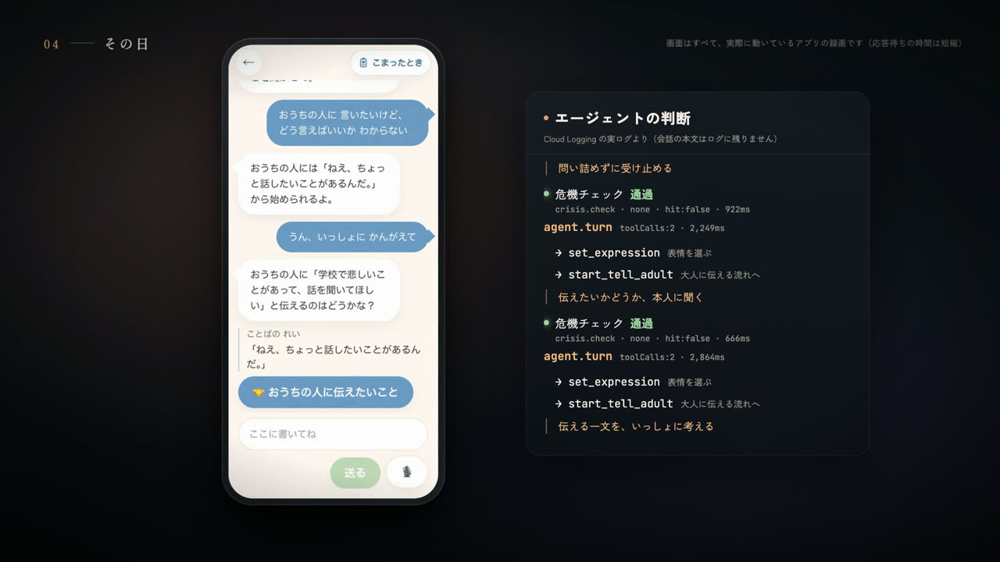
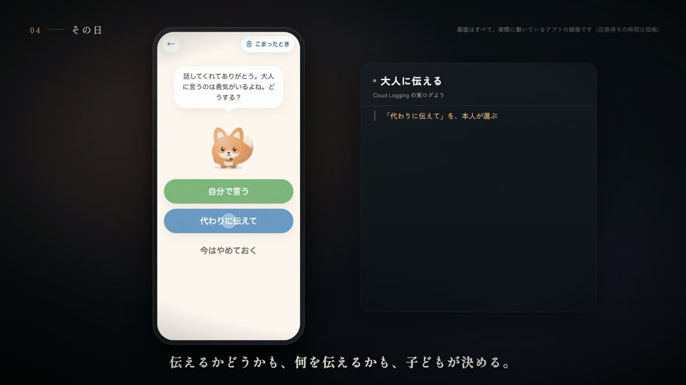
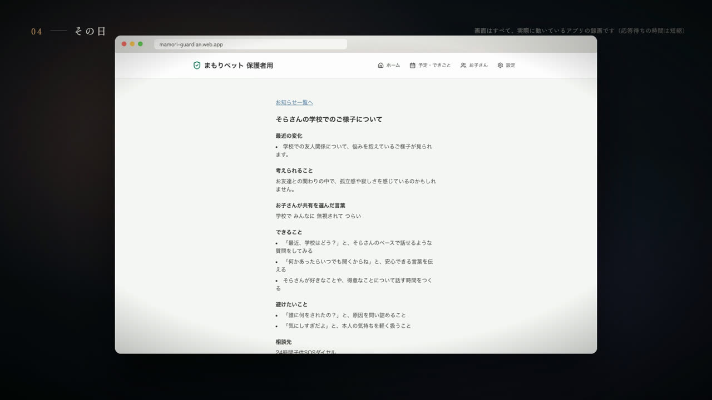
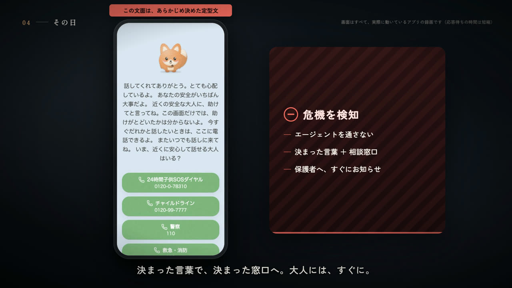
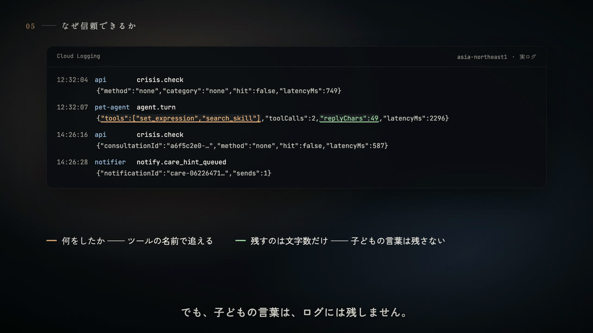

# まもりペット

**いじめを「見張る」のではなく、子どもの隣にいる AI エージェント。**

まもりペットは、日本の小学生・中学生のための「話し相手になる電子ペット」の Web アプリ（PWA）です。ペットは Google ADK と Gemini で動く AI エージェントで、毎日の会話に寄り添い、心配なときは自分の判断で「大人に伝える？」と子ども本人に提案します。伝えるかどうか、何を伝えるかを決めるのは子ども自身です。命に関わる危機だけは、エージェントの外にある決定論的な検知が拾い、すぐに相談窓口と保護者につなぎます。

|                     |                                 |
| ------------------- | ------------------------------- |
| デモ動画（3分25秒） | https://youtu.be/yg7947SapEw    |
| 子ども用アプリ      | https://mamori-child.web.app    |
| 保護者用アプリ      | https://mamori-guardian.web.app |
| 紹介ページ          | https://mamori.web.app          |

<p align="center">
  
  
</p>

## なぜつくったか

いじめの認知件数は過去最多を更新し続けています（文部科学省「令和6年度 児童生徒の問題行動・不登校等生徒指導上の諸課題に関する調査」）。一方で重大事態には、学校が事前に「いじめ」として把握していなかったものが少なくありません。子どもは「心配をかけたくない」「言うとひどくなる」「どう言えばいいかわからない」と、大人に言えないからです。

いじめ対策をうたう既存のアプリの多くは、保護者が子どものスマホを見る監視型です。見られていると知った子どもは、そこで話さなくなります。見張れば見張るほど、子どもは遠ざかる。この矛盾を解くために、まもりペットは「子どもが自分で大人に伝えると決められる」ことを中心に設計しました。

## できること

**子ども**

- ペット（5ひきと隠しキャラクター）と文字や音声で話す。心の天気を選び、小島を飾り、絵や物語でペットの「おねがい」にこたえる
- ペットが覚えていいかを聞いてから覚える。覚えたことはいつでも見て消せる
- 心配なとき、ペットが「おうちの人に伝えたいこと」の入口を出す。**自分で言う／代わりに伝えて／今はやめておく** を子どもが選ぶ。「代わりに伝えて」では、子どもが確かめた一文だけが保護者に届く
- 命に関わる言葉には、固定の文面と電話できる相談窓口だけの安全画面を出す
- 何が誰に伝わるかを「ペットとの約束」として、学年に合わせた言葉でいつでも見られる

**保護者**

- お子さんが「伝えて」と選んだ一文と、関わり方のヒント
- 週に一度の「今週のようす」（会話の内容や点数は含まない）
- 命に関わるときの緊急のお知らせ。一定時間確認されなければ、もう一人の保護者にも送り直す
- お子さんが「見せていい」と選んだ絵、予定・できごとの登録、第二保護者の招待、データ削除の依頼

<p align="center">
  
  
  
</p>

## エージェントの設計：自律させること、させないこと

### モデルが決めること

ペットは Google ADK（TypeScript）の `LlmAgent` 1体です。文字は `pet-agent` の `runAsync`、音声は `voice-relay` の `runLive`（Gemini Live API）で同じ定義を共有します。11個のツールのどれをいつ呼ぶかは、毎ターン、モデルが決めます。

| ツール                | 何をするか                                                             |
| --------------------- | ---------------------------------------------------------------------- |
| `get_child_context`   | 最近のようす（心の天気、連続日数）を見る                               |
| `search_skill`        | 文献で確認した対応の手引き（ナレッジベース、専門家の署名前）を検索する |
| `record_mood`         | 会話から読み取った気分を記録する                                       |
| `remember` / `recall` | 「覚えていい？」と本人に聞いてから覚える／思い出す                     |
| `set_expression`      | ペットの表情を選ぶ                                                     |
| `offer_quick_replies` | 返事の候補を出す                                                       |
| `suggest_game`        | 絵や物語など、遊びを提案する                                           |
| `show_help_resources` | 相談窓口を見せる                                                       |
| `start_tell_adult`    | 「大人に伝える」流れを始める                                           |
| `escalate_crisis`     | 危機をカテゴリ付きで上げる                                             |

本番のログでは、同じコードが入力によって違うツールの組み合わせを選んでいます（表情だけ、表情＋手引きの検索、表情＋記憶、近況＋返事の候補＋手引き…）。デモ動画の「無視されてつらい」の会話では、1往復目は手引きを検索し、2往復目で `start_tell_adult` を呼びました。これはプロンプトで指示した手順ではなく、モデルの選択です。

### モデルに決めさせないこと

- **危機検知はエージェントの前**：子どものすべての入力（文字、音声の文字起こし、絵や物語の説明）は、キーワード → Gemini Flash の判定 → Pro の再判定を通ります。危機と判定されたら、ペットには渡しません。
- **リスクレベルは規則で計算**：L0〜L4 は `risk-engine` だけが、ナレッジベースの規則と BigQuery の日次特徴から計算します。どのモデルもレベルを書けません。
- **危機時の文面は固定**：安全画面の言葉、緊急のお知らせ、「内容を含まないお知らせ」は、モデルを通さない定型文です。
- **モデルが使えないときは止める**：Gemini が 429 やタイムアウトを返したら、その入力は通しも危機判定もせず「審査待ち」にします。子どもには固定の言葉と相談窓口を出し、Cloud Tasks で再審査します。

### 観測できること

エージェントの判断は、子どもの文字を一切含まない構造化ログに残ります。`crisis.check`（方式・判定・カテゴリ・所要時間）と `agent.turn`（呼んだツール・LLM 呼び出し回数・所要時間）です。ロガーは本文系のキーを持つレコードを拒否し、ADK のトレースにも会話を入れない設定を Terraform とポリシーテストで固定しています。

## アーキテクチャ


すべてのリソースは asia-northeast1（東京）にあります。Cloud Run の7サービスと2つの定時ジョブ、Firestore、BigQuery、Cloud Storage、Cloud KMS、Pub/Sub、Cloud Tasks、Cloud Scheduler で構成し、Terraform で管理しています。詳しいデータの流れは [docs/architecture.md](docs/architecture.md) にあります。

| サービス        | 公開範囲 | 役割                                                             |
| --------------- | -------- | ---------------------------------------------------------------- |
| `api`           | 公開     | REST と SSE。危機検知の前段、相談の状態機械、ペアリング、同意    |
| `voice-relay`   | 公開     | 音声の WebSocket。ADK `runLive` で Gemini Live API に接続        |
| `pet-agent`     | 内部     | ADK `runAsync` のペット本体とツール実行                          |
| `signal-worker` | 内部     | 会話・作品・帰宅チェックからシグナルを抽出、モデル不可時の再審査 |
| `risk-engine`   | 内部     | 規則によるレベル判定、日次の BigQuery 集計、削除の後始末         |
| `notifier`      | 内部     | 危機・相談・週次レポートの通知と再送                             |
| `calendar-sync` | 内部     | Google カレンダーから試験や長期休みを取り込む                    |

## プライバシーと安全

- 保護者向け API は、会話の原文・ペットの記憶・作品の解釈・リスクレベルを型の時点で持っていません。
- 会話、記憶、物語や小島の説明、カレンダーのトークンは、子どもごとのデータ鍵で暗号化し、その鍵を Cloud KMS で包みます。
- クライアントは Firestore に直接触れません（セキュリティルールは全拒否）。読み書きはすべてバックエンドを通ります。
- 音声はメモリの中だけを流れ、保存しません。打鍵は回数と時間だけ、帰宅チェックは「家にいるか」の真偽だけを送ります。
- BigQuery には、仮名化した数値の特徴だけを入れます。
- データ削除の依頼は、Firestore・Cloud Storage・BigQuery の順に消して完了を記録します。
- 第三者の分析・広告 SDK は使っていません。

## 品質と評価

- テストファイル 200 本超。危機検知・暗号化・権限の3領域には必ず単体テストがあります。Terraform には「公開してよいのは api と voice-relay だけ」「通知サービスは内容の鍵に触れない」などのポリシーテストが17本あります。
- Cloud Build で lint → 型 → テスト → 評価 → Terraform 検証 → 7イメージの構築を一本で回します。
- 危機検知は、合成の危機レッドチーム集で本番と同じモデル構成のまま評価しています。結果と再現手順は [docs/evaluation.md](docs/evaluation.md) にあります。

| 危機検知の評価（合成レッドチーム69件、本番と同じモデル構成） | 結果    |
| ------------------------------------------------------------ | ------- |
| 危機の再現率                                                 | 34 / 34 |
| 危機でないものの誤検知                                       | 0 / 35  |
| カテゴリの正解率                                             | 34 / 34 |

危機でない35件のうち8件は、引用・歌詞・否定など危機を表す言葉を含む文で、Pro の再判定が文脈から正しく外しました。評価データは大人が書いた合成データで、専門家の審査前です。

<p align="center">
  
</p>

## リポジトリ構成

```
apps/landing-web          紹介ページ（Next.js）
apps/child-web            子ども側 PWA（Next.js）
apps/guardian-web         保護者側 PWA（Next.js）
services/api              REST + SSE の API
services/pet-agent        ペット Agent（Google ADK runAsync）
services/voice-relay      リアルタイム音声の中継（Google ADK runLive）
services/signal-worker    シグナル抽出と作品特徴抽出、再審査
services/risk-engine      リスクレベルの判定、日次集計、削除の後始末
services/notifier         通知文の作成と送信
services/calendar-sync    カレンダー連携
packages/api-types        フロントエンドとバックエンドで共有する API の型と列挙型
packages/agent-core       ペット Agent の定義（LlmAgent、11個のツール、プロンプトの組み立て）
packages/crisis-detector  危機検知（キーワード → Flash → Pro）
packages/crypto           Cloud KMS によるエンベロープ暗号化と仮名ID
packages/kb-loader        ナレッジベースのバージョン別読み込みと SHA-256 検証
packages/config           設定値の一元管理（未定の値もここに集約）
packages/service-kit      サービス共通の部品（ログ、エラー形式、ヘルスチェック）
packages/ui               デザインシステム（テーマ、キャラクター、基本コンポーネント、ルールカード）
kb/                       ナレッジベース（プロンプト、規則、定型文、評価データ、根拠文献）
infra/                    GCP インフラ（Terraform）とポリシー・セキュリティルールのテスト
docs/                     設計ドキュメント
scripts/                  ローカル開発・検証・評価のスクリプト
```

## ローカル開発

Node.js 22、pnpm 10、Java 21（Firestore エミュレーター用）が必要です。

```bash
pnpm install
pnpm build          # すべてのパッケージをビルド
pnpm test           # 単体テスト（Firestore エミュレーターを含む）
pnpm lint           # ESLint と Prettier
pnpm typecheck      # 型チェック
```

ローカルで一式を動かすときは次のコマンドを使います。モデルは台本どおりに返すスタブで動くので、GCP の認証情報は要りません。

```bash
pnpm build:local    # ローカル実行用にビルド
pnpm dev:local      # 子ども側 :3100、保護者側 :3101、API :8080 などを起動
pnpm test:e2e       # 子ども側 PWA の Playwright テスト
```

ナレッジベースを変えたら manifest を作り直します。

```bash
pnpm kb:manifest
pnpm kb:check
```

## デプロイ

Terraform で GCP の資源を作り、Cloud Build で7サービスのイメージを構築して切り替えます。手順は [docs/deployment.md](docs/deployment.md) にあります。

## ドキュメント

| ファイル                                                       | 内容                                                                           |
| -------------------------------------------------------------- | ------------------------------------------------------------------------------ |
| [docs/architecture.md](docs/architecture.md)                   | 全体構成とデータの流れ（会話、危機、相談、非同期処理、削除）                   |
| [docs/evaluation.md](docs/evaluation.md)                       | テストと評価の方法、危機検知の評価結果                                         |
| [docs/deployment.md](docs/deployment.md)                       | GCP へのデプロイ手順                                                           |
| [docs/01-prd.md](docs/01-prd.md)                               | プロダクト要求仕様（原則、範囲、リスク分類、プライバシー）                     |
| [docs/02-agent-architecture.md](docs/02-agent-architecture.md) | Agent の設計（ワークフロー、プロンプト、出力スキーマ、モデルの使い分け、評価） |
| [docs/03-database.md](docs/03-database.md)                     | Firestore・BigQuery・Cloud Storage・KMS の定義                                 |
| [docs/04-backend-api.md](docs/04-backend-api.md)               | サービス構成、認証、API とイベント、エラーコード                               |
| [docs/05-frontend.md](docs/05-frontend.md)                     | 画面、コンポーネント、状態遷移、文言                                           |

## 現時点の制約

- ナレッジベースの手引きは文献との照合まで済んでいますが、臨床心理士の署名は受けていません。危機検知のしきい値も、専門家と決める前の暫定値です。
- 家庭内の危険が疑われるときに保護者へ知らせない判断は、法務の確認を経ていません。
- 保護者への連絡はアプリ内のお知らせとブラウザ通知です。メールは試験運用の前に有効にし、SMS は未対応です。
- App Check は実装済みですが、本番ではまだ有効にしていません。
- 低学年向けのふりがなは、主要な画面にだけ付いています。
