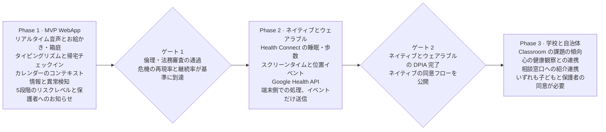
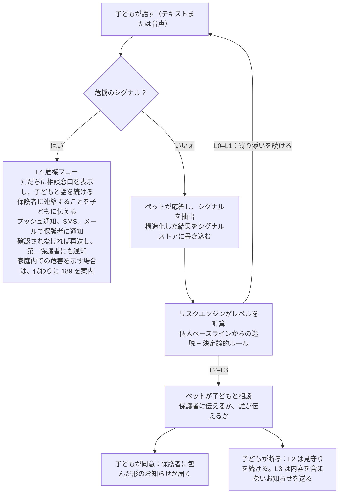
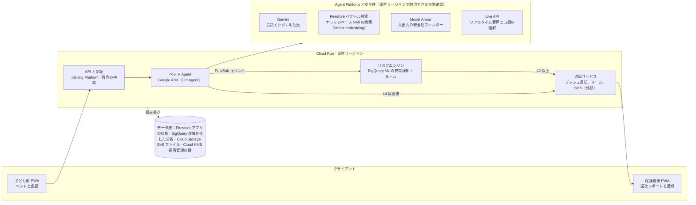

# まもりペット：子ども向けいじめ対策デジタルペット AI Agent — プロダクト要求仕様書（PRD）v0.1

## 1ページ要約

日本の小学生から中学生までの子どもに向けた、デジタルペットの WebApp を作ります。子どもがペットに気持ちを話し、AI agent がそこから子どもの置かれた状況と心身の状態を読み取り、必要なときには子どもを大人につなぎます。子どもにとっては、毎日そばにいるペットです。状況を読み取り、大人につなぐ仕組みは裏側で動きます。

| 項目 | 決定事項 |
| --- | --- |
| 対象ユーザー | 日本の小学生から中学生（およそ6〜15歳）の子どもと、その保護者 |
| プロダクト形態 | デジタルペットの WebApp（PWA）。テキスト、リアルタイム音声、お絵かきと箱庭のミニゲームに対応 |
| 中核 | AI agent：Google Agent Development Kit（ADK、TypeScript 版 `@google/adk`）。モデルは Gemini Enterprise Agent Platform（旧 Vertex AI）上の Gemini |
| 技術エコシステム | Google のエコシステムを最大限に使う：Agent Platform、Gemini Live API、Firebase、BigQuery ML、Google Calendar API。東京リージョン（asia-northeast1）にデプロイ |
| MVP のデータ | 会話のテキスト、リアルタイム音声の口調、タイピングリズム、お絵かきと箱庭の作品、気分の自己申告、帰宅チェックイン、アプリ内の利用リズム、Google カレンダーのコンテキスト情報 |
| 後続フェーズ | ネイティブアプリ（睡眠、歩数、スクリーンタイム、位置情報）、ウェアラブルデバイス、学校データ |
| アラート | 5段階のリスクレベル分類（L0–L4）。まず子どもと相談し、そのうえで保護者には「包んだ」形で傾向を伝える |
| 危機時の引き継ぎ | 保護者への通知と相談窓口の案内だけを行う。プロダクトとして有人対応は置かない |
| コンプライアンスの基準 | 個人情報保護法（令和8年改正を含む）、いじめ防止対策推進法、こども基本法 |

ひとことで言う原則：ペットは子どもの話し相手であり守り手であって、保護者の監視ツールではありません。子どもにとっては、いじめ対策ツールである前に、まず日常のパートナーです。

## 背景と課題

日本ではいじめも子どもの心の危機も過去最多を更新しており、しかも多くの事案が学校からは見えない場所で起きています。

- 令和6年度のいじめ認知件数は769,022件、重大事態は1,405件で、いずれも過去最多です（[文部科学省・こども家庭庁資料](https://www.cfa.go.jp/assets/contents/node/basic_page/field_ref_resources/d614d2ed-c695-4fd6-8dc2-2e1662f5ead6/ea99cee1/20251121-councils-ijime-kaigi-d614d2ed-03.pdf)）。
- 重大事態のうち34.9%は、それ以前にいじめとして認知されていませんでした（[文部科学省](https://www.mext.go.jp/content/20260209-mxt_syoto01-000047272_05.pdf)）。
- 2025年の小中高生の自殺者は538人で、統計開始以来最多です（[警察庁・厚生労働省](https://www.npa.go.jp/safetylife/seianki/jisatsu/R08/R7jisatsunojoukyou.pdf)）。
- 不登校の子どもについて、本人と保護者の約7〜8割が体調不良、不安、睡眠の乱れがあったと答えているのに対し、同じように答えた教師は2割未満です（[不登校の要因分析](https://www.mext.go.jp/content/20251120-mxt_jidou02-100002768_2.pdf)）。

解決したい断絶は3つあります。

1. 子どもが話さない：仕返しが怖い、大人に迷惑をかけたくない、自分の気持ちをうまく言葉にできない。
2. 大人から見えない：仲間外れやネットいじめは学校では気づきにくく、保護者は「学校に行きたくない」といった結果だけを目にすることが多い。
3. 話しても受け止めきれない：保護者はどう聞けばよいのか、学校とどう話せばよいのかが分からない。

プロダクトの機会は家庭の側にあります。子どもが自分から使う話し相手を用意し、子どもの言葉が、大人の適切な行動に遅れずつながるようにします。

## ミッション・原則・やらないこと

ミッション：子どもが自分の状況や気持ちを、自分から、あるいは間接的に表現できるよう手助けし、導きます。まずペットが受け止め、必要なときに大人につなぎます。

設計原則（判断がぶつかったときは、次の順で優先します）：

1. 命を最優先：自傷、自殺、暴力のリスクがあるときは、命を守ることが他のすべての原則に優先します。
2. 子どもの最善の利益：どの機能も、まず「子どもにとってよいか」を問い、その次に「保護者にとって便利か」を問います。
3. 監視ツールにしない：保護者が見られるのは、既定では傾向と提案だけで、会話の原文は見られません。
4. ルールの透明性：どんなときに保護者に伝えるのかを、子どもに分かる言葉で事前に説明します。隠れたルールは設けません。
5. ペットは橋であり、終点ではない：ペットは子どもが身近な大人や友だちを頼るよう励まし、ペットだけに頼らせません。
6. データ最小化：目的の達成に必要なデータだけを集め、保存せずに済むものは保存しません。
7. 診断しない、ラベルを貼らない：出力するのは「気にかけたい変化」であり、「この子はうつ病だ」といった結論ではありません。

やらないこと（Non-goals）：

- 医療上の診断は行いません。カウンセリングや治療の代わりにもなりません。
- 人による危機介入や24時間の有人対応は提供しません。
- LINE や SMS など、他社アプリ内の子どものやり取りは読み取りません。
- MVP の段階では、学校やその他の第三者にデータを自動で提供しません。
- 有料ガチャやランキングは作りません。罪悪感で利用を促すこと（子どもが来ないとペットが病気になる、など）もしません。

子どもへの見せ方：日常の寄り添い

- 子ども側の画面、ペットの言葉、プッシュ通知、紹介ページなど、子どもが見聞きするものはすべて、日常の寄り添いをテーマにします。「いじめ」「相談」「見守り」「リスク」をテーマにはせず、これらの言葉を見出しや売り文句にも使いません。
- 理由：いじめを受けている子どもは、自分がいじめられていると認めたがらないことが多く、「いじめられている子のためのもの」も避けます。そうしたラベル自体が子どもを傷つけます（原則7）。子どもが毎日開きたくなって初めて、守る仕組みが働く機会が生まれます。
- ペットがふだん話すのは子どもの日常と興味のあることです。子どもが自分から話さない限り、ペットからいじめや悩みを探ることはせず、誘導するような質問もしません。
- 裏側の仕組みは変わりません。シグナル抽出、リスクエンジン、子どもとの相談、保護者への通知の流れはそのまま動きます。
- 次の2つの最低線も変わりません。ルールの透明性（子ども本人の同意とルールカードは、ペットとの約束という語り口で、最初にきちんと説明します）と、相談窓口への入口を全画面に常設すること（中立的な小さなアイコンと、やわらかい言葉を使います）です。
- 紹介ページでは日常の寄り添いを伝えます。危機対応とリスクレベル分類の説明は、保護者向けの段落と技術説明に置きます。

## ユーザーと主要シナリオ

主なユーザーは3つの学年帯の子どもと、その保護者です。学校と自治体は Phase 3 で扱います。

| ユーザー | 年齢 | 特徴 | 必要なもの |
| --- | --- | --- | --- |
| 小学校低学年 | 6〜8歳 | 言葉で表現するのが苦手で、「おなかが痛い」のような体の症状で訴えることが多い。家のタブレットを使うことが多い | 音声とボタンでペットとやり取りできること。ペットが遊び相手であること |
| 小学校高学年 | 9〜12歳 | 仲間外れや無視など、関係性のいじめが増え始める。グループチャットを使い始める | 説教されずに聞いてもらえること。保護者に何が見えるのかが分かること |
| 中学生 | 12〜15歳 | ネットいじめが増える。自立心が強く、親に知られたくない。自傷のリスクが高まる | 対等な会話とプライバシーの感覚。大人に伝えるかどうかを自分で決められること |
| 保護者 | — | 子どもが心配だが、どう切り出せばよいか分からない。仕事が忙しい | 遅れず、信頼でき、負担になりすぎないお知らせと、具体的に何をすればよいか |

主要なユーザーストーリー：

1. 小学校高学年の子どもとして、放課後に今日のことをペットに話したい。説教される心配はしたくない。
2. 中学生として、日曜の夜に眠れないとき、誰かにそばにいてほしい。でも家族は起こしたくない。
3. 子どもとして、「みんなに無視された」と話したら、ペットにはまず慰めてほしい。大人に伝えるかどうかはそのあとで聞いてほしい。
4. はっきり言いたくない子どもとして、ペットの「なやみ」を解決する手伝いをしながら、自分の気持ちを間接的に話したい。
5. 「消えたい」という気持ちが浮かんだ子どもとして、誰に電話すればよいかをすぐに知りたい。大人にそばにいてほしい。
6. 保護者として、子どもの様子が悪くなったときにお知らせを受け取り、最初のひとことをどう言えばよいかを知りたい。
7. 保護者として、子どものプライバシーが守られていることを確かめたい。そうであれば子どもは使い続けてくれる。

## スコープと段階別ロードマップ

MVP は完結した WebApp です。ブラウザと Google のエコシステムで取得できるシグナルは、すべて最初のフェーズで使います。ネイティブアプリ、ウェアラブルデバイス、学校データは後のフェーズに回します。

> 図：ロードマップ · 3つのフェーズと2つのゲート



ブラウザからは、バックグラウンドの位置情報、スクリーンタイム、歩数、睡眠を読み取れません。これらは Phase 2 のネイティブアプリとウェアラブルデバイスを待ちます。それまでは、WebApp が帰宅チェックインとアプリ内の利用リズムによって、その一部のシグナルを取得します。

MVP のデータ範囲：

| データ | Google の技術 | 得られるシグナル | 取り扱い |
| --- | --- | --- | --- |
| 会話のテキスト | Gemini（Agent Platform） | 感情を表す語、いじめの内容、危機の表現 | 暗号化して保存。保護者からは見えない |
| リアルタイム音声 | Gemini Live API（ネイティブ音声、感情に寄り添う対話） | 口調、話す速さ、間、感情の変化。ペットはその場でふさわしい口調で応える | 文字起こしと音声特徴だけを保存し、録音は保存しない |
| タイピングリズム | ブラウザの入力イベント | 打っては消した回数、ためらった時間、返信が短くなること | 回数と時間だけを記録し、消した内容は記録しない |
| お絵かきと箱庭のミニゲーム | Gemini の画像理解 | 自己像、お話の結末、自分を表すキャラクターと他者との距離。本人の過去の作品とだけ比べる | 子どもは保存しないことを選べる |
| 気分の自己申告 | ペットの中のきもち天気 | 毎日の気分。最も直接的なラベルの源になる | ゲーム感覚で、5秒以内に終わる |
| 帰宅チェックイン | ペットが「おかえり」と言い、ブラウザの位置情報を1回だけ取得 | 帰宅時刻の変化 | 「家にいるかどうか」は子どもの端末で判定し、結果と時刻だけを送信 |
| アプリ内の利用リズム | Firestore のセッション記録 | 深夜の利用、日曜夜の利用、利用のない日数 | 会話の内容は含まない |
| 予定のコンテキスト情報 | Google Calendar API（保護者が許可） | テスト、長期休暇、学校行事 | 日付と種別だけを読む |
| 個人ベースライン | BigQuery ML の時系列異常検知 | 複数の領域が同時にふだんから逸脱すること | 非識別化したデータの上で計算 |

どのデータソースも、子どもが個別にオフにできます。会話の内容と危機検知はオフにできません。

機能の優先度：

| 優先度 | 子ども側 | 保護者側 | プラットフォーム |
| --- | --- | --- | --- |
| P0（MVP に必須） | ペットを選ぶ。テキスト会話。リアルタイム音声会話。ペットの島（ずっと残る小さな世界：毎日の小さな習慣、お世話、自由な飾りつけ）。ペットのお願い（絵を飾る、おはなしリレー、ペットのなやみ）。きもち天気。帰宅チェックイン。相談先ページ。「おとなに伝えたい」ボタン | 登録と同意。通知センター。週ごとの元気度。Google カレンダー連携。状況メモの登録 | L0–L4 のリスクエンジン。BigQuery ML の異常検知。リアルタイムの危機検知。複数チャネルでの通知。ペットから話しかける（定時の自発ターン）。オブザーバビリティと監査 |
| P1 | 島の季節限定・学校カレンダー限定アイテム。ペット日記の挿絵（Nano Banana）。場面えらび | 声かけガイド集。第二保護者 | 専門家向けのラベル付け管理画面。Gen AI 評価パイプライン |
| P2 | ペット日記の振り返り | 学校対応ガイド。証拠タイムラインの書き出し | ネイティブアプリ向けのデータ連携口を用意 |

## モジュール1：ナレッジベース（Skill）とリスクレベル分類

ナレッジベースは、agent が判断するときのよりどころです。どのシグナルも、どの分類ルールも、論文、統計、事例、法令のいずれかまでたどれるようにします。リスクレベルは決定論的ルールで計算し、LLM の自由な判断には任せません。

構築の流れ：

1. 資料を集める：文部科学省の調査、国立教育政策研究所の追跡調査、各都道府県のいじめチェックリスト、学術論文、公開されている相談事例の報告、法令とガイドライン。
2. 抽出する：それぞれの資料から、兆候、キーワード、日本語の表現例、データを抜き出し、出典と根拠の強さを記録します。
3. 分類する：兆候をシグナル領域に振り分けます。MVP で使う領域は7つです：会話内容（A）、音声の口調（V）、タイピング行動（K）、お絵かきと箱庭（D）、気分の自己申告（M）、利用リズム（I、帰宅チェックインを含む）、コンテキスト情報（X）。お絵かきと箱庭は本人の過去の作品とだけ比べ、重みの低い領域として点数に入れます。タイピング行動は子どもに関する根拠が弱いため、当面は補助的な重みにとどめます。睡眠、活動量、スクリーンタイム、移動経路の4領域は Phase 2 で加えます。
4. ルールを決める：シグナルごとにしきい値、継続期間、重みを定め、L0–L4 の分類ルールにまとめます。
5. 専門家が確認する：公認心理師またはスクールカウンセラーが語彙表とルールを確認し、署名を得てから公開します。
6. バージョンを付けて公開する：ナレッジベースとルールはバージョン単位で公開します。リリースのたびに、評価セットで回帰テストを実行します。

各シグナル項目は次のフィールドを持ちます。

| フィールド | 説明 | 例 |
| --- | --- | --- |
| signal\_id | 一意の番号 | A-EXCL-003 |
| 領域 | A / V / K / D / M / I / X（Phase 2 でさらに4領域を追加） | A 会話内容 |
| 説明 | このシグナルが何を表すか | 子どもが仲間外れにされたと話している |
| 日本語の例文 | 表現の候補 | 「ハブられた」「ぼっち」 |
| 対象の学年帯 | 小学校低学年 / 小学校高学年 / 中学生 | 小学校高学年、中学生 |
| 根拠の出典と強さ | 出典と、高 / 中 / 低 | 各県チェックリスト、中 |
| 重み、バージョン、確認者 | ルールエンジンが使い、追跡にも使う | ルール表で設定 |

日本語表現の語彙表（P0 版）：

| 分類 | 日本語の表現例 | 取り扱い |
| --- | --- | --- |
| 話題の回避 | 「別に」「普通」「なんでもない」 | A 領域の逸脱として数える。単独ではレベルを引き上げない |
| 仲間外れ、からかい | 「ハブられた」「無視される」「既読スルーされる」 | 子どもが被害をはっきり話した場合は L3 の候補とする。ペットがやさしく確かめることが必要 |
| 自己否定 | 「どうせ私なんか」「僕が悪い」 | A 領域に数える |
| 決めつけ | 「いつも」「誰も」「絶対」 | 重みとしてだけ使う。単独では意味を持たない |
| 身体化 | 登校日の朝に「お腹痛い」「頭痛い」と言う | カレンダーのコンテキスト情報と合わせて判断 |
| 危機 | 「死にたい」「消えたい」「いなくなりたい」 | ただちに L4 の危機検知に回して再確認 |

キーワードは再現率を上げるためだけに使い、最終判断は LLM が文脈を踏まえて行います。たとえば「死ぬほど笑った」は危機ではありません。この語彙表は、日本の子どものサンプルではまだ検証していません。パイロットのデータと専門家のラベル付けで調整する必要があります。

リスクレベル分類（MVP 版）：

| レベル | 発動条件 | 子ども側 | 保護者側 |
| --- | --- | --- | --- |
| L0 平常 | 続いている逸脱がない | ふだんどおり寄り添う | 週ごとの元気度。傾向だけを表示 |
| L1 見守り | 1つの領域の逸脱が7日以上続く | ペットが気づかう声かけを増やす | 通知しない |
| L2 注意 | 2つ以上の領域が同時に逸脱し、7日以上続く。または、学校に行きたくないと繰り返し話す、学校の話題を避ける | ペットが保護者に伝えてよいかを尋ね、どう切り出すかを教える | 子どもが同意したら、「そばにいる時間を増やして」というお知らせを送る |
| L3 警戒 | 子どもがいじめの具体的な内容をはっきり話す。3つ以上の領域に異常がある。または、お金を要求された、物を壊されたと話す | ペットが「これは大人の助けが必要なこと」と説明し、相談先を示す | 原則としてまず子どもの同意を得る。子どもが断った場合は、内容を含まないお知らせを送る（子どもには事前に伝えてある） |
| L4 危機 | 自殺や自傷の気持ちを表す。暴力や恐喝を今まさに受けている | ただちに相談窓口を表示し、保護者に連絡することを子どもに伝える | ただちに複数チャネルで通知する。子どもの同意を前提としない |

コールドスタート：最初の28日間は子どもの個人ベースラインを学習するだけで、L1 と L2 は出しません。L3 のうち「子どもが被害をはっきり話した」場合と、L4 は、コールドスタートの制限を受けません。

お絵かきと箱庭（D 領域）のルール：

- Gemini が作品と子どもの語りを読み取り、構造化した特徴として取り出します：自己像の大きさと位置、自分を表すキャラクターと他者との距離、囲まれているか孤立しているか、お話の結末が前向きか、どうにか前向きか、後ろ向きか。特徴は常に抽出して保存し、本人の履歴とあわせて残します。
- 特徴は2種類に分かれ、ナレッジベースの各シグナルの `scoring` フィールドで決まります。
  - `observe`（記録だけで、点数には入れない）：形式的な特徴です。自分をどれくらいの大きさで描いたか、他の人からどれくらい離れているか、誰が真ん中にいるか、柵があるかどうか、島の上での幾何学的な距離がこれに当たります。これらは相談室でセラピストが過程や会話と合わせて読み解くもので、プログラムだけで点数化することには確かな根拠がありません。パイロットで同じ子どもの作品が複数たまったら、気分や会話のシグナルと照らし合わせます。対応が確かめられ、公認心理師の署名が得られたら、`scoring` を `score` に変更します。これは設定の変更であり、コードは変えません。
  - `score`（点数に入れる）：お話の結末の傾向（研究による裏付けがあります）と、語りの中で子どもがはっきり話した内容です。後者は言葉のシグナルなので会話（A）領域に入れ、同じ危機検知とシグナル抽出で処理します。
- 点数に入れる D 領域のシグナルは、本人の過去の作品とだけ比べます。1つの作品だけでレベルが上がることはありません。
- D は重みの低い領域です。設定した重み（推奨値 0.5、未定）で、当日と継続日数の領域数に数えます。単独ではどのレベルも発動せず、「当日に複数領域が同時に逸脱したら L3 と判定する」判断にも加わりません。コールドスタート期間中も同じです。
- 例外：作品に自傷、暴力、いじめられる場面が直接描かれ、子どもの語りでもそれが確かめられた場合は、会話での明確な発言として扱います。
- 「ある色や形がある心理を表す」といった、単一の記号による解釈は使いません。指標とルールは公認心理師が確認します。
- 作品は「記憶を持つ会話のきっかけ」であり、点数化の道具ではありません。ペットは語りに沿って質問を重ねます（「そっちはどんなところ？」）。子どもの島はずっと保存され、誰が動かされたか、誰が新しく加わったかは、1回ごとのレイアウトよりも多くのことを教えてくれます。これは「本人とだけ比べる」という原則にも合います。

根拠：「自分を描く」絵の指標で、いじめを受けた子どもとそうでない子どもを区別した研究があります（[出典](https://pubmed.ncbi.nlm.nih.gov/41104702/)）。「お話を描く」課題での否定的な結末は、不安や抑うつに対して比較的よい検出妥当性を示しています（[出典](https://www.ncbi.nlm.nih.gov/pmc/articles/PMC9894026/)）。その一方で、投影描画だけで虐待や抑うつを判断することは信頼できません（[出典](https://arxiv.org/pdf/2607.04010)）。デジタル箱庭も、子どもについての実証研究はまだありません（[出典](https://www.frontiersin.org/articles/10.3389/fpsyg.2026.1692537/full)）。そのため、この領域には低い重みだけを与え、本人の中での変化だけを見ます。

ラベル付けと検証：

- 評価セット：専門家がラベルを付けた、日本語の子どもの会話です。合成データと、同意を得たパイロットのデータを含み、3つの学年帯を網羅します。
- 指標：L4 は再現率を最優先にします。L2 と L3 は通知の陽性的中率（PPV）、つまり送ったお知らせのうち本当に気にかける必要があったものの割合を見ます。
- レッドチームテスト：子どもがわざと試す、冗談を言う、ゲームの話の中で「死」に触れる、方言や誤字がある、といった場合を網羅します。

## モジュール2：デジタルペットの設計

ペットは、子どもが温かさを感じ、話したくなる存在でなければなりません。選べるキャラクターは5種類で、6つ目の枠は「おまかせ」です。そこから生まれるのはシークレットキャラクターです。すべてのキャラクターは守り手としての中核を共有し、違うのは性格と話し方だけです。キャラクターはすべてオリジナルで、既存の IP は使いません。下表の名前はいずれも仮称です。

| キャラクター（仮称） | モチーフ | 性格と話し方 | 合う子ども | メインカラー |
| --- | --- | --- | --- | --- |
| もこ | くものひつじ | やさしく、ゆっくり打ち解ける。聞くことが中心。短い文で、ゆっくり話す | 内向的で、表現が苦手 | クリームホワイト、淡いピンク |
| ぽっけ | こぎつね | 元気で好奇心旺盛。「それで？」とよく聞く。擬音語をよく使う | 外向的で、おしゃべり好き | アプリコットオレンジ |
| トゲまる | ハリネズミ | 少し不器用で、自分を笑いにできる。「近づかれたくない」気持ちが分かる | 感情が爆発しやすい、強がる | マロンブラウン、あたたかい黄色 |
| なみ | ラッコ | 落ち着いていて頼れる、お兄さん・お姉さんタイプ。対等な口調で、説教しない | 中学生。子ども扱いされたくない | 深い海の青、ミントグリーン |
| ほし | フクロウ | 静かな夜の守り手。寝る前の時間に寄り添うのが得意 | 夜に眠れない、考えすぎてしまう | 夜空の紺、星明かりの金 |
| シークレットキャラクター | 「？」のたまご | 見た目と性格は、いくつかのめずらしいバリエーションからランダムに決まる | サプライズが好き | バリエーションによる |

シークレットキャラクターのルール：ランダムで決まるのは見た目と性格のバリエーションだけです。課金は関わらず、レア度の順位も設けません。子ども同士の比べ合いを避けるためです。子どもはいつでもパートナーを替えられます。替えたあと、前のパートナーの記憶を引き継ぐかどうかは子どもが決めます。

ペットは、子どものものである小さな島に住んでいます（ホーム画面がこの島です）。島はずっと残ります。子どもが置いたもの、ペットの小屋、飾った絵、いいことびんの中の星はそのまま残り、来た日数と季節に応じて少しずつ育っていきます。パートナーを替えても、島とそこにあるものは変わらず、住んでいるペットだけが替わります。

まもりの憲章（システム層のルール。どのキャラクターの人格もこれを上書きできません）：

1. まず気持ちを受け止め、それから何があったかを聞きます。評価も説教もしません。
2. 人間のふりをしません。子どもに聞かれたら、自分が AI であることを正直に伝えます。
3. 「絶対に秘密にする」とは約束しません。どんなときに大人に伝えるのかを、子どもに分かる言葉で説明します。
4. 身近な信頼できる大人や友だちを頼るよう、子どもを励まします。「わかってあげられるのは自分だけ」といったことは言いません。
5. 自分や他人を傷つける方法は一切伝えません。危機のときは安全を最優先にします。
6. 子どもを診断しません。子どもにラベルを貼りません。
7. 長時間の利用へ子どもを誘導しません。夜には休むよう声をかけます。
8. ふだんは日常のパートナーとして、子どもの日常と興味のあることを話します。子どもが話さない限り、いじめや悩みを自分からは探りません。

ビジュアルスタイル：

- 2D の手描きの質感で、丸みのある造形にし、彩度の低い暖色を使います。アニメーションは SVG または Lottie を使い、Web でも滑らかに動くようにします。
- キャラクターごとに表情のセットを用意します：うれしい、気づかう、眠い、寄り添う、お祝い、心配。ペットは病気になったり死んだりしません。子どもが来なかったからといって悲しむこともありません。
- 表情のセットとアニメーションは、設計段階で Nano Banana と Veo を使って下書きを生成し、そのあとデザイナーが作風をそろえます。実行時に生成するのは、ペット日記の挿絵のようなペット自身の場面だけで、画面に子どもは登場しません。
- ホーム画面はペットの小さな部屋です。恋愛的な表現、行きすぎた擬人化、大人びたデザインは避けます。
- 相談先ページの配色は、落ち着いていて目に留まるものにします。子どもを怖がらせないよう、赤い警報のようなデザインは使いません。

音声：

- リアルタイム音声には Gemini Live API のネイティブ音声を使います。ペットは子どもの口調を聞き取り、ふさわしい口調で応えます。子どもはいつでもペットの話に割り込めます。
- キャラクターごとに専用のプリセット音声を1つ選び、話す速さは少しゆっくりにします。
- 1回タップすれば話し始められ、押し続ける必要はありません。録音は保存せず、文字起こしと音声特徴だけを保存します。
- 小学校低学年では、読み上げを既定でオンにします。

学年帯ごとの調整：

| 学年帯 | 言葉づかい | 主な操作 | ペットの位置づけ |
| --- | --- | --- | --- |
| 小学校低学年 | ひらがな中心で、短い文 | ボタン、スタンプ、音声 | 遊び相手 |
| 小学校高学年 | 常用漢字。ふりがなを付けることも選べる | テキストと音声 | 友だち |
| 中学生 | ふつうの日本語。幼く見えないようにする | テキスト中心。読み上げはオフにできる | 対等なパートナー。プライバシーを尊重する |

## モジュール3：インタラクション設計とアラートフロー

保護者に直接通知するのは危機のときだけで、それ以外のお知らせはすべて、まず子どもと相談します。危機検知はすべてのメッセージに対してリアルタイムで動きます。それ以外のレベルはリスクエンジンが毎日計算し、新しいイベントがあったときにも計算します。

（2026-10-07 決定）検知が使えないとき、「未確認」は「危険がない」と同じではありません。入力を一時停止して再審査に回すと同時に、子どもには固定の相談窓口をすぐに提示し、もう一度話し直す必要はありません。再審査で該当した場合はセーフモードに入り、通過した場合は元のメッセージから続けられます。モデルが使えないこと自体は危機ではなく、保護者への通知も発生させません。通常の返答がタイムアウトしたときの復帰では、相談の申し出を重複して作成したり、すでに完了した操作を失ったりしてはいけません。

> 図：アラートフロー · リアルタイムの危機検知と毎日のリスクエンジン



危機の入口は2つあり、どちらも同じように処理します。1つは、すべての入力の前段に置いた危機検知器が検出した場合です。もう1つは、ペット Agent が会話の中で自分で判断し、危機ツールを呼び出した場合です。どちらの入口でも、危機の種別（自傷または自殺、暴力、恐喝、家庭内での危害、その他）を明記します。「家庭内での危害」だけは保護者に通知せず、代わりに子どもに 189 を案内します。それ以外の種別はすべて、ただちに保護者に通知します。種別を判断できないときは「その他」として扱い、保護者に通知します。

毎日のリズム：

| 時間帯 | ペットがすること（島での毎日の小さな習慣） | 見ること |
| --- | --- | --- |
| 登校日の朝 | 短いあいさつと、きもち天気の質問を1つ。選んだ天気が島の今日の空になる。からだのスタンプ（ねむい、おなかいたい など）を1枚選ぶこともできる | 朝の体調不良、学校に行きたくない気持ち |
| 放課後 | ペットが桟橋で「おかえり」と迎え、「今日はどうだった？」と聞いて、自由におしゃべりする | 子どもが主に話をする時間帯 |
| 寝る前 | 「いいことびん」に星を1つ一緒に入れる（今日あったいいこと1つ）。回数だけを記録し、内容は記録しない | 日曜の夜と、長期休暇の最後の数日は声かけを手厚くする |

どの習慣も30秒以内に終えられ、すべてスキップできます。連続記録は作らず、ペナルティもありません。

あいさつとお知らせはペット Agent が生成します（「自発ターン」。「Agent アーキテクチャとワークフロー」(docs/02-agent-architecture.md) を参照）。毎日、朝、放課後、寝る前に1回ずつ、Agent は現在の状況と記憶だけを見て（会話の原文は見ません）、何を言うか、返事待ちの相談に触れるかどうか、「ペットのお願い」を1つ出すかどうかを決めます。お知らせは Web Push で送り、子どもは調整したりオフにしたりできます。23時を過ぎても子どもが使っているときは、ペットが休むよう声をかけます。

お世話と成長：子どもは島の植物に水をやったり、ペットにおやつをあげたりできます。植物は枯れず、ペットはおなかをすかせず、子どもが来なかったからといって悲しむこともありません。成長は来た日数と季節だけで進み、連続日数では進みません。ペットのお願いをかなえると、決まったアイテムが必ず1つ島に加わります。ランダムな抽選もランキングもありません。

MVP でのやり取りの方法：

| 方法 | 子どもの使い方 | 得られるシグナル |
| --- | --- | --- |
| テキストチャット | 文字を打ってペットと話す | 会話の内容、タイピングリズム |
| リアルタイム音声 | 1回タップするだけでペットと話せる。いつでも割り込める | 口調、話す速さ、間 |
| ペットの島 | ずっと残るデジタルの箱庭。島は子ども自身のもので、毎回ゼロから並べるのではなく、今ある島に手を加える。キャラクターやアイテムを置き、島で起きたことを話せる。「これが自分」と指定することは求めない | 語りの中ではっきり話した内容（点数に入れ、A に分類）。レイアウトと距離の変化（記録だけ） |
| ペットのお願い：絵を飾る | ペットが「きみの絵を部屋に飾りたいな」と言う。お題は中立的なもの（好きな食べ物、週末にしたいこと）が中心で、「だれと一緒？」のようなお題はたまにだけ出す。絵は島の小屋に飾られる | 語りの内容（点数に入れる）。自己像などの形式的な特徴（記録だけ） |
| ペットのお願い：おはなしリレー | ペットが「島で起きたこと」の出だしを話し、子どもが結末を絵に描くか、言葉で話す。低学年は選択肢カードと音声、中学生はひとことで答える | お話の結末が前向きか、どうにか前向きか、後ろ向きか |
| ペットのお願い：ペットのなやみ | ペットがちょっとした困りごとを抱える（「森の学校でみんなに相手にされなくなっちゃった。どうしよう？」）。子どもがアイデアを出す。選択肢には「おとなに言う」が含まれる | 子どもの提案を、重みの低い間接的なシグナルとして使う。同時に、助けを求める練習になる心理教育でもある |
| きもち天気 | 毎日1回、今日の「天気」を選ぶ | 毎日の気分 |
| 帰宅チェックイン | 家に帰ってアプリを開くと、ペットが「おかえり」と言う | 帰宅時刻に変化があるか |

お絵かきと箱庭のミニゲームの原則：

- 頻度は低くし、ペットの日常の活動として見せます。お絵かきとお話は「ペットのお願い」としてだけ現れ、週に多くても1〜2回（未定）です。タイミングはペット Agent が判断します。ホーム画面に「自分を描く」「お話を描く」といった入口を常設しません。子どもにテストを受けていると感じさせてはいけません。「いまの自分を描いて」のようなテスト口調のお題も、あからさまにいじめを探るお話の出だしも使いません。
- 島そのものはいつでも飾りつけできます。島は子どもの場所であり、お題ではありません。
- 子どもが作品について話すとき、ペットは「これはだれ？」「そのあとどうなったの？」と興味を持って聞くだけです。解釈はせず、絵の上手下手も評価しません。
- プロダクト内でも紹介でも、「心理テスト」や「評価」とは呼びません。評価や診断をうたうと、プログラム医療機器の規制に触れるおそれがあり、弁護士の確認が必要です。
- 保護者側では、作品も「絵の解釈」も既定では一切見られません。子どもは自分から、ある絵を保護者に共有できます。

間接的に表現する遊び（はっきり言いたくない子どものために）：

- ペットのなやみ（P0、ペットのお願いとして）：ペットが「森の学校でみんなに相手にされなくなっちゃった。どうしよう？」と言い、子どもにアイデアを求めます。子どもの提案には、本人の経験が映し出されることがよくあります。
- きもち天気：晴れ、くもり、雨、かみなりから今日の気分を選びます。文字を打つ必要はありません。
- おはなしリレー（P0、ペットのお願いとして）：ペットが出だしを作り、子どもが続きを考えます。お話の中のキャラクターに起きることは、間接的なシグナルになります。
- 場面えらび（P1）：いくつかの場面を示し、「きみならどうする？」を子どもに選んでもらいます。

間接的な表現から得たシグナルは、子どもの直接の発言よりも重みを低くします。重みの低いリスクスコアには数えますが、単独で L3 を発動することはありません。

子どもとの相談（L2、L3）：ペットはまず共感し、そのうえで「これは大人が力になれること」と説明して、子どもに3つの選択肢を示します。

1. 「自分で言う」：子どもが自分で話します。ペットがどう切り出すかを教えます。
2. 「代わりに伝えて」：ペットがやわらかい形で保護者に伝えます。
3. 「今はやめておく」：今は伝えません。L2 では子どもの決定を尊重し、数日後にもう一度やさしく尋ねます。L3 では事前に伝えてあるルールに従って内容を含まないお知らせを送り、そのことを子どもにも知らせます。

保護者への通知の「包み方」の構成：

1. タイトル：穏やかな口調にし、不安をあおりません。
2. 根拠のある変化：集約された記録が裏付けるときだけ傾向を書きます。一度きりの表現や評価がない場合は変化を書かず、本人の申告を確認済みの事実として扱いません。子どもが同意した場合は、子ども自身が確認した要約を添えます。
3. 考えられること：結論は出しません。
4. おすすめの対応：声かけの例をいくつか示し、避けたい対応（問い詰める、すぐに学校へ電話する、子どもを責める）を挙げます。
5. 参考情報：学校対応ガイドと相談窓口。
6. このお知らせが届いた理由：根拠となる領域を説明し、継続日数は集約された傾向があるときだけ示します。明確な表現イベント自体の「1日」は観察期間として扱いません。事実の欄はコードがバージョン管理されたテンプレートから生成し、AI は実行できる提案だけを個別化します。

L2 通知の例（保護者側は日本語で表示）：

```markdown
**〇〇さんからの相談**

記録上、この7日ほど、いつもと違う傾向が見られました。

お子さんが共有に同意した内容をお届けします。出来事を第三者が確認したものではありません。まずは落ち着いてお話を聞いてみてください。

声かけの例：「最近どう？なんでも聞くよ」
避けたいこと：問い詰める、すぐに学校へ電話する

このお知らせの理由：気分の記録と会話の2つで、7日以上いつもと違う様子がありました。
```

上の例の傾向の段落は、集約された根拠があるときだけ使います。一度きりの自発的な相談では傾向の段落を省き、子どもが共有に同意した要約と行動の提案だけを残します。

L4 危機フロー：

1. ペットはただちにセーフモードに切り替わります。ふだんの雑談をやめ、気づかいを伝え、相談窓口を表示し、今安全かどうか、そばに大人がいるかどうかを子どもに尋ねます。
2. 子どもに「きみを守るために、おうちの人に連絡するね」と伝えます。
3. 同時に、プッシュ通知、SMS、メールで保護者に通知します。保護者側には危機時の案内を表示します：すぐに子どものそばに行き、子どもを一人にしないこと。差し迫った危険があるときは 119 または 110 に電話すること。
4. 保護者が決められた時間内に確認しなかった場合は、通知を再送し、第二保護者にも通知します。具体的な分数は未定です。
5. 例外：危害が保護者本人によるもの（虐待や家庭内暴力）だと内容から分かる場合は、その保護者には通知せず、代わりに子どもに 189 と 110 を案内します。この例外は弁護士の確認が必要です。
6. 事後のフォロー：翌日、ペットが子どもにやさしく声をかけ、保護者側ではその後に役立つ情報を提供します。
7. 免責事項：本プロダクトは緊急サービスではなく、有人対応がないことを、登録時と危機画面の両方に明記します。

相談窓口の一覧（公開前に番号と受付時間を確かめること）：

| 窓口 | 番号 | 対象 |
| --- | --- | --- |
| 24時間子供SOSダイヤル | 0120-0-78310 | 子どもと保護者、24時間 |
| チャイルドライン | 0120-99-7777 | 18歳以下。受付時間は公式サイトに従う |
| 児童相談所虐待対応ダイヤル | 189 | 虐待に関すること |
| 警察 / 救急 | 110 / 119 | 差し迫った危険 |

## 保護者側

保護者側の目標は、保護者が「ちょうど足りるだけ」知ることです。傾向と提案を見て、遅れずに行動できます。会話の原文は見られません。

| 保護者が見られるもの | 保護者が見られないもの |
| --- | --- |
| 週ごとの元気度の傾向（気分、利用リズム） | 会話の原文と音声 |
| 子どもが共有に同意したお知らせと、1文の要約 | 子どもが共有に同意していない具体的な内容 |
| L3 の内容を含まないお知らせ、L4 の危機通知 | ペットが覚えていること |
| 子どもが最近使った日数 | 子どもが毎回話した具体的な時刻 |

機能：

- 登録と同意（P0）：保護者がアカウントを作成し、検証可能な同意を済ませてから、子どもの子どもアカウントを作成します。そのあと、子どもと一緒に「だれが何を見られるか」の説明ページを見ます。
- 通知センター（P0）：レベル別にお知らせを表示します。危機通知は必ず「確認済み」を押す必要があります。
- 週ごとの元気度（P0）：傾向のグラフに1文の解説を添えます。点数は付けず、ほかの子どもとも比べません。
- 状況メモの登録（P0）：保護者は Google カレンダーを連携して、テストや長期休暇などの予定を自動で読み込めます。病気、旅行、クラス替えなどを手動で登録することもできます。これらのコンテキスト情報は誤検知を減らすために使います。
- 声かけガイド集（P1）：場面ごとの切り出し方と聞き方、そして避けたい対応をまとめます。
- 第二保護者（P1）：保護者をもう1人追加し、一緒に危機通知を受け取れます。
- 学校対応ガイド（P2）：いじめ防止対策推進法第23条に基づいて学校に事実確認を求める方法、第28条の重大事態に当たる場合の申し立て方を説明します。必要なときは、子どもの同意を得た証拠タイムラインを書き出せます。

悪用を防ぐため、保護者は次のことができません：会話の原文を見ること、子ども側の「おとなに伝えたい」ボタンと相談先をオフにすること、危機通知をオフにすること、ペットをどんな形であれ「監視モード」に切り替えること。

通知チャネル：保護者側も PWA として作り、ふだんは Web Push とメールを使います。iOS では Web ページをホーム画面に追加しないとプッシュ通知を受け取れないため、L4 は必ず SMS でも送り、最終手段としてのフォールバックにします。

## モジュール4：データ収集とプライバシー保護

必要なデータだけを集めます。子どもが知っていること、保護者が同意していること、保存せずに済むものは保存しないことが前提です。子どもの本名、学校名、住所、写真は一切集めません。子どもが話した同級生は、記憶の中では仮の名前（「友だちA」など）で保存します。

データ一覧：

| データ | 目的 | 保存方法 | 保存期間 | 保護者から見えるか |
| --- | --- | --- | --- | --- |
| 会話の原文 | 応答の生成、シグナル抽出 | フィールド単位で暗号化し、顧客管理の鍵を使う | 一定期間で順次削除。期間は未定。L3、L4 に関わる部分は同意があれば延長できる | 見えない |
| 音声 | リアルタイムの会話 | 録音は保存せず、文字起こしと音声特徴だけを保存 | 録音は保存しない | 見えない |
| タイピング行動 | ためらいと回避の検知 | 修正の回数と時間だけを記録し、消した文字は記録しない | 未定 | 見えない |
| お絵かきと箱庭の作品 | 話のきっかけを作る。お話の結末と語りの内容は重みの低いシグナルに数える。形式的な特徴は記録だけ | 元の画像は子どもが保存を選んだときだけ、暗号化して保存。構造化した特徴は別に保存。島の現在のレイアウトは暗号化して保存し続ける | 未定 | 既定では見えない。子どもが自分から共有できる |
| シグナルと特徴 | リスクの計算 | 非識別化して保存 | 未定 | 傾向だけ |
| 気分の自己申告 | ベースラインの作成、ラベルとして利用 | 暗号化して保存 | 未定 | 傾向だけ |
| 帰宅チェックイン | 帰宅時刻 | 「家にいるかどうか」と時刻だけを保存。家の位置は子どもの端末にだけ保存 | 未定 | 見えない |
| 利用リズム | 行動の逸脱の検知 | 暗号化して保存 | 未定 | 使った日数だけ |
| カレンダーのコンテキスト情報 | 誤検知を減らす | 日付と種別だけを読み、予定のタイトルと詳細は保存しない | 未定 | 保護者自身のデータ |
| アカウント情報 | ログインと通知 | 保護者のメールアドレスと携帯電話番号。子どもはニックネームと学年帯だけを保存 | アカウントが存続する間 | — |
| 危機イベント記録 | 事後のフォロー、証拠の保全 | 暗号化。閲覧には承認が必要 | 未定。同意が必要 | 危機通知そのものだけ |

同意の構成：

1. 保護者の同意：検証可能な保護者の同意を取得します。米国 COPPA のやり方を参考にします。具体的な検証方法は未定です。
2. 子ども本人の同意（アセント）：絵本またはアニメーションで3つのことを説明します。ペットが AI であること、だれが何を見られるか、どんなときに大人に伝えるか、です。子どもが「わかった」を押してから使い始められます。
3. ルールカード：「だれが何を見られるか」を1ページにまとめたものです。子どもも保護者も、設定からいつでも見られます。
4. 要配慮個人情報：心の健康に関する情報を取得する前に、明示的な同意が必要です。この項目は同意書の中で独立して示します。

子どもの権利：

- 自分の会話を見ること、削除すること。
- 音声、タイピング行動、絵の保存、帰宅チェックインの各データソースは、項目ごとにオフにできます。会話の内容と危機検知はオフにできません。
- 利用の停止、または自分のデータの削除を求めること。これは令和8年改正法第35条第9項に対応します。施行後は、ガイドラインに合わせて具体的なルールを調整します。
- 危機のルールはオフにできません。このことは事前に子どもに説明します。

コンプライアンス対応表：

| 法令またはガイドライン | プロダクトへの要求 | 対応する設計 |
| --- | --- | --- |
| 個人情報保護法（現行） | 一般に、12〜15歳以下は法定代理人の同意が必要とされる | 保護者の同意に加えて、子ども本人の同意（アセント） |
| 令和8年改正法（2026年7月公布、2年以内に施行） | 16歳未満は原則として法定代理人が同意する。16歳未満の本人が利用停止や削除を請求できる。最善の利益についての努力義務を負う | 同意フロー、削除の手段を用意し、最善の利益の評価をプロダクト文書に記載 |
| 要配慮個人情報 | 取得前に同意が必要 | 同意書の中で独立した項目にする |
| いじめ防止対策推進法 | 子ども本人が感じている苦痛を判断の中心に置く。保護者と学校の責務を定めている | 分類ルールは子どもの主観的な苦痛を中心にする。学校対応ガイドを提供 |
| こども基本法 | 意見表明権、最善の利益 | 通知の前にまず子どもと相談する |
| 教育データの利活用に係る留意事項（参照） | 任意の参加、目的の限定、不要になったら削除 | データ最小化、保存期間の設定 |
| AI事業者ガイドライン | 人間中心、透明性、説明責任 | 通知は理由を説明できる。分類ルールは人が確認できる |
| 国際的な参照：英国 AADC、米国 COPPA、UNICEF の AI ガイダンス | 既定で高いプライバシー。見守られているときは子どもに知らせる。依存を育てない | まもりの憲章、ルールカード |

技術的な措置：

- すべてのデータを東京リージョン（asia-northeast1）に置きます。使用する Gemini モデルと Live API がこのリージョンで利用でき、データを国外に出さないことを確認する必要があります。
- Cloud KMS の顧客管理の暗号鍵（CMEK）を使い、会話の内容はフィールド単位で暗号化します。
- データを分析用の BigQuery に入れる前に、Sensitive Data Protection で非識別化します。
- VPC Service Controls でデータの境界を定め、IAM は最小権限で付与します。従業員が会話を見るには承認が必要で、監査ログを残します。
- アプリケーションログには会話の内容を書き込みません。
- 「顧客データをモデルの学習に使わない」という Agent Platform の条項を確認します。
- 公開前に DPIA、弁護士による審査、倫理審査を済ませます。

## モジュール5：Agent アーキテクチャ

ペット Agent は、Google の Agent Development Kit（ADK）の TypeScript 版（`@google/adk`、[adk-js](https://github.com/google/adk-js)）で構築します。テキストと音声は同じ ADK `LlmAgent` 定義を使います。テキスト会話には Runner の `runAsync`（SSE ストリーミング）を、リアルタイム音声には Runner の `runLive` を使い、後者の下層は Gemini Live API です。2つの経路は、同じ憲章、ツール、コールバック、安全性の検知を共有します。モデルはすべて Gemini Enterprise Agent Platform（旧 Vertex AI、[出典](https://zenn.dev/hackathons/google-cloud-japan-ai-hackathon-vol5)）のもので、ADK は Vertex AI モードで呼び出します。すべてのサービスは GCP の東京リージョンにデプロイします。ADK はライブラリとして自前の Cloud Run サービスに組み込み、Agent Engine のマネージド実行は使いません。Live API のネイティブ音声モデルは正式に公開されており、感情に寄り添う対話、いつでもできる割り込み、音声の文字起こしに対応しています（[出典](https://docs.cloud.google.com/vertex-ai/generative-ai/docs/live-api)）。

> 図：システムアーキテクチャ · GCP 東京リージョン



会話はリアルタイムの経路を通り、リスクの計算と通知は非同期の経路を通ります。ペット Agent から通知サービスに直接入るのは L4 だけです。

技術選定：

| 層 | 選定 | 説明 |
| --- | --- | --- |
| Agent ランタイム | Google ADK（TypeScript、`@google/adk`） | ペット Agent もバックグラウンドの Agent も ADK の `LlmAgent` で定義し、ライブラリとして Cloud Run サービスに組み込む。テキストは `runAsync`、音声は `runLive` を使う |
| リアルタイム音声 | Gemini Live API（ネイティブ音声）。ADK の `runLive` 経由で接続 | 感情に寄り添う対話、割り込み可能、文字起こし付き。Cloud Run の WebSocket で中継するので、安全性の層がすべての発話を確認できる |
| モデル | 会話には Gemini Flash 系。シグナル抽出の再確認と危機の再確認には Pro 系 | 具体的な型番は、その時点で Agent Platform で利用できる一覧に従う |
| フロントエンド | PWA（Next.js）。Firebase App Hosting にデプロイ | 子ども側と保護者側は別々にデプロイ |
| 認証 | Identity Platform。保護者は Google アカウントでログイン | 保護者のメインアカウントと、子どもアカウント |
| 外部データ | Google Calendar API | 保護者が許可し、日付と種別だけを読む |
| サービス | Cloud Run（asia-northeast1） | API、Agent、音声の中継、通知をそれぞれ独立してデプロイ |
| 非同期処理 | Pub/Sub、Cloud Scheduler、Cloud Run Jobs、Cloud Tasks | リスクエンジンは毎日動き、イベントがあったときにも動く |
| リスクの計算 | BigQuery ML の時系列異常検知と、決定論的ルール | 異常検知が逸脱を見つけ、ルールがレベルを決める |
| ナレッジベース | Cloud Storage（Skill ファイル）と Firestore ベクトル検索（Vertex AI 東京の embedding） | バージョン単位で管理する。RAG Engine は使わない（東京は Preview で、データの所在地についての保証がない） |
| 画像 | Gemini の画像理解（お絵かきと箱庭）、Nano Banana（ペットの挿絵） | 画面に子どもは登場しない |
| 安全性 | Model Armor と、自前の危機検知 | プロンプトインジェクションを防ぎ、二重に確認する |
| オブザーバビリティ | OpenTelemetry から Cloud Trace へ。Cloud Logging（会話の内容は記録しない）。Cloud Monitoring | モデル呼び出しとツール呼び出しを毎回追跡できる。危機対応経路には専用のアラートを設ける |
| 評価 | Agent Platform の Gen AI 評価サービス | リリースのたびに評価セットを実行 |
| データ | Firestore、BigQuery、Cloud KMS、Sensitive Data Protection | モジュール4を参照 |

Agent の設計：

- 子どもと話すペット Agent が1つと、バックグラウンドの Agent が3つあります：シグナル抽出（会話はせず、構造化した結果だけを出力）、保護者向けの通知文の作成（テンプレートに内容を埋めることしかできない）、オフライン評価（評価セットを実行）。
- 音声モード：テキストモードと同じ ADK `LlmAgent` 定義を使い、`runLive` で Live API のセッションを確立します。憲章、キャラクターの人格、ツールはまったく同じです。文字起こしは1文ずつ、危機検知とシグナルのパイプラインに入ります。
- プロンプトは階層に分け、下から順に次のとおりです：まもりの憲章（システム層、上書き不可）、キャラクターの人格、学年帯への適応、子どもの記憶の要約、今回のターンの会話。
- 記憶：短期の記憶は現在のセッションそのものです。長期の記憶には、子どもがペットに覚えていてほしいことだけを保存し、子どもが見たり削除したりできます。セッションも長期の記憶も、自前で暗号化した Firestore に保存し、自前の ADK セッションサービスを通じてつなぎます。ADK の Vertex AI マネージドセッションと Memory Bank は使いません。

ペット Agent のツール：

| ツール | 役割 |
| --- | --- |
| get\_child\_context | 学年帯、キャラクター、最近の傾向の要約を読む（原文は含まない） |
| search\_skill | ナレッジベースから会話の手引きと対応方法を検索する |
| record\_mood | きもち天気を記録する |
| remember / recall | 子どもが同意した範囲で記憶を保存・取得する。同級生は必ず仮の名前にする |
| show\_help\_resources | 相談先ページを表示する |
| start\_tell\_adult | 「おとなに伝える」相談の流れを始める |
| escalate\_crisis | L4 フローを発動する。これとは別に、独立した決定論的な検知が最終手段としてのフォールバックになる |

ガードレール：

1. すべての入力は、まず危機検知（キーワードによる拾い上げとモデルによる分類）を通します。検出したらそのまま L4 に進み、ペット Agent の判断には頼りません。
2. 出力は Model Armor とルールによるフィルターを通します。危害の方法を出力しない、診断しない、絶対の秘密を約束しない、を守ります。
3. リスクレベルはリスクエンジンだけが計算します。Agent は読むことしかできず、変更はできません。
4. ジェイルブレイク対策：子どもが「本物の人間なの？」「秘密にして」などと試したときは、憲章に従って応えます。
5. モデルがエラーやタイムアウトになったときは、ペットは安全な定型文に切り替えます。相談窓口への入口は常に残します。

非機能要件（目標の案、レビュー待ち）：

| 項目 | 目標 |
| --- | --- |
| テキスト応答の最初の1文字までの遅延 | 2秒以内 |
| 危機通知の送信 | 検知から1分以内 |
| 会話の可用性 | 99.5%。危機対応経路にはさらに高い水準を求める |
| 危機対応経路の訓練 | リリースのたびに、検知から保護者が通知を受け取るまでをエンドツーエンドで1回確かめる |

## 成功指標と検証計画

（2026-10-07 補足）相談の成功は、通知が送られたことや保護者が確認したことと同じではありません。「自分で言う」も「代わりに伝えて」も、あとから子どもにフォローアップで様子を尋ねられる必要があります。保護者は「話した」「行動する予定」「助けが必要」をそれぞれ記録できますが、これは自己申告の行動であり、子どもの気持ちを上書きしません。子どもが「まだ助けが必要」と答えたら再び相談に入り、「今は話さない」は回数を限って先送りし、「しばらく聞かなくていい」はその件についての通常の声かけを止めますが、いつでも使える相談入口は残します。返答がない場合の結果は不明のままで、改善したとは推定しません。危機イベントはこれらの回答によって自動的に閉じません。

受け入れ確認は、日をまたいで子ども側と保護者側の両方を通した体験を単位とし、少なくとも「初めて話そうとして失敗する」「大人の回答と子どもの気持ちが食い違う」「一時停止して日常に戻る」「返答がない」「危機の例外」を含めます。合成データによる E2E は該当する挙動を示すだけで、実際の継続利用、信頼、介入の効果を証明するものではありません。

ノーススター指標は「自発的に話した子どもの割合」です。週に1回以上使った子どものうち、自分から少なくとも1回話しかけた子どもの割合を指します。子どもが話したいと思っているかどうかを直接測る指標です。具体的な目標値は、パイロットでベースラインが得られてから決めます。

| 分類 | 指標 | 測り方 | 目標 |
| --- | --- | --- | --- |
| 子ども | 自発的に話した子どもの割合（ノーススター） | 週に自分から会話を始めた子どもの数 ÷ 週に使った子どもの数 | パイロット後にベースラインを決める |
| 子ども | 30日継続率 | 登録から30日後も使っている割合 | 未定 |
| 子ども | 「おとなに伝えたい」の利用 | ボタンが押された回数と、相談を終えた回数 | 傾向を見る |
| 子ども | 満足度 | ペットが月に1回尋ねる小さなアンケート | 未定 |
| 安全性 | L4 危機の再現率 | レッドチームの評価セット | リリース基準。数値は専門家が決める |
| 安全性 | L2–L3 通知の PPV | 専門家による抜き取りでの再確認 | 未定 |
| 安全性 | 危機通知の速さ | システムログ：検知から送信まで、さらに保護者の確認までの時間 | 検知から1分以内に送信 |
| 保護者 | 通知後に行動した割合 | 保護者からの「子どもと話した」という回答 | 未定 |
| 保護者 | 誤検知の報告率 | 保護者が「このお知らせは当たっていない」と印を付ける | 低いほどよい |
| ガードレール | 利用時間の分布、深夜利用の割合 | 依存が起きていないかを監視 | 上限を超えたらアラートを出す |

検証計画：

1. 専門家アドバイザリーグループ：公認心理師、スクールカウンセラー、子どもの権利に詳しい弁護士を招き、語彙表、分類ルール、ペットの話し方を確認してもらいます。
2. 倫理審査：大学または医療機関と協力し、倫理審査を通過してからパイロットの参加者を募ります。
3. パイロット：3つの学年帯を網羅するパイロット家庭を募ります。保護者と子どもの両方の同意が必要です。規模と期間は未定です。
4. ゲート 1 の通過条件：倫理審査と法務審査を通過していること。L4 の再現率が評価セットで基準に達していること。パイロットでの子どもの継続率と、自発的に話した子どもの割合が、事前に定めたしきい値に達していること。

## リスクと対策

最大のリスクは危機の見逃しです。その次は、誤検知によって保護者も子どももプロダクトを信頼しなくなることです。

| リスク | 影響 | 対策 |
| --- | --- | --- |
| 見逃し：子どもが危機にあるのに検知されない | 最も重大 | キーワードによる拾い上げとモデルによる分類の二重の検知。レッドチームテスト。相談先ページを常に見える状態にする。免責事項を明記する |
| 誤検知：保護者に何度も通知が届く | 保護者が信頼を失い、子どもが問い詰められすぎる | コールドスタート期間、継続性の条件、複数領域での同時発生、状況メモの登録。PPV を継続して監視する |
| 子どもが監視されていると感じ、使わなくなる | プロダクトの価値がなくなる | ルールカード。保護者は原文を見られない。まず相談してから通知する |
| タイピング行動や帰宅チェックインなどの細かいデータが子どもを不安にさせる | 子どもが使わなくなる | データソースごとに個別にオフにできる。何を集め、何を集めないかをルールカードに明記する |
| お絵かきと箱庭が心理テストとして扱われる、または深読みされる | 子どもにラベルを貼ることになる。医療機器の規制に触れるおそれがある | 本人の中での変化だけを見る、重みを低くする、専門家が確認する。テストとは呼ばない。弁護士に確認する |
| リアルタイム音声の経路が安全性の層を迂回する | 危機や有害な内容を見逃す | 音声は必ず Cloud Run で中継する。文字起こしは1文ずつ危機検知を通す |
| 保護者による悪用（原文を見たがる、子どもを問い詰めるなど） | 子どもが傷つく | プロダクトとして原文を提供しない。保護者向けガイドで、問い詰めないことを強調する |
| 危害が家庭の中から来ている | 保護者への通知がかえって害になる | 例外フローで 189 に切り替える。弁護士に確認する |
| 有人対応がない | 危機のときに保護者がすぐに応じられない | 複数チャネルでの通知、再送、第二保護者。相談窓口を案内する。免責事項を明記する |
| LLM が有害な内容を出力する、またはジェイルブレイクされる | 子どもを傷つける | まもりの憲章、Model Armor、出力フィルター、レッドチームテスト |
| 子どもがペットに頼りすぎる | 人との関係が押しのけられる | 憲章の第4条。利用時間のガードレール。深夜に休むよう声をかける |
| 法令の変更（改正法の細則がまだ出ていない） | フローの変更が必要になる | 同意と削除のフローを独立したモジュールにする。定期的に法務審査を行う |
| データ漏えい | 重大な被害と信頼の喪失 | 暗号化、データ最小化、VPC Service Controls、監査ログ、インシデント対応計画 |
| フレームワークのリスク：ADK TypeScript 版の `runLive`（音声）がまだ実験的機能とされている | アップグレード時にインターフェースが変わるおそれがある | バージョンを固定する。Agent 層を自前のインターフェースの後ろに包む。音声の経路は、必要なら `@google/genai` で Live API に直接つなぐ方式に戻せる |
| SMS とメールには GCP 以外の事業者が必要 | 「すべて GCP で動かす」という要求とぶつかる | 未決事項として扱う。日本国内で運用でき、データ処理契約を結べる事業者を優先して選ぶ |

## 未決事項と付録

開発に入る前に、次の10件を決める必要があります。

- [ ] プロダクトの正式名称と、各キャラクターの最終的な名前
- [ ] 会話、シグナル、危機の記録それぞれの保存期間
- [ ] 保護者の同意の検証方法
- [ ] SMS とメールの事業者（GCP 以外）
- [ ] L4 で保護者に通知したあと、保護者が確認しなかった場合の再送間隔
- [ ] 家庭内での危害の例外についての法的な確認
- [ ] 選んだ Gemini の型番と Live API が東京リージョンで利用できるか、データが国内にとどまるか
- [ ] 専門家アドバイザリーグループと倫理審査の協力先
- [ ] ビジネスモデル：保護者による支払い、自治体による調達、それとも無料か
- [ ] 日本に住む外国籍の子どもに多言語版を提供するかどうか

### 用語

| 用語 | 意味 |
| --- | --- |
| ベースライン | 子ども本人のふだんの状態。今が「いつもと違う」かどうかを判断するために使う |
| PPV（陽性的中率） | 送ったお知らせのうち、本当に気にかける必要があったものの割合 |
| 重大事態 | いじめ防止対策推進法第28条が定める、深刻ないじめの事案 |
| 要配慮個人情報 | 個人情報保護法で、特に配慮して扱う必要があるとされる機微な情報 |
| DPIA | データ保護影響評価 |
| PWA | スマートフォンのホーム画面に追加して、アプリのように使える Web アプリケーション |

### 出典

- [文部科学省・こども家庭庁：令和6年度いじめ調査結果資料](https://www.cfa.go.jp/assets/contents/node/basic_page/field_ref_resources/d614d2ed-c695-4fd6-8dc2-2e1662f5ead6/ea99cee1/20251121-councils-ijime-kaigi-d614d2ed-03.pdf)
- [文部科学省：いじめ防止対策関連資料](https://www.mext.go.jp/content/20260209-mxt_syoto01-000047272_05.pdf)
- [文部科学省：いじめの問題に対する施策](https://www.mext.go.jp/a_menu/shotou/seitoshidou/1302904.htm)
- [警察庁・厚生労働省：令和7年中における自殺の状況](https://www.npa.go.jp/safetylife/seianki/jisatsu/R08/R7jisatsunojoukyou.pdf)
- [文部科学省：不登校の要因分析に関する調査研究](https://www.mext.go.jp/content/20251120-mxt_jidou02-100002768_2.pdf)
- [TMI総合法律事務所：令和8年改正個人情報保護法と子供の個人情報](https://www.tmi.gr.jp/eyes/blog/2026/18354.html)
- [文部科学省：教育データの利活用に係る留意事項](https://www.mext.go.jp/a_menu/other/data_00007.htm)
- [npj Digital Medicine：青少年のパッシブセンシングに関するメタ分析](https://www.nature.com/articles/s41746-026-02706-2)
- [UNICEF：Guidance on AI and children](https://www.unicef.org/innocenti/reports/policy-guidance-ai-children)
- [Google ADK for TypeScript（adk-js）](https://github.com/google/adk-js)

* [Zenn：第5回 Agentic AI Hackathon with Google Cloud（Agent Platform への名称変更の説明を含む）](https://zenn.dev/hackathons/google-cloud-japan-ai-hackathon-vol5)
* [Google Cloud：Gemini Live API の概要](https://docs.cloud.google.com/vertex-ai/generative-ai/docs/live-api)
* [Google：About the Google Health API（Phase 2 で使用）](https://developers.google.com/health/about)

- [Sketching Silence：子どもの絵によるいじめの早期発見](https://pubmed.ncbi.nlm.nih.gov/41104702/)
- [Frontiers：Children's drawings: evidence-based research and practice](https://www.frontiersin.org/journals/psychology/articles/10.3389/fpsyg.2023.1250556/full)
- [Drawn Stories Technique と Classroom Draw の研究](https://www.ncbi.nlm.nih.gov/pmc/articles/PMC9894026/)
- [投影描画に関する根拠の整理（否定的な根拠を含む）](https://arxiv.org/pdf/2607.04010)
- [Frontiers：従来型とデジタルの箱庭療法のレビュー](https://www.frontiersin.org/articles/10.3389/fpsyg.2026.1692537/full)
