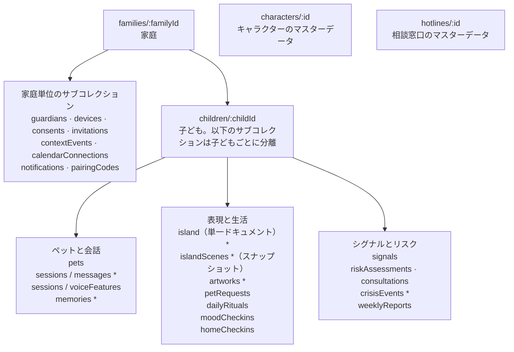

# いじめ対策デジタルペット — データベース定義 v0.1

## 概要と設計原則

データは4か所に分けて保存します。Firestore はアプリケーションの状態、BigQuery は非識別化した分析データ、Cloud Storage は作品の原画とナレッジベースのファイル、Cloud KMS は鍵を管理します。すべて東京リージョン（asia-northeast1）に置きます。本書は「子ども向けいじめ対策デジタルペット AI Agent — プロダクト要求仕様書（PRD）v0.1」（docs/01-prd.md）に基づきます。

設計原則：

1. クライアントは Firestore に直接接続しません。読み書きはすべてバックエンド API を経由し、Firestore のセキュリティルールは既定ですべて拒否します。
2. 機微なテキストはフィールド単位で暗号化します。会話の原文、ペットの記憶、作品についての語りは、Cloud KMS のエンベロープ暗号化をかけて bytes として保存し、データ鍵は子どもごとに1本持ちます。開封したデータ鍵はサービスのプロセスのメモリ内で短時間だけキャッシュします（ラップ済みの暗号文と AAD をキーにし、TTL と容量は `packages/config` の `dekCache` を参照）。ディスクには書かず、ログにも出しません。子どもを停止または削除したあとは child レコードの読み取り自体が失敗するため、キャッシュされた鍵が再び使われることはありません。
3. 分析には非識別化データだけを使います。BigQuery に入るデータは仮名ID（HMAC）だけを持ち、テキストの内容は一切含みません。
4. 保存しなくて済むものは保存しません。録音は保存しません。タイピングの挙動は回数と所要時間だけを保存します。自宅の位置は子どもの端末にだけ保存します。
5. 期限が来たら自動で削除します。保存期間は Firestore TTL と Cloud Storage のライフサイクルルールで適用します。
6. 時刻はすべて UTC で保存し、表示するときに日本時間へ変換します。

## ストレージの役割分担とコレクション構成

アプリケーションの状態はすべて Firestore に置き、ほかのストレージはそれぞれ1種類の用途を受け持ちます。

| ストレージ | 保存するもの | 選んだ理由 |
| --- | --- | --- |
| Firestore（Native モード） | アカウント、同意、ペット、会話、作品特徴、シグナル、リスク、通知 | ドキュメントモデルが「家庭—子ども」の階層に合う。TTL に対応している。レイテンシが低い |
| BigQuery | 非識別化した日次特徴量、ベースライン、異常検知の結果、評価データ | BigQuery ML でそのまま時系列の異常検知ができる |
| Cloud Storage | 作品の原画、ナレッジベースの Skill ファイル、評価セット、証拠のエクスポート | 大きなファイルに向いている。バージョン管理とライフサイクルルールに対応している |
| Cloud KMS | データ鍵を暗号化するための鍵（KEK） | CMEK とフィールド単位のエンベロープ暗号化を提供する |
| Secret Manager | サービス単位のシークレット（SMS 事業者の API キーなど） | シークレットをコードや設定に書かない |

> 図：Firestore のコレクションツリー



保護者のデータは家庭の下に、子どものデータはそれぞれの children ドキュメントの下に置きます。こうしておくと、ある子どものデータを削除するときは、そのサブツリーを再帰的に削除するだけで済みます。ルートコレクションにはほかに config（ナレッジベースの有効バージョンなどの設定）と deletionRequests がありますが、図には描いていません。

## 列挙型の定義

以下の列挙型は Firestore、BigQuery、API で共通に使います。値はすべて英小文字です。

| 列挙型 | 値 | 説明 |
| --- | --- | --- |
| GradeBand | low / high / jhs | 小学校低学年、小学校高学年、中学生 |
| GuardianRole | primary / secondary | 主たる保護者、第二保護者 |
| CharacterId | moko / pokke / togemaru / nami / hoshi / hidden | 5種類のキャラクターとシークレットキャラクター |
| Channel | text / voice | 会話のチャネル |
| Domain | a / v / k / d / m / i / x | シグナル領域：会話、音声、タイピング、お絵かきと箱庭、気分、利用リズム、コンテキスト情報。Phase 2 で s（睡眠）、p（活動量）、t（スクリーンタイム）、l（位置情報の経路）を追加する |
| RiskLevel | l0 / l1 / l2 / l3 / l4 | リスクレベル |
| ArtworkType | drawing / story / island | ペットのお願いで描いた絵、おはなしリレーの絵、島のスナップショット。古いデータの self\_portrait は drawing として扱う |
| StoryOutcome | positive / compensated / negative / unclear | お話の結末：前向き、かろうじて前向き、後ろ向き、不明 |
| GameType | drawing / story / pet\_worry | ペットのお願い：絵を飾る、おはなしリレー、ペットのなやみ |
| CrisisCategory | self\_harm / violence / extortion / family\_harm / other | 危機のカテゴリ。family\_harm だけは保護者に通知しない |
| SignalScoring | score / observe | シグナルをリスク計算に使うかどうか。observe は記録するだけ |
| MoodWeather | sunny / cloudy / rainy / stormy | きもち天気 |
| ContextCategory | exam / long\_vacation / school\_event / sick / travel / class\_change / other | コンテキスト情報のカテゴリ |
| ConsultChoice | self / proxy / not\_now | 自分で話す、ペットに伝えてもらう、いまはやめておく |
| NotifyChannel | webpush / email / sms | 通知チャネル |
| NotifyStatus | queued / sent / delivered / acknowledged / failed | 通知の状態 |
| CrisisStatus | open / guardian\_acknowledged / closed | 危機イベントの状態 |
| DataSource | voice / typing / artwork\_save / home\_checkin / calendar | 子どもが個別にオフにできるデータソース |
| ConsentType | guardian\_terms / guardian\_sensitive / child\_assent | 保護者の規約同意、機微情報への同意、子ども本人の同意（アセント） |

## 家庭・アカウント・同意

1つの家庭には1〜2人の保護者と複数の子どもがいます。同意の記録は追記のみで、書き換えません。撤回するときは撤回時刻を書き込み、記録そのものは残します。

### families/:familyId

| フィールド | 型 | 必須 | 説明 |
| --- | --- | --- | --- |
| familyId | string | はい | ドキュメント ID、UUID |
| primaryGuardianId | string | はい | 主たる保護者 |
| status | string | はい | active / deleting |
| termsVersion | string | はい | 現在同意している規約のバージョン |
| createdAt | timestamp | はい | 作成時刻 |

### families/:familyId/guardians/:guardianId

| フィールド | 型 | 必須 | 説明 |
| --- | --- | --- | --- |
| guardianId | string | はい | Identity Platform の uid と同じ |
| role | GuardianRole | はい | 主たる保護者または第二保護者 |
| displayName | string | いいえ | 表示名 |
| email | string | はい | 通知の受信用 |
| phoneE164 | string | いいえ | L4 の SMS 用、E.164 形式 |
| notifyChannels | array\<NotifyChannel> | はい | 既定は webpush と email。L4 では sms も加える |
| verifiedAt | timestamp | はい | 検証可能な保護者の同意が完了した時刻 |
| createdAt | timestamp | はい | 作成時刻 |

### families/:familyId/children/:childId

| フィールド | 型 | 必須 | 説明 |
| --- | --- | --- | --- |
| childId | string | はい | UUID。子どもの Identity Platform アカウントはカスタムクレームでこれに紐づく |
| nickname | string | はい | 子どものニックネーム。本名は保存しない |
| gradeBand | GradeBand | はい | 学年帯 |
| dataSources | map\<DataSource, boolean> | はい | データソースごとのオン・オフ。子ども自身が設定する |
| currentRiskLevel | RiskLevel | はい | リスクエンジンだけが書き込む |
| careFlag | boolean | はい | L1 の見守りフラグ。true のときペットは声かけを増やす |
| baselineReadyAt | timestamp | いいえ | コールドスタートが終わる時刻（28日目） |
| pseudoId | string | はい | HMAC による仮名ID。BigQuery ではこれだけを使う |
| wrappedDek | bytes | はい | KMS の鍵で暗号化した、この子どものデータ鍵 |
| deviceLockEnabled | boolean | はい | 端末を共用するときにペットの合言葉を有効にするかどうか |
| status | string | はい | active / paused / deleting |
| createdAt | timestamp | はい | 作成時刻 |

### families/:familyId/consents/:consentId

| フィールド | 型 | 必須 | 説明 |
| --- | --- | --- | --- |
| type | ConsentType | はい | 同意の種類 |
| subjectChildId | string | いいえ | どの子どもに関する同意か |
| actorId | string | はい | 同意した人：保護者または子どもの uid |
| documentVersion | string | はい | 規約または説明文のバージョン |
| scope | map | いいえ | 同意したデータソースと用途 |
| verificationMethod | string | いいえ | 保護者の同意の検証方法。未定 |
| grantedAt | timestamp | はい | 同意した時刻 |
| revokedAt | timestamp | いいえ | 撤回した時刻。記録は削除しない |

### families/:familyId/devices/:deviceId

| フィールド | 型 | 必須 | 説明 |
| --- | --- | --- | --- |
| ownerType | string | はい | guardian / child |
| ownerId | string | はい | 保護者または子どもの ID |
| fcmToken | string | はい | FCM Web Push のトークン |
| platform | string | いいえ | ios\_pwa / android / desktop |
| lastSeenAt | timestamp | はい | 最後に利用した時刻 |

（2026-10-06 決定）子どものデバイス ID はトークンの SHA-256 です。子ども向けの API では自分のトークンの登録と削除だけを許可し、同じトークンを別の子どもや保護者に紐づけることは拒否します。ブラウザには childId／deviceId の経路識別子だけをキャッシュし、トークンやメッセージ本文は別途保存しません。購読解除、ログアウト、再ペアリングではまずローカルのバックグラウンド表示を止め、FCM が明確な失効エラーを返したあとにサーバー側が条件付きで古いデバイスのレコードを削除します。

### families/:familyId/pairingCodes/:code

子どもの端末用のペアリングコードです。保護者が発行し、1回だけ使えます。

| フィールド | 型 | 必須 | 説明 |
| --- | --- | --- | --- |
| childId | string | はい | ペアリングする子ども |
| createdBy | string | はい | ペアリングコードを発行した保護者 |
| expiresAt | timestamp | はい | 10分後に失効する。TTL フィールドを兼ねる |
| usedAt | timestamp | いいえ | 使用した時刻 |

### families/:familyId/invitations/:invitationId

第二保護者の招待に使います。1回だけ使えます。

| フィールド | 型 | 必須 | 説明 |
| --- | --- | --- | --- |
| email | string | はい | 招待される人のメールアドレス |
| invitedBy | string | はい | 招待を送った主たる保護者 |
| expiresAt | timestamp | はい | 7日後に失効する。TTL フィールドを兼ねる |
| acceptedAt | timestamp | いいえ | 承諾した時刻 |
| acceptedBy | string | いいえ | 承諾した人の uid |

ドキュメント ID は招待トークンの SHA-256 です。トークン（128 ビットの乱数。API での invitationId）は主保護者に1回だけ返し、データベースには原文を保存しません。承諾時はトークンのハッシュでルートコレクション `invitationLookup/{ハッシュ}`（familyId、expiresAt、usedAt。expiresAt は TTL フィールドとして使う）を引いて家庭を特定し、ログインしたメールアドレスが email と一致することを確かめます。

### deletionRequests/:requestId（ルートコレクション）

削除リクエストはルートコレクションに置きます。こうすると、家庭のデータを削除したあとも削除の記録そのものは残り、あとから確認できます。ここには子どもに関する内容を一切保存しません。

| フィールド | 型 | 必須 | 説明 |
| --- | --- | --- | --- |
| familyId | string | はい | 対象の家庭 |
| childId | string | いいえ | 空の場合は家庭全体の削除を表す |
| requestedBy | string | はい | リクエストした人の uid |
| requesterRole | string | はい | child / guardian |
| status | string | はい | accepted / running / completed / failed |
| requestedAt | timestamp | はい | リクエストした時刻 |
| firestoreClearedAt | timestamp | いいえ | オンラインのサブコレクションと通知の削除に成功した時刻。失敗時のリトライは未完了のステップから続ける |
| deletionEventPublishedAt | timestamp | いいえ | 削除イベントの発行に成功した時刻。外部ストレージの削除が済んだことは意味しない。発行後の記録に失敗した場合や並行するリクエストでは重複して発行されることがあるため、消費側は冪等でなければならない |
| completedAt | timestamp | いいえ | 完了した時刻 |

### jobRuns/:runId（ルートコレクション）

毎日のレベル判定ジョブをシャードに分けて実行するときの調整用レコードです。各 task は自分のシャードを書き終えたら taskIndex を doneTasks に加え、全シャードをそろえた task が BigQuery の異常検知を実行します。ジョブのメタデータだけで、子どもの識別子や内容は一切含みません。runId は日付と Cloud Run の実行 ID から算出します。

| フィールド | 型 | 必須 | 説明 |
| --- | --- | --- | --- |
| job | string | はい | risk-engine-daily |
| date | string | はい | 集計対象の日付 YYYY-MM-DD |
| taskCount | number | はい | シャード数 |
| doneTasks | number[] | はい | 完了した taskIndex |
| anomaliesStartedAt | timestamp | いいえ | 異常検知の開始時刻。1回だけ書く |
| expiresAt | timestamp | はい | TTL フィールド。1週間保持する |

### opsFlags/:flag（ルートコレクション）

全体の運用スイッチです。現在は `opsFlags/voice` だけで、notifier が予算アラートを受け取り `pilot.voiceBreakerThreshold` に達したときに disabled = true を書き込みます。すると api は音声チケットを発行しなくなり、voice-relay は新しいセッションを拒否します。次の請求期間の最初の予算通知が届いたときに自動で復帰します。運用担当者が手動で止めるときは reason に別の値を書き、その場合は自動では再開しません。子どもの識別子や内容は一切含みません。

| フィールド | 型 | 必須 | 説明 |
| --- | --- | --- | --- |
| disabled | boolean | はい | true のとき音声を全体で停止する |
| reason | string | はい | budget / budget_period_reset / 運用担当者が記入 |
| period | string | いいえ | 発動時の請求期間の開始時刻（予算通知の costIntervalStart） |
| updatedAt | timestamp | はい | 更新時刻 |

## ペット・会話・記憶

以下の children/:childId は families/:familyId/children/:childId の省略形です。会話はセッション（session）単位でまとめ、メッセージのテキストはすべて暗号化して保存します。音声は保存しません。音声中継サービスがメモリ上で特徴量を計算し、計算が終わりしだい音声を破棄します。

### characters/:characterId（マスターデータ）

| フィールド | 型 | 必須 | 説明 |
| --- | --- | --- | --- |
| characterId | CharacterId | はい | キャラクター ID |
| displayName | string | はい | キャラクター名。例：もこ |
| archetype | string | はい | モチーフ。例：くものひつじ |
| personaPromptRef | string | はい | 人格プロンプトのファイルの Cloud Storage 上のパスとバージョン |
| voiceName | string | はい | Live API のプリセット音声名 |
| palette | map | はい | メインカラーとサブカラー |
| hiddenVariants | array\<map> | いいえ | シークレットキャラクターのみ：バリエーション ID、見た目、性格 |
| active | boolean | はい | 公開中かどうか |

### children/:childId/pets/:petId

| フィールド | 型 | 必須 | 説明 |
| --- | --- | --- | --- |
| characterId | CharacterId | はい | 選んだキャラクター |
| hiddenVariantId | string | いいえ | シークレットキャラクターのバリエーション |
| petName | string | いいえ | 子どもがペットにつけた名前 |
| active | boolean | はい | 現在のパートナーかどうか。パートナーを替えると前のペットは false になる |
| memoryCarriedFrom | string | いいえ | パートナーを替えたとき、どのペットから記憶を引き継いだか |
| growth | map | いいえ | 成長と着せ替えの状態（P1） |
| createdAt | timestamp | はい | 作成時刻 |

### children/:childId/sessions/:sessionId

| フィールド | 型 | 必須 | 説明 |
| --- | --- | --- | --- |
| petId | string | はい | 会話したペット |
| channel | Channel | はい | テキストまたは音声 |
| startedAt | timestamp | はい | 開始時刻 |
| endedAt | timestamp | いいえ | 終了時刻 |
| localHour | number | はい | 開始時の日本時間の時（hour）。深夜の利用かどうかの判定に使う |
| turnCount | number | はい | 会話のターン数 |
| safeMode | boolean | はい | 危機時のセーフモードに入ったことがあるかどうか |
| expireAt | timestamp | はい | TTL フィールド |
| adkState.gameSuggestionsDeclined | boolean | いいえ | 現在のテキストセッションでゲームをはっきり断ったかどうか。はっきり言い直したら false に戻る。真偽値だけを保存し、原文は保存しない。子どもの長期的なラベルにはせず、新しいセッションには引き継がない |

### children/:childId/chatUsage/:date\_voice

子どもごとの1日（東京の日付）の音声の利用量で、`voice.dailyMinutesPerChild` を適用するために使います。voice-relay はセッション終了時に今回の時間を加算し、api はチケット発行前に、voice-relay はセッション作成前に残り秒数を読みます。同じコレクションで日付ごとに会話のターン数を記録するドキュメントとは別にし、カウントだけで内容は持ちません。

| フィールド | 型 | 必須 | 説明 |
| --- | --- | --- | --- |
| seconds | number | はい | 当日の累計の音声秒数（セッションごとに切り上げてから加算） |
| expireAt | timestamp | はい | TTL フィールド。2日間保持する |

### children/:childId/chatUsage/:date\_proactive と proactiveTurns/:date-:slot

（2026-10-06 実装）自発ターンはチャットの利用量とは独立で、JST の日付ごとにトランザクションで `turns` を先に確保します。既定では1日最大3回です（未定の値。`packages/config` を参照）。`chatUsage` ドキュメントには `turns` と `expireAt` だけを持ち、本文は含みません。

`proactiveTurns` には、生成前に `status=running`、`leaseUntil`、`expireAt` を書き、完了後に `status=completed`、`localDate`、`slot`、`greeting`、任意の `petRequest`、`fallback`、`createdAt` を書きます。同じ日付と時間帯ではモデルを1回しか実行しません。処理中の重複リクエストには 409 を返し、完了後は結果を再送します。リースが切れた場合は固定の文言だけを補い、モデルを再び呼びません。保持期間は既定で7日ですが、物理的な削除は配備環境の TTL 設定に依存します。このドキュメントにチャットの記録は保存しません。

完了時の記録には `petId`、`memoryRevision`、`modelHistoryResetAt`（timestamp または null）も保存します。生成完了のトランザクションでは、確保時の値と子どもの現在のこれらのフィールドを比較し、要約の忘却、履歴リセット境界の前進、ペットの変更があった場合は固定のあいさつだけを保存します。再送とホームの読み取りでも現在のバージョンと比較し、バージョンのない古い記録ではモデルの本文を表示しません。タスクのリトライでは固定の文言を補うだけで、モデルの再呼び出しやプッシュの再送はしません。

子どものプッシュ通知が有効なときは、あいさつを永続化したあとにトランザクションで `pushStatus=claimed` を先に確保し、送信後に状態を記録します。重複したタスクが重ねて送ることはありませんが、プロセスの中断で日常のあいさつが1回抜けることはあり、確実な到達は保証しません。この方式は危機通知には使いません。お知らせがオフのとき、夜間、アカウントの停止／削除中、未終了の危機があるときは送りません。

### children/:childId/sessions/:sessionId/messages/:messageId

| フィールド | 型 | 必須 | 説明 |
| --- | --- | --- | --- |
| role | string | はい | child / pet / system |
| contentEnc | bytes | はい | 暗号化したテキスト。音声メッセージは文字起こしを保存する |
| inputMode | string | はい | typed / voice\_transcript / quick\_reply |
| typing | map | いいえ | 子どもがタイピングしたメッセージのみ：keyCount、deleteCount、composeMs、longPauseCount |
| crisisCheck | map | いいえ | 子どものメッセージのみ：hit、method（keyword / model。モデルが使えないときは paused）、score、checkedAt。pendingReview が true のときは再審査待ちで、ペットのコンテキストには入れない。再審査後に false に戻し、recheckedAt を記録する |
| replyState | string | いいえ | テキスト入力への応答状態：awaiting_review / generating / retryable / complete。応答の続行をトランザクションで取得できるのは、通過済みの awaiting_review か、ツールの副作用がないと明確な retryable だけ。中断の結果が不明なときはやり直しを開放しない |
| modelInfo | map | いいえ | ペットのメッセージのみ：モデル名、レイテンシ、プロンプトのバージョン |
| createdAt | timestamp | はい | 作成時刻 |
| expireAt | timestamp | はい | TTL フィールド。L3・L4 に関係し、同意を得たメッセージは延長する |

テキストのセッションには `latestInputMessageId`（ID のみ。本文は含まない）も保存します。応答の続行は最新の入力と一致しなければならず、元の messageId を再利用して、子どものメッセージを重ねて書いたり message.created を再発行したりしません。並行する取得、完了済み、再審査待ち、危機に該当、期限切れのコンテキストに対するリトライはいずれも拒否します。

### children/:childId/sessions/:sessionId/voiceFeatures/:utteranceId

| フィールド | 型 | 必須 | 説明 |
| --- | --- | --- | --- |
| messageId | string | はい | 対応する文字起こしメッセージ |
| durationMs | number | はい | この発話の長さ |
| speechRate | number | はい | 話速。1秒あたりのモーラ数 |
| pauseRatio | number | はい | 無音の割合 |
| pitchMeanHz | number | いいえ | 平均ピッチ |
| pitchStdHz | number | いいえ | ピッチの変動幅 |
| affectLabels | map | いいえ | モデルが出した感情ラベルと信頼度 |
| createdAt | timestamp | はい | 作成時刻 |

### children/:childId/memories/:memoryId

| フィールド | 型 | 必須 | 説明 |
| --- | --- | --- | --- |
| contentEnc | bytes | はい | 暗号化した記憶の内容。同級生の名前は仮名に置き換えてある |
| category | string | はい | like / event / person / other |
| sourceMessageId | string | いいえ | どのメッセージから記録したか |
| createdAt | timestamp | はい | 作成時刻 |

子どもはすべての記憶を見ることも削除することもできます。削除は物理削除です。仮名の対応表は children/:childId/private/pseudonyms という1つのドキュメントに保存し、全体を暗号化します（mapEnc、bytes）。復号できるのはペット Agent サービスだけです。

任意の意味検索では、さらに `characterId`、`petId`、同意の状態、有効期限で絞り込みます。ベクトルのフィールドは `embedding`（768 次元）、`embeddingModel`、`embeddingContentHash` です。`MEMORY_VECTOR_SEARCH=true` のときだけ、現在の子どもと現在のペットの同意済みの記憶にベクトルを補い、その子どものサブコレクション内で検索します。ベクトルは機微な派生データであり、内容の暗号化と同等ではなく、記憶と一緒に削除します。インデックスやモデルが使えないときはローカルの並べ替えにフォールバックし、未同意の記憶はどちらの経路にも入りません。

（2026-10-06 実装）`mapEnc` には本名と `おともだちA/B/...` の組の配列を暗号化して保存し、`updatedAt` も別に持ちます。ADK の `beforeToolCallback` とツールの実行器は仮名化の処理を共有し、記憶の提案の書き込みと子ども側に返す確認の文言のどちらも仮名を使います。認識に失敗した場合、仮名化されていない記憶は保存しません。Vertex モードでは構造化された人名認識を使い、ローカルの scripted モードでは限られた語形のデモだけを提供します。いずれも任意の人名を完全に正確に認識するとは主張できません。

### children/:childId.agentSummary

ペットのターン6回ごとに最大1回、モデルによる要約を書きます。入力は直近16件の有効な child／pet メッセージに限り、危機、再審査待ち、期限切れ、記憶の消去より前のメッセージは除外します。書き込み前に子どもの状態、現在のペット、セッションの状態、消去フラグをもう一度確認し、処理中の生成が削除済みの内容を復活させないようにします。パラメータはすべて `packages/config` で管理します。

| フィールド | 型 | 説明 |
| --- | --- | --- |
| textEnc | bytes | 子どもの鍵で暗号化した粗い粒度の要約。新たに平文の text は保存しない |
| approved | boolean | 新しい要約は必ず false。子どもが自分で確認するまで Agent のコンテキストには入れない |
| petId | string | 要約が属するペット。ペットをまたいだ読み取りは禁止 |
| approvedAt | timestamp | 子どもが確認した時刻。未確認のときは存在しない |
| source | string | model / local_safe_template。ローカルのテンプレートをモデルの結果として扱わない |
| sessionId / throughTurn | string / number | 冪等な書き込み位置 |
| generatedAt / expiresAt | timestamp | 生成時刻と論理的な有効期限。既定で7日間保持する |

読み取り時には、承認済みで、有効期限内で、ペットが一致する要約だけを使います。petId のない古い要約はコンテキストに入れません。子どもは設定ページで確認または忘却でき、保護者向けの読み取り API はありません。決定には暗号文の SHA-256 をバージョンとして添え、期限切れや置き換え済みのときは 409 を返します。忘却は要約を消し、`modelHistoryResetAt` と `memoryRevision` を進めて、古い履歴が再びモデルに入らないようにします。これは内容の利用に対する同意であって専門家による安全審査ではなく、既存の ADK の履歴の切り詰めの代わりにもなりません。埋め込みのフィールドには Firestore のドキュメント TTL が適用されないため、削除と保持の方針は子どもの情報と記憶の消去のフローに従います。

## 表現作品と生活シグナル

お絵かきと箱庭は、保存するときに構造化した特徴へ変換します。リスクエンジンは特徴だけを読み、原画は読みません。サーバーには座標を一切保存しません。帰宅チェックインは「家にいるかどうか」だけを保存します。

### children/:childId/artworks/:artworkId

| フィールド | 型 | 必須 | 説明 |
| --- | --- | --- | --- |
| type | ArtworkType | はい | drawing または story |
| requestId | string | いいえ | 対応するペットのお願い。子どもが自分から描いた絵にはない |
| promptId | string | いいえ | お話の書き出しの ID。story のみ |
| imageRef | string | いいえ | 原画の Cloud Storage 上のパス。子どもが保存を選んだときだけ持つ |
| narrativeEnc | bytes | いいえ | 暗号化した子どもの語り（テキストまたは音声の文字起こし） |
| features | map | はい | 構造化した特徴：selfSizeRatio、selfPosition、othersCount、nearestOtherDist、isolated、storyOutcome、explicitHarm |
| storyOutcomeSource | string | いいえ | storyOutcome の出どころ：option（子どもが決まった結末を選び、api がそのまま書き込む）または model（子どもが文字や声で語り、signal-worker のモデルが判定する）|
| featureModel | string | はい | 特徴抽出に使ったモデルとプロンプトのバージョン |
| sharedWithGuardian | boolean | はい | 子どもが自分から保護者に共有したかどうか |
| createdAt | timestamp | はい | 作成時刻 |
| expireAt | timestamp | いいえ | TTL フィールド |

### children/:childId/island/current

ペットの島はずっと残り続けます。1人の子どもが持つ現在のレイアウトは1つだけで（固定のドキュメント ID `current`）、変更のたびに全体を上書きします。パートナーを替えてもこのドキュメントは変わりません。

| フィールド | 型 | 必須 | 説明 |
| --- | --- | --- | --- |
| sceneGraphEnc | bytes | はい | 暗号化した現在のシーングラフ：各アイテムの ID、カタログ ID、カテゴリ、座標、向き、重なり順 |
| selfFigureId | string | いいえ | 子どもが自分で指定した「これがわたし」。指定は必須ではない |
| decorations | array\<string> | はい | 小屋に飾ってある artworkId（子どもが保存して飾ることを選んだ絵だけ） |
| unlockedItems | array\<string> | はい | ペットのお願いを達成して手に入れたアイテムのカタログ ID |
| visitDays | number | はい | 訪れた日数。植物と小屋の成長段階を決める。連続日数では数えない |
| lastVisitDate | string | はい | 最後に訪れた日（日本時間の日付） |
| season | string | はい | 現在の季節テーマ。サーバー側で日付から計算する |
| goodThingCount | number | はい | いいことびんの星の累計数。回数だけを記録し、内容は記録しない |
| updatedAt | timestamp | はい | 最後に変更した時刻 |

### children/:childId/islandScenes/:sceneId

子どもが島を変更するたびにスナップショットを1つ保存し、特徴抽出と時系列での比較に使います。箱庭は画像ではなくシーングラフとして保存するので、距離や孤立の度合いはモデルに頼らずそのまま計算できます。

| フィールド | 型 | 必須 | 説明 |
| --- | --- | --- | --- |
| sceneGraphEnc | bytes | はい | 暗号化したシーングラフ：各アイテムの ID、カテゴリ、座標、向き、重なり順 |
| selfFigureId | string | いいえ | 子どもが指定した「自分を表す」フィギュア。指定がないときは、幾何特徴のうち「自分」に関する項目が null になる |
| previousSceneId | string | いいえ | 1つ前のスナップショット。追加・削除・移動の比較に使う |
| features | map | はい | selfToNearestDist、selfToCenterDist、enclosed、isolated、categoryCounts、addedCount、removedCount、movedCount、storyOutcome。storyOutcome 以外はすべて `scoring: observe` |
| narrativeEnc | bytes | いいえ | 暗号化した子どもの語り |
| createdAt | timestamp | はい | 作成時刻 |
| expireAt | timestamp | いいえ | TTL フィールド |

### children/:childId/petRequests/:requestId

「ペットのお願い」は、ペット Agent が suggest\_game で持ちかけます（自発ターンを含む）。週あたりの回数に上限があります。

| フィールド | 型 | 必須 | 説明 |
| --- | --- | --- | --- |
| type | GameType | はい | drawing / story / pet\_worry |
| promptId | string | はい | ナレッジベースの games ディレクトリにあるお題の ID（お絵かきのお題、お話の書き出し、ペットのなやみ） |
| rewardItemId | string | はい | 達成後に島へ置くアイテムのカタログ ID。持ちかけた時点で決めておく |
| status | string | はい | offered / completed / declined / expired |
| sessionId | string | いいえ | お願いを持ちかけた会話セッション。自発ターンで持ちかけたときはない |
| resultRef | string | いいえ | 達成時に対応する artworkId または islandScenes のスナップショット ID。ペットのなやみでは子どもが選んだ選択肢の ID |
| offeredAt | timestamp | はい | 持ちかけた時刻 |
| completedAt | timestamp | いいえ | 達成した時刻 |
| declinedAt | timestamp | いいえ | 子どもが「いまはいい」を選んだ時刻 |
| expiresAt | timestamp | はい | 達成されなければ期限で終了する（推奨は7日、未定）。TTL フィールド |

### children/:childId/dailyRituals/:localDate

1日につき1ドキュメントです。「やったかどうか」だけを記録し、内容は記録しません。

| フィールド | 型 | 必須 | 説明 |
| --- | --- | --- | --- |
| localDate | string | はい | 日本時間の日付。ドキュメント ID |
| morningMood | boolean | はい | 朝にきもち天気を選んだ |
| bodySticker | string | いいえ | 任意のからだスタンプ（sleepy / stomach / headache / fine など。専門家の確認待ち） |
| okaeri | boolean | はい | 下校後にあいさつまたはチェックインをした |
| goodThing | boolean | はい | 寝る前にいいことびんへ星を入れた。内容は保存しない |
| watered | boolean | はい | 植物に水をあげた |
| updatedAt | timestamp | はい | 最後に更新した時刻 |

### children/:childId/moodCheckins/:checkinId

| フィールド | 型 | 必須 | 説明 |
| --- | --- | --- | --- |
| weather | MoodWeather | はい | 今日のきもち天気 |
| localDate | string | はい | 日本時間の日付、YYYY-MM-DD |
| localHour | number | はい | 日本時間の時（hour） |
| createdAt | timestamp | はい | 作成時刻 |

### children/:childId/homeCheckins/:checkinId

| フィールド | 型 | 必須 | 説明 |
| --- | --- | --- | --- |
| atHome | boolean | はい | 端末側で判定した結果 |
| method | string | はい | geo、または manual（子どもが位置情報をオフにしていて、手動で「おうちについたよ」を押した場合） |
| localDate | string | はい | 日本時間の日付 |
| checkinAt | timestamp | はい | チェックインした時刻 |

### families/:familyId/contextEvents/:eventId

| フィールド | 型 | 必須 | 説明 |
| --- | --- | --- | --- |
| childIds | array\<string> | はい | 対象の子ども。複数指定できる |
| category | ContextCategory | はい | コンテキスト情報のカテゴリ |
| source | string | はい | calendar / manual |
| startDate | string | はい | YYYY-MM-DD |
| endDate | string | はい | YYYY-MM-DD |
| externalEventHash | string | いいえ | カレンダー予定のハッシュ。重複排除に使う。タイトルは保存しない |
| createdBy | string | はい | 作成者 |

カレンダーを同期するとき、予定のタイトルはカテゴリの判定のためにメモリ上でだけ使い、判定が終わりしだい破棄します。

### families/:familyId/calendarConnections/:guardianId

| フィールド | 型 | 必須 | 説明 |
| --- | --- | --- | --- |
| calendarIds | array\<string> | はい | 保護者が同期対象に選んだカレンダー |
| refreshTokenEnc | bytes | はい | KMS で暗号化した OAuth リフレッシュトークン |
| scopes | array\<string> | はい | カレンダー予定の読み取り専用の権限だけを要求する |
| lastSyncAt | timestamp | いいえ | 前回同期した時刻 |
| status | string | はい | active / revoked / error |

## シグナル・リスク・通知

シグナルはすべて元のドキュメントを参照します。リスク評価と通知は「どの領域が、何日続いているか」だけを保存し、会話の原文は保存しません。

### children/:childId/signals/:signalId

| フィールド | 型 | 必須 | 説明 |
| --- | --- | --- | --- |
| domain | Domain | はい | シグナル領域 |
| signalDefId | string | はい | ナレッジベースのシグナル番号。例：A-EXCL-003 |
| value | number | はい | シグナルの強さ、0–1 |
| explicit | boolean | はい | 子どもの明確な発言かどうか。L3 のルールで使う |
| sourceRef | string | はい | 元のドキュメントのパス：メッセージ、作品、チェックインなど |
| kbVersion | string | はい | ナレッジベースのバージョン |
| extractedBy | string | はい | 抽出に使ったモデルとプロンプトのバージョン、または rule |
| localDate | string | はい | 日本時間の日付 |
| createdAt | timestamp | はい | 作成時刻 |
| expireAt | timestamp | はい | TTL フィールド |

### children/:childId/riskAssessments/:assessmentId

| フィールド | 型 | 必須 | 説明 |
| --- | --- | --- | --- |
| level | RiskLevel | はい | 今回の計算で出たレベル |
| previousLevel | RiskLevel | はい | 前回のレベル |
| trigger | string | はい | daily / event |
| domainsFlagged | array\<Domain> | はい | ベースラインから逸脱している領域 |
| persistenceDays | map | いいえ | 領域ごとの、逸脱が続いている日数 |
| anomalyRef | string | いいえ | BigQuery の異常検知結果への参照 |
| inColdStart | boolean | はい | コールドスタート期間中かどうか |
| rulesVersion | string | はい | リスクレベル分類ルールのバージョン |
| explanation | map | はい | 領域、日数、explicit／crisis のフラグ。原文は含まない。explicit=true の days=1 は一度きりの表現であり、継続的な観察を意味しない。通知ではこの days を 0 に、changes を空に正規化するが、元のリスク記録は書き換えない |
| computedAt | timestamp | はい | 計算した時刻 |

### children/:childId/consultations/:consultationId

| フィールド | 型 | 必須 | 説明 |
| --- | --- | --- | --- |
| assessmentId | string | はい | どのリスク評価がきっかけになったか |
| level | RiskLevel | はい | l2 または l3 |
| source | string | いいえ | 誰が始めたか：risk-engine の評価（既定）または child（子どもが「ペットのなやみ」で「おとなに話す」を選んだ場合。assessmentId は child-request）|
| petRequestId | string | いいえ | source が child のときに対応するペットのお願い |
| offeredAt | timestamp | はい | ペットが最後に相談を持ちかけた時刻 |
| offerCount | number | はい | これまでに持ちかけた回数。L2 の再確認には回数の上限がある |
| choice | ConsultChoice | いいえ | 子どもの選択 |
| choiceAt | timestamp | いいえ | 選択した時刻 |
| summaryEnc | bytes | いいえ | 子どもが添えることに同意した一文の要約。暗号化する |
| childConfirmedSummary | boolean | いいえ | 子どもがこの要約を確認したかどうか |
| followUpAt | timestamp | いいえ | 「自分で言う」「代わりに伝えて」、または L2 の「いまはやめておく」のあとのフォローアップの時刻。現在の間隔は3日で、専門家の確認待ち |
| followUpRound | number | いいえ | 回答済みのフォローアップの回数。既定は 0 で、現在は最大3回 |
| followUpAnswer | string | いいえ | talked / need_help / not_now / supported。子ども自身の状態だけで、保護者には返さない |
| followUpState | string | いいえ | talked / later / needs_help / supported / paused。いじめが解決したことを意味しない |
| followUpUpdatedAt | timestamp | いいえ | 最後にフォローアップに答えた時刻 |
| followUpAnsweredAt | timestamp | いいえ | その件についての通常のフォローアップを止めた時刻。危機は閉じず、リスクレベルも変えない |
| previousFollowupId | string | いいえ | まだ助けが必要という回答で新しい相談を作ったとき、前回のフォローアップの記録への関連付け |
| followUpReason | string | いいえ | child_followup による新しい相談の need_help フラグ。Agent が手助けを続けるためのもので、原文は含まない |
| notificationId | string | いいえ | 最終的に送った通知 |

`children/:childId/followups/:followupId` には、各回の `{kind, sourceId, answer, answeredAt, result, consultationId?}` の記録を保存します。初回の ID は `consultation-{id}` / `crisis-{id}` で、以降は `~1` / `~2` を付け足します。同じ回答の重複送信は元の結果を再送し、誤って次の回に答えたことにはなりません。危機の記録にも上記のフォローアップのフィールドを持てますが、それによって `status` は変わりません。回答がないときはフォローアップ待ちの状態のままにし、自動で supported を補いません。

### families/:familyId/notifications/:notificationId

| フィールド | 型 | 必須 | 説明 |
| --- | --- | --- | --- |
| childId | string | はい | どの子どもについての通知か |
| recipientIds | array\<string> | はい | 受け取る保護者 |
| kind | string | はい | weekly\_report / care\_hint / content\_free\_alert / crisis |
| level | RiskLevel | はい | 対応するリスクレベル |
| templateId | string | はい | 通知テンプレートの ID とバージョン |
| payload | map | はい | 整形後の内容：タイトル、変化、提案、相談先、理由 |
| channels | array\<NotifyChannel> | はい | 送信チャネル |
| status | NotifyStatus | はい | 現在の状態 |
| attempts | array\<map> | はい | 送信ごとのチャネル、時刻、結果 |
| acknowledgedAt | timestamp | いいえ | 保護者が確認した時刻 |
| acknowledgedBy | string | いいえ | 確認した保護者 |
| feedback | map | いいえ | 保護者の自己申告 `{action: talked/planned/need_help, updatedAt}`。確認とは別で、子どものフォローアップの回答は含まず、子どもの Agent には渡さない |
| createdAt | timestamp | はい | 作成時刻 |

### children/:childId/crisisEvents/:crisisId

| フィールド | 型 | 必須 | 説明 |
| --- | --- | --- | --- |
| triggerType | string | はい | text / voice / artwork / island |
| sourceRef | string | はい | きっかけになった元のドキュメント |
| detection | map | はい | キーワードの一致、モデルのスコア、再判定の結果。delayed が true のときは再審査の時点で判定したもの（モデルが使えず保留した入力） |
| category | CrisisCategory | はい | self\_harm / violence / extortion / family\_harm / other。危機検知器またはペットの危機ツールが決める。判定できないときは other |
| familyHarmSuspected | boolean | はい | category が family\_harm かどうかと同じ値。true のときは保護者に通知せず、それ以外のカテゴリはすべて通知する |
| notificationId | string | いいえ | 送った危機通知 |
| timeline | array\<map> | はい | 各ステップの動作と時刻：相談窓口の表示、子どもへの説明、通知、再送、確認、終了 |
| status | CrisisStatus | はい | 現在の状態：open / guardian\_acknowledged / child\_acknowledged（家庭内での危害は子ども自身が確認する）/ closed。確認から24時間が経過したとき、または家庭内での危害では検知から7日が経過したときに、リスクエンジンの日次ジョブが closed に変える。読み取る側はそれより前から終了として扱う |
| detailEnc | bytes | いいえ | 暗号化した関連部分。同意を得たときだけ保存する |
| createdAt | timestamp | はい | 作成時刻 |

### children/:childId/weeklyReports/:weekId

weekId には ISO 週を使います。例：2026-W40。

| フィールド | 型 | 必須 | 説明 |
| --- | --- | --- | --- |
| weekStart | string | はい | 月曜日の日付 |
| vitality | map | はい | 元気度の傾向：気分の分布、利用した日数、深夜に利用した日数 |
| summaryText | string | はい | 一文の解説。テンプレートから生成し、原文は含まない |
| generatedAt | timestamp | はい | 生成した時刻 |
| viewedAt | timestamp | いいえ | 保護者が見た時刻 |

## BigQuery と Cloud Storage

BigQuery が受け取るのは非識別化した数値の特徴量だけで、シグナルサービスが毎日 Storage Write API で書き込みます。データセットとバケットはすべて asia-northeast1 に置き、CMEK を使います。

### データセット features\_deid

| テーブル | 主な列 | パーティションとクラスタリング | 用途 |
| --- | --- | --- | --- |
| daily\_features | pseudo\_id、feature\_date、domain、feature\_name、value、grade\_band、kb\_version | feature\_date でパーティション分割、pseudo\_id と domain でクラスタリング | 子どもごと・日ごと・特徴量ごとの数値 |
| baselines | pseudo\_id、feature\_name、day\_type（登校日 / 休日）、median、iqr、window\_days、computed\_at | computed\_at でパーティション分割 | 個人ベースライン |
| anomalies | pseudo\_id、feature\_name、feature\_date、is\_anomaly、anomaly\_probability、lower\_bound、upper\_bound、model\_version | feature\_date でパーティション分割 | ML.DETECT\_ANOMALIES の出力 |
| risk\_levels\_daily | pseudo\_id、date、level、domains\_flagged、rules\_version | date でパーティション分割 | 振り返りと評価に使うレベルの履歴 |

異常検知には ARIMA\_PLUS を使います。pseudo\_id と feature\_name の組を time\_series\_id\_col とし、子どもごと・特徴量ごとに1本の系列にします。特徴量名は領域の文字で始めます。例：a\_negative\_ratio、v\_speech\_rate、k\_delete\_ratio、d\_self\_isolation、m\_weather\_score、i\_late\_night\_sessions、i\_home\_checkin\_hour、x\_exam\_flag。

### データセット eval と ops\_metrics

| テーブル | 主な列 | 用途 |
| --- | --- | --- |
| eval.labeled\_items | item\_id、source（synthetic / pilot）、grade\_band、expert\_label、labeler、kb\_version | 専門家がラベル付けした評価セット |
| eval.runs | run\_id、kb\_version、rules\_version、model、metric、value、created\_at | リリース前に毎回実行する評価の結果 |
| ops\_metrics.notification\_latency | notification\_id、level、detected\_at、sent\_at、acknowledged\_at | 危機対応経路の所要時間の監視。子どもの ID は含まない |

### Cloud Storage バケット

すべてのバケットで、均一なバケットレベルのアクセスと公開アクセスの防止を有効にします。

| バケット | 内容 | ライフサイクル | アクセス方法 |
| --- | --- | --- | --- |
| {project}-artworks | 子どもが保存を選んだ作品の原画。パスは families/{f}/children/{c}/artworks/{id}.png | artworks.expireAt に合わせる | 読み書きできるのは API のサービスアカウントだけ。フロントエンドは5分間有効な署名付き URL で読み取る |
| {project}-kb | ナレッジベースの Skill ファイル、リスクレベル分類ルール、人格プロンプト。バージョンごとにディレクトリを分ける | オブジェクトのバージョニングを有効にし、自動削除しない | Agent とリスクエンジンは読み取り専用 |
| {project}-eval | 評価セットの元データ | 手動で管理 | 評価パイプライン |
| {project}-exports | 証拠タイムラインのエクスポートファイル | 7日後に削除 | 15分間有効な署名付き URL |

## ナレッジベースとルールの保存

ナレッジベースはファイルとして {project}-kb バケットに置きます。バージョンごとに1つのディレクトリを作り、専門家の承認署名を得てから公開します。現在有効なバージョンは Firestore の config/kb ドキュメントに記録します（activeVersion、releasedAt、approvedBy）。

| パス（kb/v{バージョン}/ 配下） | 内容 | 読み取る側 |
| --- | --- | --- |
| signals/\*.yaml | シグナル定義。フィールドは PRD の「モジュール1：ナレッジベース（Skill）とリスクレベル分類」の定義に合わせる | シグナルサービス |
| lexicon/ja.yaml | 日本語表現の語彙表：カテゴリ、表現例、扱い方 | 危機検知、シグナルサービス |
| rules/risk\_rules.yaml | リスクレベル分類ルール、コールドスタートの日数、継続日数、重みの低い領域 | リスクエンジン |
| skills/\*.md | ペット Agent 向けの会話ガイド。たとえば子どもの打ち明け話への応じ方 | ペット Agent。公開時にチャンクに分割し、ベクトルを生成して Firestore の kbChunks に書き込み、ベクトル検索で取り出す |
| prompts/charter.md、prompts/persona/*.md、prompts/grade/*.md | まもりの憲章、キャラクターの人格、学年帯への適応 | ペット Agent、音声中継 |
| templates/notifications/\*.ja.md | 保護者向け通知のテンプレート | 通知文の作成 Agent |
| games/story\_prompts.yaml、games/island\_items.yaml | お話の書き出し、箱庭アイテムのカタログとそのカテゴリ | フロントエンド、シグナルサービス |
| manifest.json | バージョン番号、承認者、各ファイルのチェックサム、公開時刻 | すべてのサービスが起動時に検証する |
| sources/registry.yaml、sources/evidence-review.md | 出典の登録簿（原文で確認できたかどうかを出典ごとに記録）と、根拠の確認記録 | kb-loader の検証。シグナルと会話ガイドは登録済みの出典だけを引用できる |

ベクトル検索の対象になるのは skills/\*.md だけです（ルートコレクション kbChunks：kbVersion、skillId、chunkIndex、text、embedding、approved。バージョン単位でまるごと入れ替える）。ルールファイルはリスクエンジンが直接読み込み、検索を経由しません。これにより、計算結果を毎回再現できます。kbChunks は `scripts/kb-publish.mjs` で公開します。まず kb:check と `review/*.yaml` の専門家の承認署名を確認します（署名が全ファイルを対象とし、manifest_hash が一致している必要があります。そうでない場合は、本番以外の環境に限り `--allow-draft` を付けて approved=false で書き込めます）。次に skills をチャンクに分割し、Vertex AI（東京）の text-embedding でベクトルを生成して kbChunks に書き込みます（新しいバージョンを書き込んでから古いバージョンを削除します）。最後にバージョンのディレクトリ全体を {project}-kb/{version}/ にアップロードします。

ナレッジベースの確認状態は3段階です。manifest.json の reviewStatus と content-review.yaml の review_status に同じ値を書き、各ファイルの冒頭の状態表示と一致していることを kb-loader が検証します。

| 状態 | 意味 | ペット Agent の検索（search\_skill） |
| --- | --- | --- |
| draft\_pending\_expert\_review | 下書き。出典は未確認 | 本番環境では使わない |
| literature\_reviewed | 出典を原文で確認し、会話ガイドごとに根拠の文献を対応づけた状態。専門家の署名はない（approvedBy は空） | dev 環境に限り、環境変数 KB\_UNSIGNED\_SEARCH=literature\_reviewed を設定したときだけ使う。prod では使わない |
| expert\_approved | 公認心理師などの専門家が確認し、review/\*.yaml に署名した状態 | 使う |

文献の確認は専門家の承認の代わりにはなりません。prod への公開（`--release`）には expert\_approved が必要です。

シグナル定義の例：

```yaml
# signals/a-excl-003.yaml
signal_id: A-EXCL-003
domain: a
description: 子どもが仲間外れにされていると話す
examples_ja: ["ハブられた", "無視される", "既読スルーされる"]
grade_bands: [high, jhs]
explicit: true
evidence:
  source: 各県いじめチェックリスト
  strength: medium
reviewed_by: 未定
```

リスクレベル分類ルールの例（抜粋。数値は PRD に従う）：

```yaml
# rules/risk_rules.yaml
cold_start_days: 28
low_weight_domains: [d, k]
low_weight_factor: 0.5 # L1、L2 の領域数では低重みの領域をこの係数で数える。当日の複数領域による L3 には関与しない
levels:
  l1: { min_domains: 1, min_days: 7 }
  l2: { min_domains: 2, min_days: 7 }
  l3: { min_domains: 3, or_explicit_in: [a, d] }
  l4: { crisis_detector: true }
```

## アクセス制御・インデックス・保存期間・削除

サービスごとに専用のサービスアカウントを使い、必要な権限だけを与えます。リスクエンジンと通知サービスには復号の権限がなく、会話の原文には触れられません。

| サービスアカウント | アクセスできるもの | アクセスできないもの |
| --- | --- | --- |
| sa-api | Firestore の読み書き。artworks バケット。content 鍵による復号（子ども本人が閲覧をリクエストしたときだけ）と暗号化（子どもの作成時に新しいデータ鍵をラップするときだけ） | 仮名の対応表 |
| sa-pet-agent | sessions、messages、memories、仮名の対応表。content 鍵による暗号化と復号。Agent Platform、RAG Engine | 家庭単位の通知 |
| sa-voice-relay | messages と voiceFeatures への書き込み。Live API | 記憶、作品 |
| sa-signal-worker | メッセージと作品の読み取り（復号可）。signals への書き込み。BigQuery features\_deid への書き込み | 通知、保護者のデータ |
| sa-risk-engine | signals の読み取り。riskAssessments と consultations への書き込み。BigQuery の読み書き | 暗号化された内容すべて |
| sa-notifier | notifications の読み書き。保護者の連絡先の読み取り | 子どものデータの原文すべて |
| sa-calendar-sync | calendarConnections の読み取り（トークンを復号可）。contextEvents への書き込み | 子どものデータ |
| スタッフ | 既定ではデータへのアクセス権限がない。会話を見るには承認が必要で、Privileged Access Manager が一時的に権限を与え、監査ログを残す | — |

鍵（Cloud KMS）：content は会話、記憶、語り、シーングラフを暗号化します。tokens はカレンダーのトークンを暗号化します。pseudo は HMAC の仮名IDを生成します。storage は Firestore、BigQuery、Cloud Storage の CMEK として使います。すべての鍵を90日ごとにローテーションします。Firestore のセキュリティルールは、すべてのクライアントからの読み書きを一律に拒否します。

複合インデックス：

| コレクショングループ | フィールド | 用途 |
| --- | --- | --- |
| signals | domain 昇順、localDate 降順 | 領域ごとに直近のシグナルを取得する |
| riskAssessments | computedAt 降順 | 最新のレベルを取得する |
| notifications | recipientIds 配列に含む、createdAt 降順 | 保護者の通知一覧 |
| notifications | kind、status、createdAt | 未確認の危機通知を見つけて再送する |
| consultations | choice、followUpAt 昇順 | 期日が来て、もう一度尋ねる必要のある相談を見つける |
| contextEvents | childIds 配列に含む、startDate 昇順 | ある子どものコンテキスト情報を取得する |
| contextEvents | childIds 配列に含む、endDate 昇順 | 日次のレベル判定では判定ウィンドウと重なるコンテキスト情報だけを取り、ペットのコンテキストでは終わっていないものだけを取る |

保存期間：messages、sessions、signals、artworks、islandScenes、petRequests はそれぞれ expireAt または expiresAt フィールドを持ち、Firestore TTL が削除します。island/current と dailyRituals は子どものアカウントがある間は残り、子どもを削除するときに一緒に削除します。具体的な日数は未定です（PRD を参照）。pairingCodes は expiresAt を使い、10分後に削除します。データベースでは7日間のポイントインタイムリカバリ（PITR）を有効にし、これとは別に定期バックアップを取ります。バックアップの保存期間は未定です。

削除の流れ：

1. 子どもが会話または記憶を削除する：ただちに物理削除し、その会話から抽出したシグナルも同時に削除します。危機イベント記録は危機時のルールに従って残します。このことは事前に子どもへ伝えます。
2. 子どもまたは保護者がすべてのデータの削除をリクエストする：子どもの状態を deleting に変えてただちに利用を止めます。そのあと、Firestore のサブツリー、Cloud Storage のオブジェクト、BigQuery のその pseudoId の行を非同期で削除します。
3. ある同意を撤回する：対応するデータソースの収集をただちに止めます。既存のデータはリクエストに応じて削除します。
4. 子どもを削除するときは、その子どものデータ鍵も同時に破棄します。これで、バックアップに残った暗号化済みの内容は二度と復号できなくなります。
5. 家庭の退会：家庭のサブツリー全体を削除し、子ども一人ひとりに対して手順2と手順4を実行します。

## フィールド制約とサンプルドキュメント

制約はすべて API 層で検証し、書き込み層で列挙型をもう一度検証します。ID とタイムスタンプはすべてサーバーが生成します。クライアントから送られてくる clientSentAt は参考値としてだけ扱います。

| フィールド | 制約 |
| --- | --- |
| nickname | 1–20文字。URL や電話番号を含めない |
| petName | 0–10文字 |
| メッセージのテキスト | 1–500文字 |
| 作品についての語り | 0–500文字 |
| 作品の画像 | PNG、最大2MB、長辺は1024ピクセル以下 |
| 箱庭の items | 1–60個。x、y は0–1の範囲。selfFigureId は items に含まれていること |
| phoneE164 | E.164 に準拠し、日本の番号（+81）に限る |
| ドキュメント ID | サーバーが生成する UUID v7。時刻順に並ぶ |
| localDate | YYYY-MM-DD。日本時間で計算する |

サンプルドキュメント（bytes フィールドはプレースホルダーで表します。expireAt の日数は例であり、正式な値は未定です）：

```json
// families/f_8c2e/children/c_41a7
{
  "childId": "c_41a7",
  "nickname": "ゆい",
  "gradeBand": "high",
  "dataSources": { "voice": true, "typing": true, "artwork_save": false, "home_checkin": true, "calendar": true },
  "currentRiskLevel": "l0",
  "careFlag": false,
  "baselineReadyAt": "2026-10-26T00:00:00Z",
  "pseudoId": "p_9f3c2a71",
  "wrappedDek": "<bytes>",
  "deviceLockEnabled": false,
  "status": "active",
  "createdAt": "2026-09-28T09:00:00Z"
}
```

```json
// .../sessions/s_91/messages/m_301
{
  "role": "child",
  "contentEnc": "<bytes>",
  "inputMode": "typed",
  "typing": { "keyCount": 42, "deleteCount": 9, "composeMs": 38000, "longPauseCount": 2 },
  "crisisCheck": { "hit": false, "method": "keyword", "score": 0, "checkedAt": "2026-09-28T07:41:10Z" },
  "createdAt": "2026-09-28T07:41:10Z",
  "expireAt": "2026-12-27T07:41:10Z"
}
```

```json
// .../signals/sg_5521
{
  "domain": "a",
  "signalDefId": "A-EXCL-003",
  "value": 0.8,
  "explicit": true,
  "sourceRef": "families/f_8c2e/children/c_41a7/sessions/s_91/messages/m_301",
  "kbVersion": "1.0.0",
  "extractedBy": "gemini-flash@signal-extract-v3",
  "localDate": "2026-09-28",
  "createdAt": "2026-09-28T07:41:14Z",
  "expireAt": "2027-03-27T07:41:14Z"
}
```

```json
// .../riskAssessments/ra_880
{
  "level": "l3",
  "previousLevel": "l1",
  "trigger": "event",
  "domainsFlagged": ["a"],
  "persistenceDays": { "a": 1, "m": 6 },
  "inColdStart": false,
  "rulesVersion": "1.0.0",
  "explanation": { "domains": ["a", "m"], "days": 6, "explicit": true },
  "computedAt": "2026-09-28T07:41:20Z"
}
```

## 未決事項

- [ ] 各コレクションの保存日数：messages、signals、artworks、islandScenes など
- [ ] 保護者の同意の検証方法と、記録すべきフィールド
- [ ] バックアップの保存期間
- [ ] 削除リクエストの完了期限
- [ ] 音声中継サービスでの音声特徴の計算方法。たとえばピッチと話速をどのライブラリで計算するか
- [ ] Phase 3 の学校連携に向けたフィールド（schoolId など）をいまのうちに用意しておくかどうか
- [ ] 使用する Gemini モデルと Live API の、東京リージョンでのデータレジデンシーの確認
