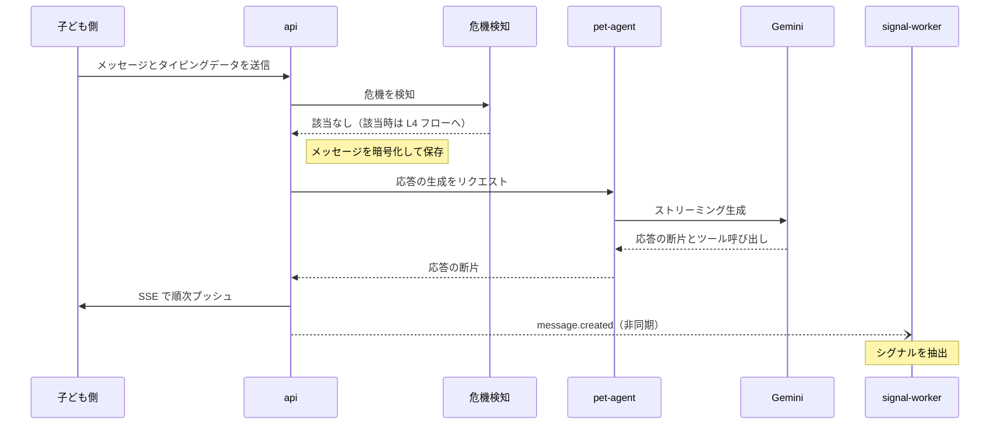

# いじめ対策デジタルペット — バックエンド API 定義 v0.1

## 概要

バックエンドは7個の Cloud Run サービスで構成し、外部に公開する入口は REST API（api）と音声 WebSocket（voice-relay）の2つだけです。それ以外のサービス間は Pub/Sub と Cloud Tasks で通信します。本書は「子ども向けいじめ対策デジタルペット AI Agent — プロダクト要求仕様書（PRD）v0.1」（docs/01-prd.md）と「いじめ対策デジタルペット — データベース定義 v0.1」（docs/03-database.md）に基づきます。

- プロトコル：HTTPS 上の JSON。パスはすべて /v1 で始まります。ペットのテキスト応答は SSE でストリーミング返却します。
- 認証：リクエストヘッダーに Identity Platform の ID トークンを付けます。ロールと所属する家庭はカスタムクレームに書き込みます。
- 時刻：すべて UTC の ISO 8601 文字列を使います。日本時間の日付が必要な場合は、別に localDate フィールドを返します。
- 安全：子どもの入力は毎回、先に危機検知を通してからペット Agent に渡します。

Agent の内部ワークフロー、プロンプト、出力スキーマは「いじめ対策デジタルペット — Agent アーキテクチャとワークフロー v0.1」（docs/02-agent-architecture.md）を参照してください。

## サービス構成と共通規約

外部に公開するのは api と voice-relay だけで、残りの5個のサービスは公開インターネットからの入口を持ちません。危機検知は共有ライブラリで、api と voice-relay がそれぞれ呼び出します。

| サービス | 種類 | 外部公開 | 役割 | サービスアカウント |
| --- | --- | --- | --- | --- |
| api | Cloud Run サービス | あり（HTTPS） | 子ども側と保護者側のすべての REST エンドポイント。事前の危機検知。ペットの応答を SSE でフロントエンドへ中継 | sa-api |
| voice-relay | Cloud Run サービス | あり（WebSocket） | ADK の runLive で Live API に接続。発話ごとに危機検知を実行。音声特徴を計算 | sa-voice-relay |
| pet-agent | Cloud Run サービス | なし | Google ADK でテキスト会話とツール呼び出しを実行。音声モードのツールも実行 | sa-pet-agent |
| signal-worker | Cloud Run サービス（Pub/Sub のプッシュを受信） | なし | シグナルと作品特徴を抽出し、BigQuery に書き込む | sa-signal-worker |
| risk-engine | Cloud Run Job と内部サービス1つ | なし | 毎日の定時計算に加え、イベント発生時にもリスクレベルを計算 | sa-risk-engine |
| notifier | Cloud Run サービス（Cloud Tasks を受信） | なし | 保護者向け通知の作成と送信。危機通知の再送 | sa-notifier |
| calendar-sync | Cloud Run Job | なし | Google カレンダーのコンテキスト情報を毎日同期 | sa-calendar-sync |

共通規約：

- アドレス：REST は https://api.{domain}/v1、音声は wss://voice.{domain}/v1/voice です。前段に外部 HTTPS ロードバランサーと Cloud Armor（レート制限、WAF）を置きます。
- リクエストヘッダー：Authorization に ID トークン、X-Firebase-AppCheck に App Check トークン（reCAPTCHA Enterprise）を付けます。X-Request-Id は任意で、省略時はサーバーが生成します。
- トレース：W3C traceparent を引き継ぎ、すべてのサービスが span を Cloud Trace に送ります。
- 冪等性：レコードを新規作成する POST エンドポイントは Idempotency-Key ヘッダー（UUID）を受け付け、24時間以内の重複送信には最初の結果を返します。
- ページング：カーソル方式です。パラメーターは pageSize（既定20、最大100）と pageToken です。
- レート制限：子ども単位と保護者単位でそれぞれ制限します。具体的な数値は未定です。

エラーは次の形式に統一します。エラーコードは「危機対応経路とエラーコード」の節を参照してください。

```json
{
  "error": {
    "code": "CONSENT_REQUIRED",
    "message": "保護者の同意が完了すると利用できます",
    "requestId": "c1f0a9e2-7b2d-4e1a-9f0c-2d6b1e8a4c33"
  }
}
```

## 認証と権限

保護者は Google アカウントまたはメールアドレスでログインします。子どもはメールアドレスを持たないため、保護者がペアリングコードを発行し、子どもの端末がそのコードと引き換えにカスタムトークンを受け取ります。ロールと所属は Identity Platform のカスタムクレームに書き込み、サーバーがリクエストのたびに検証します。

```json
{ "role": "guardian", "familyId": "f_8c2e", "guardianRole": "primary" }
{ "role": "child", "familyId": "f_8c2e", "childId": "c_41a7", "gradeBand": "high" }
```

保護者の登録：

1. 保護者が Identity Platform に登録します（Google アカウントまたはメールアドレス）。
2. POST /v1/families を呼び出して家庭を作成します。サーバーは families と guardians に書き込み、カスタムクレームを設定します。
3. 検証可能な保護者の同意を完了します：POST /v1/consents（検証方法は未定）。
4. 子どもを作成します：POST /v1/children。

子どもの端末のペアリング：

1. 保護者が保護者側で「子どもの端末をペアリングする」を押します：POST /v1/children/{childId}/pairing-codes。6桁のペアリングコードと QR コードの内容を返し、10分間有効です。
2. 子どもの端末がペアリングコードを送信します：POST /v1/child/pair。この手順はログイン不要です。
3. サーバーは検証に成功すると、Admin SDK で子どものアカウントを作成または再利用し、role=child のクレームを持つカスタムトークンを発行します。
4. 子どもの端末は signInWithCustomToken でログインし、以後はトークンを自動更新します。
5. 初回ログイン後、子ども本人の同意（アセント）のフローに進みます：POST /v1/child/assent。完了するまで、相談先以外のエンドポイントはすべて ASSENT\_REQUIRED を返します。

権限マトリクス：

| リソース | 子ども本人 | 主たる保護者 | 第二保護者 |
| --- | --- | --- | --- |
| 会話、記憶 | 閲覧、削除 | アクセス不可 | アクセス不可 |
| お絵かきと箱庭の作品 | 閲覧、削除、共有 | 子どもが共有したものだけ閲覧可 | 子どもが共有したものだけ閲覧可 |
| データソースのスイッチ | 閲覧、変更 | 閲覧 | 閲覧 |
| 週ごとの元気度 | アクセス不可 | 閲覧 | 閲覧 |
| 通知 | アクセス不可 | 閲覧、確認 | 閲覧、確認 |
| コンテキスト情報とカレンダー連携 | アクセス不可 | 閲覧、変更 | 閲覧、変更 |
| 同意の記録 | 自分のアセント | 閲覧、署名、撤回 | 閲覧 |
| リスクレベル | アクセス不可 | アクセス不可。通知だけを受け取る | アクセス不可。通知だけを受け取る |
| 全データの削除 | リクエスト可 | リクエスト可 | 不可 |

内部サービス間の呼び出しは、それぞれのサービスアカウントと OIDC トークンを使い、上の表の対象外です。

## テキスト会話1ターンの呼び出し順序

キーワード層の危機検知は、ペットが応答を生成する前に完了します。意味的スクリーニングは生成と並行して走り、該当した場合は応答を中断します。シグナル抽出は応答をブロックしません。

> 図：テキスト会話1ターンの呼び出し順序



実線はリクエスト、破線はレスポンスまたは非同期メッセージです。危機検知に該当した場合は pet-agent を呼び出さず、そのまま L4 フローに入ります。「危機対応経路とエラーコード」の節を参照してください。

## 子ども側 API

子ども側のエンドポイントはすべて /v1/child で始まり、子ども本人のデータにだけアクセスできます。相談先のエンドポイントはログイン不要で、同意の状態による制限も受けません。

| メソッド | パス | 説明 |
| --- | --- | --- |
| POST | /v1/child/pair | ペアリングコードと引き換えにカスタムトークンを取得。ログイン不要 |
| POST | /v1/child/assent | 子ども本人の同意（アセント）を送信 |
| GET | /v1/child/help-resources | 相談先。ログイン不要で、フロントエンドがオフライン用にキャッシュする |
| GET | /v1/child/home | ホームのデータ：ペット、島の概要、今日の習慣、表示待ちのあいさつ、未完了のペットのお願い、回答待ちの相談 |
| GET | /v1/characters | 選べるキャラクターの一覧 |
| POST | /v1/child/pets | パートナーを選ぶ、または変更する。記憶を引き継ぐかどうかも指定する |
| POST | /v1/child/chat/sessions | テキストのセッションを開始 |
| GET | /v1/child/chat/sessions | 自分のセッションを一覧表示 |
| POST | /v1/child/chat/sessions/{sessionId}/messages | メッセージを1件送信し、ペットの応答を SSE で返す |
| GET | /v1/child/chat/sessions/{sessionId}/messages | セッションのメッセージを閲覧 |
| DELETE | /v1/child/chat/sessions/{sessionId} | 会話を1件削除 |
| POST | /v1/child/voice/tickets | 音声セッションのチケットを申請。voice-relay への接続に使う |
| POST | /v1/child/mood | きもち天気を送信 |
| POST | /v1/child/home-checkins | 帰宅チェックイン |
| GET | /v1/child/island | 島の現在のレイアウト、飾ってある絵、解放済みのアイテム、成長段階を取得 |
| PUT | /v1/child/island | 島のレイアウトを保存（全体を上書きし、サーバーがスナップショットを1件作成。語りを添付可） |
| GET | /v1/child/pet-requests | 未完了のペットのお願い（お題、ごほうび） |
| POST | /v1/child/pet-requests/{requestId}/complete | お願いを1件完了：drawing は artworkId を付ける。story は artworkId または結末の文章を付ける。pet\_worry は選んだ選択肢を付ける |
| POST | /v1/child/pet-requests/{requestId}/decline | 今回はやらない |
| POST | /v1/child/rituals | 毎日の小さな習慣を1回記録：水やり、いいことびんに星を入れる（回数だけを記録） |
| GET | /v1/child/games/story-prompt | おはなしの書き出しを1つ取得（ペットのお願いから参照される） |
| POST | /v1/child/artworks | 絵と語りをアップロード（multipart）。requestId を付けられる |
| POST | /v1/child/artworks/{artworkId}/share | 絵を1枚、保護者に共有 |
| DELETE | /v1/child/artworks/{artworkId}/share | 共有を取り消す。閲覧済みまたはダウンロード済みのコピーの消去は保証しない |
| POST | /v1/child/island-scenes | PUT /v1/child/island に統合済み。1バージョンだけ残してから削除する |
| GET | /v1/child/memories | ペットが覚えていることを閲覧 |
| DELETE | /v1/child/memories/{memoryId} | 記憶を1件削除 |
| GET、PUT | /v1/child/data-sources | データソースのスイッチを閲覧または変更 |
| POST | /v1/child/tell-adult | 子どもが自分から「おとなに つたえたい」を押す |
| POST | /v1/child/consultations/{consultationId}/choice | ペットからの相談に回答 |
| POST | /v1/child/data-deletion-requests | 自分の全データの削除をリクエスト |

メッセージを1件送信：

```json
POST /v1/child/chat/sessions/s_91/messages
{
  "text": "きょう、みんなに むしされた",
  "typing": { "keyCount": 42, "deleteCount": 9, "composeMs": 38000, "longPauseCount": 2 },
  "clientSentAt": "2026-09-28T07:41:10Z"
}
```

レスポンスは SSE ストリームで、イベントは meta、delta（複数回可）、action（任意）、done の順に届きます。

```text
event: meta
data: {"messageId":"m_301","safeMode":false}

event: delta
data: {"text":"そっか…それは つらかったね。"}

event: action
data: {"type":"offer_tell_adult","consultationId":"cs_12"}

event: done
data: {"replyMessageId":"m_302"}
```

島の保存。座標は0–1の相対値で、画面サイズに依存しません。selfFigureId は省略できます。

```json
PUT /v1/child/island
{
  "selfFigureId": "fig_3",
  "items": [
    { "id": "fig_3", "catalogId": "rabbit_small", "category": "animal", "x": 0.82, "y": 0.15, "rotation": 0, "layer": 2 },
    { "id": "fig_4", "catalogId": "bear", "category": "animal", "x": 0.30, "y": 0.55, "rotation": 0, "layer": 2 }
  ],
  "narrative": { "mode": "voice_transcript", "text": "うさぎは ひとりで うみを みてる" }
}
```

相談への回答。choice が proxy の場合、子どもが確認した一文の要約が通知と一緒に保護者へ送られます。

```json
POST /v1/child/consultations/cs_12/choice
{ "choice": "proxy", "summary": { "text": "学校で無視されてつらい", "confirmed": true } }
```

## 保護者側 API

保護者側のエンドポイントは、会話の原文、リスクレベル、作品の解釈を返しません。通知の内容はサーバー側であらかじめ保護者向けの文面に整えてあります。

| メソッド | パス | 説明 |
| --- | --- | --- |
| GET | /v1/me | 現在の保護者、家庭、子どもの一覧 |
| POST | /v1/families | 家庭を作成 |
| POST | /v1/consents | 同意に署名：規約、機微情報 |
| GET | /v1/consents | 同意と撤回の記録。検証用の資格情報は返さない。完全な状態は /v1/me で取得する |
| DELETE | /v1/consents/{consentId} | 同意の撤回 |
| POST | /v1/children | 子どもを作成：ニックネーム、学年帯 |
| POST | /v1/children/{childId}/pairing-codes | ペアリングコードを発行 |
| GET | /v1/children/{childId}/weekly-reports?week= | 週ごとの元気度 |
| GET | /v1/children/{childId}/shared-artworks | 子どもが自分から共有した絵 |
| GET | /v1/notifications | 通知の一覧 |
| GET | /v1/notifications/{notificationId} | 通知の詳細。保護者向けに整えた内容 |
| POST | /v1/notifications/{notificationId}/ack | 受け取りを確認 |
| GET、POST | /v1/context-events | 手動で登録したコンテキスト情報を一覧表示または追加 |
| DELETE | /v1/context-events/{eventId} | コンテキスト情報を1件削除 |
| POST | /v1/calendar/connect | Google カレンダーの認可を開始し、認可 URL を返す |
| GET | /v1/calendar/callback | OAuth コールバック |
| GET | /v1/calendar/calendars | 同期できるカレンダーを一覧表示 |
| PUT | /v1/calendar/connection | 同期するカレンダーを選択 |
| DELETE | /v1/calendar/connection | カレンダー連携を解除 |
| POST | /v1/guardians/invitations | 第二保護者を招待 |
| POST | /v1/guardians/invitations/{invitationId}/accept | 第二保護者が招待を承諾 |
| POST | /v1/devices | プッシュ通知のトークンを登録 |
| GET、PUT | /v1/guardians/me/notify-settings | 通知チャネルと電話番号を取得または保存。配信の成功を意味するものではない |
| POST | /v1/children/{childId}/data-deletion-requests | 子どものデータの削除をリクエスト |
| GET | /v1/guides | 声かけガイド（P1） |
| GET | /v1/children/{childId}/evidence-export | 証拠タイムラインのエクスポート（P2、子どもの同意が必要） |

通知の詳細のレスポンス：

```json
{
  "id": "n_77",
  "childId": "c_41a7",
  "kind": "care_hint",
  "title": "最近、〇〇さんに少し元気のない日が続いています",
  "changes": [
    "寝る前のおしゃべりで、疲れや寂しさを表す言葉がいつもより多い",
    "朝の気分が低めの日が続いている"
  ],
  "meaning": "これだけで何かが起きていると決まるわけではありません。",
  "suggestions": { "try": ["「最近どう？なんでも聞くよ」"], "avoid": ["問い詰める", "すぐに学校へ電話する"] },
  "childSummary": null,
  "resources": [{ "name": "24時間子供SOSダイヤル", "phone": "0120-0-78310" }],
  "reason": { "domains": ["m", "a"], "days": 7 },
  "createdAt": "2026-09-28T09:00:00Z",
  "acknowledgedAt": null
}
```

週ごとの元気度のレスポンス：

```json
{
  "weekId": "2026-W40",
  "vitality": {
    "mood": { "sunny": 3, "cloudy": 2, "rainy": 1, "stormy": 0 },
    "activeDays": 6,
    "lateNightDays": 1
  },
  "summaryText": "今週は晴れの日が多く、おおむね安定していました。"
}
```

## エンドポイント詳細定義

以下では、各エンドポイントのリクエストとレスポンスを TypeScript の型で示します。フロントエンドとバックエンドは同じ型パッケージを共有します。エラーコードを書いていないエンドポイントは、共通エラー（UNAUTHENTICATED、PERMISSION\_DENIED、RATE\_LIMITED）だけを返します。

### 共通型

```ts
type ISODateTime = string;   // UTC の ISO 8601
type LocalDate = string;     // 日本時間の日付、YYYY-MM-DD
type GradeBand = 'low' | 'high' | 'jhs';
type CharacterId = 'moko' | 'pokke' | 'togemaru' | 'nami' | 'hoshi' | 'hidden';
type MoodWeather = 'sunny' | 'cloudy' | 'rainy' | 'stormy';
type DataSource = 'voice' | 'typing' | 'artwork_save' | 'home_checkin' | 'calendar';
type ConsultChoice = 'self' | 'proxy' | 'not_now';
type GameType = 'drawing' | 'story' | 'pet_worry';
type CrisisCategory = 'self_harm' | 'violence' | 'extortion' | 'family_harm' | 'other';
type RitualKind = 'watered' | 'good_thing';
type Expression = 'happy' | 'caring' | 'sleepy' | 'together' | 'celebrate' | 'worried';
type ContextCategory = 'exam' | 'long_vacation' | 'school_event' | 'sick' | 'travel' | 'class_change' | 'other';
type Page<T> = { items: T[]; nextPageToken?: string };
type HelpResource = { id: string; name: string; phone?: string; url?: string; hours?: string; audience: string };
type CrisisPayload = { crisisId: string; message: string; resources: HelpResource[] };
type PetAction =
  | { type: 'offer_tell_adult'; consultationId: string }
  | { type: 'show_help_resources' }
  | { type: 'suggest_game'; game: GameType; requestId: string }
  | { type: 'quick_replies'; options: string[] }
  | { type: 'set_expression'; expression: Expression };
```

### 子ども側

```ts
// POST /v1/child/pair（ログイン不要）  エラー：PAIRING_CODE_EXPIRED、INVALID_ARGUMENT
type PairReq = { code: string };  // 6桁の数字
type PairRes = { customToken: string; childId: string; needsAssent: boolean };

// POST /v1/child/assent
type AssentReq = { documentVersion: string; dataSources: Record<DataSource, boolean> };
type AssentRes = { consentId: string };

// GET /v1/child/help-resources（ログイン不要）
type HelpResourcesRes = { version: string; resources: HelpResource[] };

// GET /v1/child/home  エラー：ASSENT_REQUIRED
type ChildHomeRes = {
  gradeBand: GradeBand;
  pet: { petId: string; characterId: CharacterId; hiddenVariantId?: string; petName?: string };
  greeting: { text: string; expression: Expression; source: 'agent' | 'template' };
  todayMood?: MoodWeather;
  showHomeCheckin: boolean;
  island: { visitDays: number; stage: number; season: string; decorationCount: number };
  rituals: { morningMood: boolean; okaeri: boolean; goodThing: boolean; watered: boolean };
  petRequests: PetRequest[];
  pendingConsultation?: { consultationId: string };
};

type PetRequest = { requestId: string; type: GameType; promptText: string; options?: { id: string; text: string }[]; rewardItemId: string; expiresAt: ISODateTime };

// GET /v1/child/island
type IslandItem = { id: string; catalogId: string; category: string; x: number; y: number; rotation: number; layer: number };
type IslandRes = {
  items: IslandItem[];
  selfFigureId?: string;
  decorations: { artworkId: string; thumbnailUrl: string }[];
  unlockedItems: string[];
  catalog: { catalogId: string; category: string; label: string; spriteUrl: string; locked: boolean }[];
  visitDays: number;
  stage: number;
  season: string;
};

// PUT /v1/child/island  エラー：INVALID_ARGUMENT（selfFigureId が items に含まれない）
type IslandPutReq = { items: IslandItem[]; selfFigureId?: string; narrative?: { mode: 'typed' | 'voice_transcript'; text: string } };
type IslandPutRes = { sceneId: string; replyMessageId?: string; crisis?: CrisisPayload };

// POST /v1/child/pet-requests/{requestId}/complete
type PetRequestCompleteReq =
  | { type: 'drawing'; artworkId: string }
  | { type: 'story'; artworkId?: string; ending?: { mode: 'typed' | 'voice_transcript' | 'option'; text: string } }
  | { type: 'pet_worry'; optionId: string };
type PetRequestCompleteRes = { rewardItemId: string; petReply: string; replyMessageId?: string; crisis?: CrisisPayload };

// POST /v1/child/rituals
type RitualReq = { kind: RitualKind; localDate: LocalDate };
type RitualRes = { rituals: ChildHomeRes['rituals']; goodThingCount: number };

// GET /v1/characters
type CharactersRes = {
  items: { characterId: CharacterId; displayName: string; archetype: string; palette: { main: string; sub: string }; voicePreviewUrl: string }[];
};

// POST /v1/child/pets  エラー：INVALID_ARGUMENT
type ChoosePetReq = { characterId: CharacterId; petName?: string; carryMemoryFrom?: string };  // petName は最大10文字
type ChoosePetRes = { petId: string; characterId: CharacterId; hiddenVariantId?: string };

// POST /v1/child/chat/sessions
type StartSessionRes = { sessionId: string; openingMessage: string };

// GET /v1/child/chat/sessions
type SessionsRes = Page<{ sessionId: string; channel: 'text' | 'voice'; startedAt: ISODateTime; preview: string }>;

// POST /v1/child/chat/sessions/{sessionId}/messages → text/event-stream
// 子どもがタイピングデータをオフにしている場合、サーバーは typing フィールドを無視する
type SendMessageReq = {
  text: string;  // 1–500文字
  inputMode: 'typed' | 'quick_reply';
  typing?: { keyCount: number; deleteCount: number; composeMs: number; longPauseCount: number };
  clientSentAt: ISODateTime;
};
type SseEvent =
  | { event: 'meta'; data: { messageId: string; safeMode: boolean } }
  | { event: 'delta'; data: { text: string } }
  | { event: 'action'; data: PetAction }
  | { event: 'crisis'; data: { crisisId: string; message: string; resources: HelpResource[] } }
  | { event: 'done'; data: { replyMessageId: string } };

// GET /v1/child/chat/sessions/{sessionId}/messages
type MessagesRes = Page<{ messageId: string; role: 'child' | 'pet'; text: string; createdAt: ISODateTime }>;

// DELETE /v1/child/chat/sessions/{sessionId} → 204

// POST /v1/child/voice/tickets  エラー：DATA_SOURCE_DISABLED
type VoiceTicketRes = { ticket: string; wsUrl: string; expiresAt: ISODateTime };

// POST /v1/child/mood
type MoodReq = { weather: MoodWeather };
type MoodRes = { checkinId: string; petReply: string };

// POST /v1/child/home-checkins  エラー：DATA_SOURCE_DISABLED（method が geo で位置情報がオフ）
type HomeCheckinReq = { atHome: boolean; method: 'geo' | 'manual' };
type HomeCheckinRes = { checkinId: string; greeting: string };

// GET /v1/child/games/story-prompt
type StoryPromptRes = { promptId: string; text: string; imageUrl?: string };

// POST /v1/child/artworks（multipart/form-data）  エラー：INVALID_ARGUMENT
// フィールド：image（PNG、最大2MB）、type（drawing | story）、promptId?、requestId?、
//       narrativeText?（最大500文字）、narrativeMode（typed | voice_transcript）、save（true | false）
// 語りが危機検知に該当した場合は crisis を付ける
type ArtworkRes = { artworkId: string; petPrompt: string; crisis?: CrisisPayload };

// POST /v1/child/artworks/{artworkId}/share → 204  エラー：INVALID_ARGUMENT（元画像が保存されていない）
// DELETE /v1/child/artworks/{artworkId}/share → 204。取り消しの繰り返しは冪等
// 取り消すと、以後の一覧取得と署名付き URL の発行を止める。発行済みの GCS URL は最長5分で失効し、保存済みのコピーは回収できない。

// POST /v1/child/island-scenes  エラー：INVALID_ARGUMENT（selfFigureId が items に含まれない）
type IslandItem = { id: string; catalogId: string; category: string; x: number; y: number; rotation: number; layer: number };
type IslandReq = { selfFigureId: string; items: IslandItem[]; narrative?: { mode: 'typed' | 'voice_transcript'; text: string } };
type IslandRes = { sceneId: string; petPrompt: string; crisis?: CrisisPayload };

// GET /v1/child/memories
type MemoriesRes = Page<{ memoryId: string; text: string; category: string; createdAt: ISODateTime }>;

// DELETE /v1/child/memories/{memoryId} → 204

// GET /v1/child/data-sources と PUT /v1/child/data-sources は同じ構造を使う
type DataSourcesBody = { dataSources: Record<DataSource, boolean> };

// POST /v1/child/tell-adult
type TellAdultRes = { consultationId: string };

// POST /v1/child/consultations/{consultationId}/choice  エラー：NOT_FOUND、INVALID_ARGUMENT
type ChoiceReq = { choice: ConsultChoice; summary?: { text: string; confirmed: boolean } };  // proxy のとき summary は必須
type ChoiceRes = { notificationQueued: boolean; coachingScript?: string[] };  // self のとき、話し出す練習用のせりふを返す

// POST /v1/child/data-deletion-requests
type DeletionRes = { requestId: string; status: 'accepted' };
```

### 保護者側

```ts
// GET /v1/me
type MeRes = {
  guardian: { guardianId: string; role: 'primary' | 'secondary'; email: string; displayName?: string };
  family: { familyId: string; termsVersion: string; consentComplete: boolean };
  children: { childId: string; nickname: string; gradeBand: GradeBand; paired: boolean; assentComplete: boolean }[];
};

// POST /v1/families。同じ主たる保護者が繰り返しリクエストした場合は既存の家庭を再利用する
// 本番の issuer を設定している場合は、クレームの設定に成功したあと ID token を強制更新する。ローカルでは実際のクレームを設定しない。
// クレームの設定に失敗すると作成済みの家庭が残ることがあり、リトライ時はそれを再利用する。issuer がない場合は明示的に503を返す。
type CreateFamilyReq = { displayName?: string };
type CreateFamilyRes = { familyId: string };

// POST /v1/consents  エラー：INVALID_ARGUMENT
type ConsentReq = {
  type: 'guardian_terms' | 'guardian_sensitive';
  documentVersion: string;
  subjectChildId?: string;
  scope?: Record<string, boolean>;
  verification?: Record<string, string>;  // フィールドは検証方法によって決まる。未定
};
type ConsentRes = { consentId: string; grantedAt: ISODateTime };

// GET /v1/consents。検証方法の種別だけを返し、検証用の資格情報は返さない
type ConsentsRes = {
  items: {
    consentId: string;
    type: 'guardian_terms' | 'guardian_sensitive';
    documentVersion: string;
    subjectChildId?: string;
    verificationMethod: string;
    grantedAt: ISODateTime;
    revokedAt?: ISODateTime;
  }[];
};

// DELETE /v1/consents/{consentId} → 204（記録は残し、revokedAt を書き込む）

// POST /v1/children  エラー：CONSENT_REQUIRED、INVALID_ARGUMENT
type CreateChildReq = { nickname: string; gradeBand: GradeBand };  // ニックネームは1–20文字
type CreateChildRes = { childId: string };

// POST /v1/children/{childId}/pairing-codes
type PairingCodeRes = { code: string; qrPayload: string; expiresAt: ISODateTime };

// GET /v1/children/{childId}/weekly-reports?week=2026-W40  エラー：NOT_FOUND
type WeeklyReportRes = {
  weekId: string;
  vitality: { mood: Record<MoodWeather, number>; activeDays: number; lateNightDays: number };
  summaryText: string;
};

// GET /v1/children/{childId}/shared-artworks（imageUrl は5分間有効な署名付き URL）
type SharedArtworksRes = Page<{ artworkId: string; type: 'drawing' | 'story'; imageUrl: string; sharedAt: ISODateTime }>;

// GET /v1/notifications?status=unacknowledged
type NotificationKind = 'weekly_report' | 'care_hint' | 'content_free_alert' | 'crisis';
type NotificationSummary = { id: string; childId: string; kind: NotificationKind; title: string; createdAt: ISODateTime; acknowledgedAt?: ISODateTime };
type NotificationsRes = Page<NotificationSummary>;

// GET /v1/notifications/{notificationId}  エラー：NOT_FOUND
type NotificationDetail = NotificationSummary & {
  changes: string[];
  meaning: string;
  suggestions: { try: string[]; avoid: string[] };
  childSummary: string | null;
  resources: HelpResource[];
  reason: { domains: string[]; days: number };
};

// POST /v1/notifications/{notificationId}/ack
type AckRes = { acknowledgedAt: ISODateTime };

// GET /v1/context-events?childId=  ·  POST /v1/context-events  ·  DELETE /v1/context-events/{eventId}
type ContextEvent = { eventId: string; childIds: string[]; category: ContextCategory; startDate: LocalDate; endDate: LocalDate; source: 'calendar' | 'manual' };
type CreateContextEventReq = { childIds: string[]; category: ContextCategory; startDate: LocalDate; endDate: LocalDate };

// POST /v1/calendar/connect
type CalendarConnectRes = { authUrl: string };  // カレンダー予定の読み取り専用権限だけを要求する
// GET /v1/calendar/callback?code=&state= → 302 で保護者側の /context に戻る

// GET /v1/calendar/calendars
type CalendarsRes = { items: { calendarId: string; name: string; selected: boolean }[] };

// PUT /v1/calendar/connection
type CalendarSelectReq = { calendarIds: string[] };

// DELETE /v1/calendar/connection → 204（同時にトークンを失効させる）

// POST /v1/guardians/invitations  エラー：ALREADY_EXISTS（第二保護者が登録済み）
type InviteReq = { email: string };
type InviteRes = { invitationId: string; expiresAt: ISODateTime };

// POST /v1/guardians/invitations/{invitationId}/accept  エラー：NOT_FOUND、INVITATION_EXPIRED
type AcceptInviteRes = { familyId: string };

// POST /v1/devices
type DeviceReq = { fcmToken: string; platform: 'ios_pwa' | 'android' | 'desktop' };
type DeviceRes = { deviceId: string };

// PUT /v1/guardians/me/notify-settings  エラー：INVALID_ARGUMENT（sms を含むのに電話番号がない）
type NotifySettingsReq = { channels: ('webpush' | 'email' | 'sms')[]; phoneE164?: string };

// POST /v1/children/{childId}/data-deletion-requests
// レスポンスは子ども側の DeletionRes と同じ

// GET /v1/guides（P1）
type GuidesRes = { items: { guideId: string; title: string; body: string; tags: string[] }[] };

// GET /v1/children/{childId}/evidence-export（P2）  エラー：CONSENT_REQUIRED（子どもが同意していない）
type EvidenceExportRes = { downloadUrl: string; expiresAt: ISODateTime };  // 15分間有効
```

### 内部エンドポイント

内部エンドポイントはサービスアカウントの OIDC トークンだけを受け付け、公開インターネットには開放しません。

```ts
// POST /internal/turns（api → pet-agent）
// レスポンスはチャンクストリームで、1行に JSON を1つ返す。type は delta、action、done のいずれかで、フィールドは子ども側の SseEvent と同じ。
// ペットが escalate_crisis を呼び出した場合は { type: 'crisis', crisisId } でこのターンを終え、api が crisis.detected を発行して危機時の文言をプッシュする
type TurnReq = { childId: string; sessionId: string; messageId: string };

// POST /internal/proactive-turns（Cloud Tasks → pet-agent）
// 自発ターン：時間帯に応じたあいさつを生成し、ペットのお願いを1つ添えられる。会話の原文は読まず、使えるツールは recall、suggest_game、set_expression に限る
type ProactiveTurnReq = { childId: string; slot: 'morning' | 'after_school' | 'bedtime'; localDate: LocalDate };
type ProactiveTurnRes = { greeting: { text: string; expression: Expression }; petRequest?: PetRequest; fallback: boolean };

// POST /internal/proactive-turns/dispatch（Cloud Scheduler → api）
type ProactiveDispatchReq = { slot: 'morning' | 'after_school' | 'bedtime' };

// POST /internal/tools/{toolName}（voice-relay → pet-agent、音声モードのツール呼び出し。voice-relay 側の ADK FunctionTool の実装はここへ転送するだけ）
// operationId は同じ発話を識別する。リトライでは必ず同じ値を使う。省略も可。
// voice-relay は接続と発話の識別子の SHA-256 を使う。サーバー側の ID 検証に適合し、文字起こしを含まない。
type ToolCallReq = { childId: string; sessionId: string; operationId?: string; args: Record<string, unknown> };
type ToolCallRes = { result: unknown };

// POST /internal/assess（Pub/Sub のプッシュ signal.extracted → risk-engine）
type AssessReq = { childId: string; domains: string[]; explicit: boolean };
```

## リアルタイム音声プロトコル

ブラウザーは voice-relay にだけ接続し、Live API には直接接続しません。voice-relay は子どもの発話ごとに、確定した文字起こしを先に危機検知へ渡し、そのうえでペットに話を続けさせるかどうかを決めます。

接続の手順：

1. フロントエンドが POST /v1/child/voice/tickets を呼び出してチケットを受け取ります。有効期間は60秒、使えるのは1回だけで、現在の子どもに紐づきます。
2. フロントエンドが wss://voice.{domain}/v1/voice?ticket=… に接続します。URL には長期間有効なトークンを含めません。
3. voice-relay はテキストモードと同じ ADK のペット Agent 定義（まもりの憲章、キャラクターの人格、学年帯への適応、ツール宣言）を使い、`runLive` で Live API のセッションを確立してから ready を返します。
4. どちらかが終了メッセージを送るまで、双方が音声とイベントを送受信します。

メッセージ定義（テキストフレームは JSON で、{"type": "...", ...} の形）：

| 方向 | 種類 | 内容 | 説明 |
| --- | --- | --- | --- |
| クライアント → サーバー | start | sessionId（任意）、sampleRateHz: 16000 | セッションを開始 |
| クライアント → サーバー | バイナリフレーム | 16-bit PCM、モノラル、16kHz | マイクの音声。1フレームは約40ミリ秒 |
| クライアント → サーバー | stop | なし | 子どもがセッションを終了 |
| サーバー → クライアント | ready | sessionId | Live API のセッションを確立済み |
| サーバー → クライアント | child\_transcript | text、final | 子どもの発話の文字起こし |
| サーバー → クライアント | バイナリフレーム | 16-bit PCM、モノラル、24kHz | ペットの声 |
| サーバー → クライアント | pet\_transcript | text | ペットが話した内容。字幕に使う |
| サーバー → クライアント | interrupted | なし | 子どもがペットの発話に割り込んだ。フロントエンドはすぐに再生を止める |
| サーバー → クライアント | action | type とパラメーター | テキストモードと同じ。例：offer\_tell\_adult、show\_help\_resources |
| サーバー → クライアント | crisis | resources、message | セーフモードに入る。次の節を参照 |
| サーバー → クライアント | end | reason：stop / timeout / crisis / error | セッション終了 |

そのほかの規約：

- 音声特徴は voice-relay のメモリ上で発話ごとに計算し、voiceFeatures に書き込んだら音声をすぐに破棄します。
- 子どもの文字起こしとペットの文字起こしはどちらも messages に保存し、テキストモードと同じシグナルのパイプラインを共有します。
- セッションの長さは Live API の上限に従い、上限が近づいたらセッション再開機能で自動的につなぎ直します。
- ネットワークが切れた場合、フロントエンドは5秒以内に新しいチケットで再接続します。再接続に失敗したら、テキストに切り替えるよう子どもに案内します。

## 内部イベントと Agent ツール

サービス間のイベントは ID だけを渡し、内容は渡しません。購読側が内容を必要とするときは、自分の権限で Firestore から読み取ります。各トピックにはデッドレタートピックを設定します。リトライの上限は未定です。

| Pub/Sub トピック | 発行側 | 購読側 | ペイロード |
| --- | --- | --- | --- |
| message.created | api、voice-relay | signal-worker | familyId、childId、sessionId、messageId、channel |
| artwork.created | api | signal-worker | childId、artworkId、type（island は島のスナップショット。story はおはなしリレーの結末で、signal-worker は子どもが入力または口述した場合にだけ、結末の傾向をモデルに判定させる。お絵かきは api が signal-worker の内部エンドポイントを直接呼び出す） |
| checkin.created | api | signal-worker | childId、kind（mood / home）、レコード ID |
| signal.extracted | signal-worker | risk-engine | childId、domains、explicit |
| risk.level\_changed | risk-engine | なし（相談は risk-engine がレベル判定時に直接作成する） | childId、assessmentId、from、to |
| crisis.detected | api、voice-relay、signal-worker | notifier、risk-engine（L4 を記録） | childId、crisisId、category、familyHarmSuspected（category が family\_harm のとき true） |
| consultation.resolved | api | notifier | childId、consultationId、choice |
| data.deletion\_requested | api | 削除ジョブ | familyId、childId、scope |

Cloud Tasks のキューは4つあります。notify-send は通知を1件ずつ送信し、リトライします。crisis-escalation には遅延タスクを入れ、時刻になったら危機通知が確認済みかどうかを調べ、未確認なら再送して第二保護者にも通知します。consultation-timeout には risk-engine が L3 の相談を開始するときにタスクを入れ、時刻になっても子どもが回答していなければ notifier が内容を含まないお知らせを送ります。proactive-turns には Cloud Scheduler の起動時に api が子どもごとにタスクを入れ、pet-agent を呼び出して自発的なあいさつを生成します（Agent ドキュメントの「自発ターン（ペットから話しかける）」を参照）。

ペット Agent のツールは、テキストモード（ADK `runAsync`）と音声モード（ADK `runLive`）で同じ ADK `FunctionTool` の組を使い、宣言は完全に一致します。

| ツール | パラメーター | 戻り値 | 説明 |
| --- | --- | --- | --- |
| get\_child\_context | なし | 学年帯、キャラクター、最近の傾向の要約、回答待ちの相談 | 要約は原文を含まない |
| search\_skill | query | 最大3件の会話ガイド | Firestore のベクトル検索。承認済みのバージョンだけを返す |
| record\_mood | weather | ok | きもち天気を記録 |
| remember | content、category | memoryId | サーバー側で先に同級生の名前を仮名IDに置き換える |
| recall | topic | 最大5件の記憶 | 子どもが覚えてよいと同意した内容だけを取得 |
| set\_expression | expression | フロントエンドのアクション | ターンごとに1回、ペットの表情を設定 |
| offer\_quick\_replies | options（2–3個） | フロントエンドのアクション | 小学校低学年では既定で使う |
| show\_help\_resources | なし | フロントエンドのアクション | 相談先ページを表示 |
| suggest\_game | type：drawing / story / pet\_worry | フロントエンドのアクション。petRequests ドキュメントも作成 | 「ペットのお願い」を出す。週ごとの回数に上限があり、呼び出す前にサーバー側のクォータを確保する |
| start\_tell\_adult | reason（任意） | consultationId | 相談を1件作成 |
| escalate\_crisis | category、reason（任意） | crisisId | L4 を発動する。独立した危機検知と互いにフォールバックし合う。category が family\_harm のときだけ保護者に通知しない |

ツール宣言の例：

```json
{
  "name": "escalate_crisis",
  "description": "子どもが自傷や自殺の考えを口にしたとき、または暴力や恐喝を受けているときに呼び出す。category は危機の種類を表す。危害が家族によるものである場合だけ family_harm を選び、判断できない場合は other を選ぶ。",
  "parameters": {
    "type": "object",
    "properties": {
      "category": { "type": "string", "enum": ["self_harm", "violence", "extortion", "family_harm", "other"] },
      "reason": { "type": "string" }
    },
    "required": ["category"]
  }
}
```

## 危機対応経路とエラーコード

危機対応経路では、見逃しよりも誤検知を許容します。キーワードに該当した入力はすべて危機として扱います。モデルによるスクリーニングや再確認が利用できないときは、その入力を保留して後から審査し、通過も危機判定もさせません（Agent ドキュメントの「危機検知器」の節を参照）。セーフモードでペットが話す言葉は定型テンプレートから取り、モデルには生成させません。

1. 検知：api または voice-relay の危機検知に該当します。検知はキーワード、意味的スクリーニング、Pro による再確認の3層で、詳細は Agent アーキテクチャとワークフローのドキュメントを参照してください。再確認がタイムアウトした場合は該当として扱います。タイムアウトのしきい値の推奨値は1.5秒です。
2. 子どもへの即時応答：テキストモードでは SSE で crisis イベントを送ります。音声モードでは crisis メッセージを送り、ペットの発話を止めます。フロントエンドはセーフモードの画面に切り替え、相談窓口を表示します。
3. crisisEvents に書き込み、crisis.detected を発行します。
4. notifier が category を確認します。family\_harm でなければ、ただちに webpush、email、sms ですべての保護者に通知します。family\_harm の場合は保護者に通知せず、子ども側に189と110だけを残します（この例外は弁護士の確認が必要です）。ペット Agent が危機用のツールで報告した危機も同じ経路をたどり、既定で家庭内での危害として扱うことはしません。
5. crisis-escalation の遅延タスクを作成します。保護者が所定の時間内に確認しなければ、再送して第二保護者にも通知します。所定の時間は未定です。
6. 保護者が確認すると、イベントの状態を guardian\_acknowledged に変更します。翌日、ペットが子どもにやさしくあいさつします。イベントをクローズする条件は未定です。

テキストモードの crisis イベント：

```text
event: crisis
data: {"crisisId":"cr_5","message":"話してくれて ありがとう。あなたのことが とても大事だから、おうちの人に しらせるね。","resources":[{"name":"24時間子供SOSダイヤル","phone":"0120-0-78310"},{"name":"チャイルドライン","phone":"0120-99-7777"}]}
```

エラーコード：

| HTTP | code | 意味 |
| --- | --- | --- |
| 400 | INVALID\_ARGUMENT | パラメーターが不正 |
| 401 | UNAUTHENTICATED | トークンがない、または期限切れ |
| 403 | PERMISSION\_DENIED | ロールまたは家庭が一致しない |
| 403 | CONSENT\_REQUIRED | 保護者の同意がまだ完了していない |
| 403 | ASSENT\_REQUIRED | 子ども本人の同意（アセント）がまだ完了していない |
| 403 | DATA\_SOURCE\_DISABLED | 子どもがこのデータソースをオフにしている。例：音声、帰宅チェックイン |
| 404 | NOT\_FOUND | リソースが存在しない |
| 409 | ALREADY\_EXISTS | 重複して作成しようとした |
| 410 | PAIRING\_CODE\_EXPIRED | ペアリングコードが期限切れ、または使用済み |
| 410 | INVITATION\_EXPIRED | 第二保護者への招待が期限切れ、または使用済み |
| 429 | RATE\_LIMITED | レート制限を超えた |
| 503 | MODEL\_UNAVAILABLE | モデルのエラーまたはタイムアウト |

会話のエンドポイントは、モデルがエラーになってもエラーを返さず、定型の安全な応答を返して相談窓口への入口を残します。MODEL\_UNAVAILABLE はそれ以外のエンドポイントでだけ使います。

## 未決事項

- [ ] 保護者の同意の検証方法と、POST /v1/consents に必要なフィールド
- [ ] 各エンドポイントのレート制限の数値
- [ ] 危機通知が未確認のときの再送間隔と、危機イベントをクローズする条件
- [ ] 危機の再確認のタイムアウトしきい値。推奨値は1.5秒で、実測のうえ確定する
- [ ] SMS とメールのプロバイダー、および notifier との接続方法
- [ ] suggest\_game の週ごとの回数上限
- [ ] 外部監査や学校連携のために読み取り専用 API を提供するかどうか（Phase 3）
