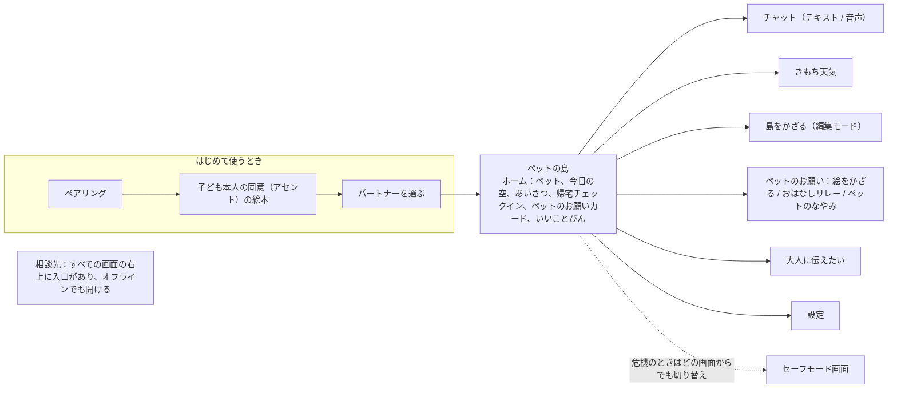
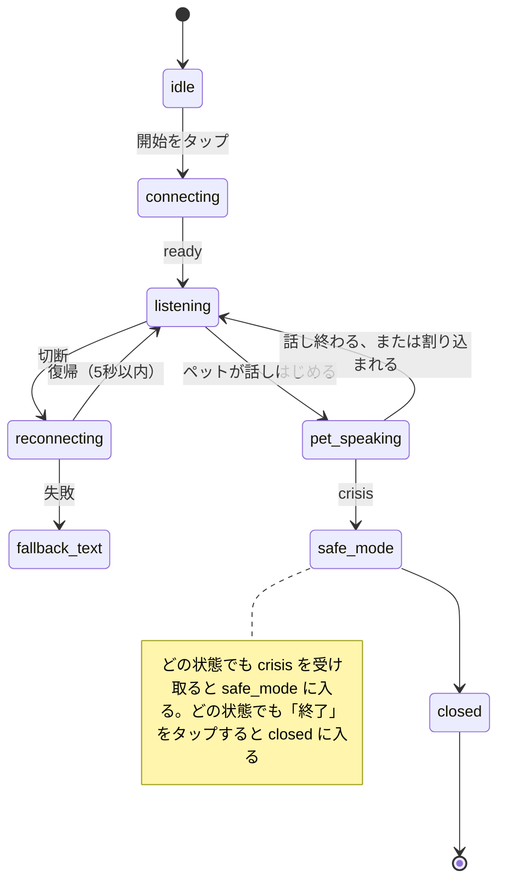

# いじめ対策デジタルペット — フロントエンド定義 v0.1

## 概要と技術スタック

フロントエンドは、子ども側（ペット）と保護者側の2つの独立した PWA です。どちらも Next.js と TypeScript で作り、Firebase App Hosting にデプロイします。画面の言語は日本語です。本書は「子ども向けいじめ対策デジタルペット AI Agent — プロダクト要求仕様書（PRD）v0.1」「いじめ対策デジタルペット — バックエンド API 定義 v0.1」「いじめ対策デジタルペット — データベース定義 v0.1」に基づきます。

| 層 | 選定 | 説明 |
| --- | --- | --- |
| フレームワーク | Next.js（App Router）、React、TypeScript | 2つのアプリを同じ monorepo に置き、コンポーネントと API クライアントを共有します |
| ホスティング | Firebase App Hosting | 東京リージョンで利用できるか確認が必要です |
| 認証 | Firebase Auth SDK（Identity Platform に接続） | 保護者は Google アカウントまたはメールアドレスでログインし、子どもは signInWithCustomToken を使います |
| 不正利用対策 | Firebase App Check（reCAPTCHA Enterprise） | すべてのリクエストに App Check トークンを付けます |
| プッシュ通知 | Firebase Cloud Messaging（Web Push）と Service Worker | 保護者側では必須です。子ども側には日常のあいさつだけを送ります |
| サーバー状態 | TanStack Query | キャッシュとリトライ |
| ローカル状態 | Zustand | ペットの部屋、音声セッションなどの画面状態 |
| スタイル | Tailwind CSS と独自の design token | キャラクターごとにテーマカラーを1組持ちます |
| アニメーション | Lottie、SVG | ペットの表情と動き |
| お絵かき | Canvas 2D と perfect-freehand | 自然な筆跡 |
| 箱庭 | PixiJS（WebGL） | ドラッグ＆ドロップ、拡大縮小、重なり順 |
| 音声 | Web Audio API と AudioWorklet | 16kHz PCM で収録し、24kHz PCM で再生します |
| 国際化 | next-intl | MVP は日本語だけですが、文言テーブルは他言語を追加できるようにしておきます |
| テスト | Vitest、Playwright | オフラインと危機画面の E2E テストを含みます |
| エラー報告 | API 経由で Cloud Logging に書き込み | 報告内容には子どもの入力を一切含めません |

## 子ども側の画面

子ども側は「ペットの小さな部屋」を中心に据え、どの機能にも2タップ以内でたどり着けるようにします。

> 図：子ども側の画面マップ



帰宅チェックインは独立した画面にしません。放課後に子どもがホームを開くと、ペットが「おかえり」と言い、チェックインを表示します。

| ルート | 画面 | 主なコンポーネント | 呼び出す API |
| --- | --- | --- | --- |
| /pair | ペアリング | PairingCodeInput | POST /v1/child/pair |
| /welcome | 子ども本人の同意（アセント）の絵本 | AssentStorybook、RuleCard | POST /v1/child/assent |
| /choose | パートナーを選ぶ | CharacterPicker、MysteryEgg | GET /v1/child/characters、POST /v1/child/pets |
| / | ペットの島 | IslandScene、GreetingBubble、HomeCheckinPrompt、PetRequestCard、GoodThingJar、WaterCan | GET /v1/child/home、GET /v1/child/island、POST /v1/child/home-checkins、POST /v1/child/rituals |
| /chat | チャット | ChatPanel、TypingMetricsInput、VoiceButton | テキストセッションとメッセージのエンドポイント、音声チケット、WebSocket |
| /mood | きもち天気 | MoodWeatherPicker | POST /v1/child/mood |
| /requests/{requestId} | ペットのお願い | PetRequestIntro、DrawingCanvas または StoryEndingPicker または WorryOptions、NarrativeRecorder、RewardReveal | GET /v1/child/pet-requests、POST /v1/child/artworks、POST /v1/child/pet-requests/{id}/complete |
| /island | 島をかざる（編集モード） | IslandSandbox、ItemDrawer、NarrativeRecorder | GET、PUT /v1/child/island |
| /tell | 大人に伝えたい | TellAdultFlow | POST /v1/child/tell-adult、相談への回答エンドポイント |
| /settings | 設定 | DataSourceToggles、MemoryList、RuleCard、PetLock | データソース、記憶、削除リクエスト、自発ターンのリズムのエンドポイント |
| /help | 相談先 | HelpResources | GET /v1/child/help-resources（オフラインキャッシュあり） |
| /safe | セーフモード | SafeModeScreen | SSE または WebSocket の crisis イベントで表示 |

## 保護者側の画面

保護者側のホームに置くのは、週ごとの元気度と未確認の通知の2つだけです。危機通知が未確認のあいだは、保護者が「確認済み」を押すまで、すべての画面の上部にバナーを表示します。

| ルート | 画面 | 主なコンポーネント | 呼び出す API |
| --- | --- | --- | --- |
| /signup | 登録 | AuthPanel | Identity Platform、POST /v1/families |
| /consent | 同意 | ConsentForm、VerificationStep | POST /v1/consents |
| /children/new | 子どもを追加 | ChildForm | POST /v1/children |
| /children/\[childId\]/pairing | 子どもの端末とペアリング | PairingCodeCard（6桁のコードと QR コード） | POST /v1/children/{childId}/pairing-codes |
| / | ホーム | WeeklyVitalityCard、NotificationList、CrisisBanner | GET /v1/me、週ごとの元気度、通知一覧 |
| /notifications/\[id\] | 通知の詳細 | PackagedNotice、ConversationStarters、AckButton | 通知の詳細、POST ack |
| /crisis/\[id\] | 危機時の案内 | CrisisGuide、HotlineList、AckButton | 通知の詳細、POST ack |
| /context | 予定・できごと | CalendarConnect、ContextEventList | カレンダー連携、コンテキスト情報のエンドポイント |
| /children/\[childId\]/shared | 子どもが共有した絵 | SharedArtworkGallery | GET shared-artworks |
| /settings | 設定 | NotifySettings、SecondGuardianInvite、InstallPrompt、DeletionRequest | 通知設定、招待、端末登録、削除リクエスト |
| /guides | 声かけガイド（P1） | GuideLibrary | GET /v1/guides |

（2026-10-07 補足）通知の詳細にある行動の回答は「確認済み」とは独立で、選択式のフォームで「話した」「行動する予定」「助けが必要」を記録し、保存に失敗したときに成功と表示してはいけません。子ども側のホームのフォローアップには「話した」「まだ助けが必要」「今は話さない」を残し、明確な「しばらく聞かなくていい」を追加します。成功時の文言はサーバーが返す continuation に応じて、先送り、一時停止、相談の継続を区別し、一律に解決済みのように表示してはいけません。一時停止はその件だけに適用し、相談の入口は引き続き使えます。

危機時の案内画面の内容は定型テンプレートから作ります。すぐに子どものそばに行くこと、子どもを一人にしないこと、緊急の危険があるときは119または110に電話することを伝え、相談窓口の一覧を添えます。iOS の保護者は PWA をホーム画面に追加しないとプッシュ通知を受け取れないため、登録が終わった時点で InstallPrompt で案内します。L4 には、最終手段としてのフォールバックとして SMS も用意します。

## 主要コンポーネントの仕様

下の表には特別な動作を持つコンポーネントだけを載せます。ボタンやダイアログなどの汎用コンポーネントは共有コンポーネントライブラリに置きます。

| コンポーネント | 配置先 | 主な動作 |
| --- | --- | --- |
| IslandScene | 子ども側 | ホームのメイン画面です。島は visitDays と季節に応じて変化し、空には今日のきもち天気を使います。ペットは島の上でアニメーションし、6種類の表情を切り替えます。あいさつを表示します（自発ターンで生成し、ないときは固定の書き出しを使います）。子どもが来なくてもペットは悲しまず、植物も枯れません |
| PetRequestCard | 子ども側 | 未完了のペットのお願いがあるとき、ホームにカードを1枚出し、お題とごほうびのアイテムを表示します。「今回はやめておく」を選べ、催促はしません。一度に表示するのは1枚だけです |
| GoodThingJar | 子ども側 | 寝る前の時間帯に表示します。タップすると星が1つ入り、ひとこと話すこともできます（内容は保存せず、回数だけ記録します）。びんの中の星は日数とともに増えていきます |
| WaterCan | 子ども側 | 1日1回、植物に水をあげられます。あげなくても枯れません |
| StoryEndingPicker | 子ども側 | おはなしリレーの結末を選びます。低学年は選択肢カード3枚と音声、高学年と中学生は1文を入力できます。絵で描くことも選べます |
| WorryOptions | 子ども側 | ペットのなやみです。選択肢は3〜4個で、必ず「大人に伝える」を含めます。選んだあと、ペットは定型テンプレートで応えます |
| RewardReveal | 子ども側 | お願いを終えると、もらったアイテムを見せて島に置きます。ランダム要素もレア度もありません |
| ChatPanel | 子ども側 | SSE で応答をストリーミング表示します。action を受け取ると「大人に伝える」または「相談する」ボタンを描画します。crisis を受け取ると直ちに /safe に遷移します |
| TypingMetricsInput | 子ども側 | 集計するのは、キー入力数、削除数、入力時間、3秒を超える停止の回数だけです。日本語 IME の変換中の削除は数えません。消した文字は決して記録しません |
| VoiceButton | 子ども側 | 1回タップすると話し始め、もう1回タップすると終わります。字幕を表示します。interrupted を受け取ると直ちに再生を止めます。切断時は5秒以内に自動で再接続します |
| DrawingCanvas | 子ども側 | ペン、12色、消しゴム、元に戻すを備え、PNG で書き出します。子どもが「保存」を選ばないとき、元の画像は今回の特徴抽出にだけ使い、サーバーには保存しません。小屋にかざれるのは保存を選んだ絵だけです。色ボタンのスクリーンリーダー用ラベルには、色番号ではなく色の名前を使います |
| NarrativeRecorder | 子ども側 | 描き終えたあと、または並べ終えたあとに、音声かテキストでペットに話して聞かせます。低学年は音声（端末の音声認識）が既定で、テキストは代わりの手段です |
| IslandSandbox | 子ども側 | 子ども自身の島を編集します。アイテムカタログ（解放済みのアイテムを含む）からドラッグ＆ドロップし、回転と重なり順の調整ができます。キャラクターを1つ「これがわたし」に設定できますが、必須ではありません。保存時は全体を上書きし、サーバー側にスナップショットを残します。キーボードでも操作でき、矢印キーで選択中のアイテムを動かします。操作説明も表示します |
| MoodWeatherPicker | 子ども側 | 4つの天気ボタンから1つを選びます。選んだあともいつでも変えられます。確認ボタン（「「あめ」に する」のように選んだ天気を書いたもの）を押して初めて送信します。送信後は「今日の天気」とペットの応答を表示し、「もう一度選ぶ」こともできます。同じ日にもう一度開くと、記録済みの天気をそのまま表示します |
| HomeCheckinPrompt | 子ども側 | 放課後に初めてホームを開いたときに表示します。位置情報は1回だけ取得し、端末に保存した家の範囲と照合して、「家にいるかどうか」だけを送信します |
| TellAdultFlow | 子ども側 | 選択肢は「自分で言う」「ペットに伝えてもらう」「今はやめておく」の3つです。「自分で言う」を選ぶと、話し始めの練習を出します。「ペットに伝えてもらう」を選ぶと、1文の要約を子どもに確認してもらいます |
| SafeModeScreen | 子ども側 | 定型文と相談窓口を表示し、相談窓口にはワンタップで電話できます。ほかの機能への入口は隠します。戻ることはできますが、戻る前に「今は安全？」ともう一度たずねます。家庭内での危害のときに「安全」と答えると POST /v1/child/crisis-acknowledgements を呼んで子どもの確認を登録し、その後24時間はホームに 189 を固定表示します（ChildHomeRes.careHotline） |
| HelpResources | 子ども側 | オフラインでも使えます。相談窓口の電話番号は tel: リンクにします |
| RuleCard | 子ども側、保護者側 | 「だれに何が見えるか」を1ページで説明します。学年帯ごとに別の版があります |
| PetLock | 子ども側 | 共用端末で使うペットの合言葉です。4桁の数字またはパターンを使います |
| PackagedNotice | 保護者側 | 決まった構成で表示します：タイトル、変化、考えられる意味、提案、相談先、理由 |
| WeeklyVitalityCard | 保護者側 | 気分の分布、利用した日数、深夜に利用した日数、ひとことの解説を表示します。点数は付けず、ほかの子どもとも比べません |
| CrisisBanner | 保護者側 | 危機通知が未確認のあいだ、すべての画面の上部に固定します |

## クライアント側データ収集の規約

フロントエンドが収集するのは下の表に挙げた内容だけで、それ以外は一切収集しません。サードパーティの分析 SDK や広告 SDK は組み込まず、Firebase Analytics も使いません。

| データ | 収集するもの | 決して収集しないもの | アップロードのタイミング | 子どもがオフにした場合 |
| --- | --- | --- | --- | --- |
| タイピング行動 | キー入力数、削除数、最初のキー入力から送信までの時間、3秒を超える停止の回数 | 消した文字、キー入力の時系列、ほかのアプリでの入力 | メッセージと一緒にアップロード | テキストだけを送り、typing フィールドは付けません |
| 音声 | 16kHz PCM の音声ストリーム。子どもが「話しはじめる」を押したあとにだけ収録します | バックグラウンド録音、端末への録音の保存 | リアルタイムで voice-relay に送信 | 音声ボタンを隠します |
| 帰宅チェックイン | 1回限りの低精度の位置情報。端末に保存した「家の範囲」と照合します | 座標のアップロード、継続的な測位、バックグラウンド測位 | チェックイン時に「家にいるかどうか」だけをアップロード | 手動で「家についたよ」を押す方式に切り替えます |
| お絵かき | 完成した PNG。長辺を1024ピクセルに縮小します | 描く過程の録画 | 完成時にアップロード | 引き続き描けます。元の画像は今回の特徴抽出にだけ使います |
| 箱庭 | シーングラフの JSON：アイテム、カテゴリ、相対座標、向き、重なり順、「これがわたし」のキャラクター | スクリーンショット | 完成時にアップロード | 対象外 |
| きもち天気 | 選んだ天気 | なし | タップ時にアップロード | 子どもは入力しなくてもかまいません |
| 利用リズム | セッションの開始時刻と終了時刻。サーバー側で記録します | 画面の滞在時間、クリックストリーム | 単独ではアップロードしません | 対象外 |

「家の範囲」は初回設定時に決めます。子どもが家にいるときに「ここがわたしの家」を1回押すと、中心点と半径を端末の IndexedDB にだけ保存し、アップロードはしません。

## オフライン・プッシュ通知・セキュリティ

相談先とセーフモードの画面は、ネットワークが切れていても必ず開けるようにします。機微な内容は端末に長く残しません。

オフライン：

- Service Worker が /help、/safe、ペットの基本アニメーション、安全に関する定型文をプリキャッシュします。
- ネットワークが切れているとき、ホームには「今はネットにつながりません」と表示します。ペットは通常どおり表示し、相談窓口への入口を目立たせます。
- ネットワークが切れているあいだ、会話をキューに保存することはしません。機微な内容が端末に長時間残るのを避けるためです。きもち天気は先に IndexedDB に保存し、接続が戻ってから同期できます。

プッシュ通知：

- FCM Web Push を使います。保護者側は通知と危機のお知らせを受け取ります。子ども側が受け取るのは朝、放課後、寝る前の日常のあいさつだけで、子どもがオフにできます。
- プッシュ通知の本文には機微な文字を一切含めません。ロック画面には「新しいお知らせが1件あります」とだけ表示し、詳細はアプリを開いて確認します。危機のプッシュ通知のタイトルは「緊急：お子さんの安全に関するお知らせ」のように目立つものにしますが、こちらにも具体的な内容は書きません。
- iOS では、PWA をホーム画面に追加しないとプッシュ通知を受け取れません。

（2026-10-06 実装）設定ページで明示的にオンを選んだあとで初めて通知の許可を求めます。Firebase／VAPID の設定がない場合、未対応のブラウザ、許可の拒否は、それぞれ状態として表示します。Service Worker は現在紐づいている端末の日常のあいさつだけを扱い、タイトルと本文はアプリと一緒に配布する KB の固定文言から取り、リモートからの任意の文字列や遷移先は使いません。タップするとこのサイトのホームだけを開きます。JST の 23:00〜05:00 にはあいさつを表示せず、購読解除／ログアウト／再ペアリングではまずローカルの表示を止めます。実際の FCM の到達は、設定と端末での確認がまだ必要です。

要約の確認：設定ページに現在のペットの有効期限内の要約を表示し、子どもは「おぼえていいよ」で確認するか拒否できます。確認したあとは削除ボタンで忘れさせられます。既定ではその後の会話に使わず、保護者には表示しません。リクエストに失敗したら再試行でき、要約のバージョンが変わったときは読み込み直し、古い確認を新しい内容に当てはめません。この確認は専門家による審査ではありません。

セキュリティ：

- 端末に保存するのは、ログイントークン（Firebase Auth が標準で使う IndexedDB ストレージ）、家の範囲、PetLock の設定だけです。チャットの履歴はメモリ上にだけ持ち、画面を閉じると消えます。
- 厳格な CSP を設定し、サードパーティのスクリプトの読み込みを禁止します。すべてのリクエストに App Check トークンを付けます。
- 共用端末では、子ども側を開くときにまず PetLock の合言葉を入力します。
- Web ページではスクリーンショットを防げません。プロダクトとしても、この点については何も約束しません。

## アクセシビリティと学年帯への適応

画面は子どもアカウントの学年帯に応じて、下の表の設定に自動で切り替わります。子どもが設定画面で手動で調整することもできます。

| 設定 | 小学校低学年 | 小学校高学年 | 中学生 |
| --- | --- | --- | --- |
| 文字 | ひらがな中心で、漢字にはすべてふりがなを付けます | 常用漢字を使い、ふりがなはオン・オフできます | 通常の日本語で、ふりがなは付けません |
| 基本の文字サイズ | 20px | 18px | 16px |
| 主な入力方法 | 音声、ボタン、スタンプ | テキストと音声 | テキスト中心 |
| 読み上げ | 既定でオン | 既定でオフ（オンにできます） | 既定でオフ |
| タッチターゲット | 56px 以上 | 48px 以上 | 44px 以上 |
| 画面のスタイル | 大きなアイコン、少ない文字 | 標準 | シンプルで、子どもっぽく見えないもの |

（2026-10-06 実装）低学年向けの動的な文字には、ブラウザ内でローカルに動く Kuromoji／IPADIC の形態素解析による読みがなを適用します。静的な画面の語句にはすぐにふりがなを付け、それ以外の文字は Web Worker で処理します。対象は会話、ホームのあいさつ、お願いのお題、記憶／要約、お絵かきのお題と返答、相談の文言、島のアイテム名です。ストリーミング中の変化は 120ms でまとめ、古い結果が新しい文字を置き換えることはありません。原文はアップロードせず、ローカルの永続ストレージにも書きません。約 17 MiB の共通プログラムと辞書は既存のビルドスクリプトでコピーして必要なときに読み込み、Service Worker はこれらの共通リソースだけをキャッシュするため、初回読み込み後はオフラインでも使えます。

読みがなの限界：形態素辞書は、珍しい姓名、造語、複数の読みを持つ語の個人ごとの読み方を保証しません。読みを確定できないときは原文のままにし、1文字ずつ推測せず、すべての姓名の読みが正しいとも主張しません。辞書の読み込みに失敗しても、原文、既存の静的なふりがな、相談窓口への入口は使えます。手動の読み上げは引き続き端末内の日本語の音声だけを使い、その音声がないときははっきりと利用不可を示し、リモートの読み上げには切り替えません。

共通の要件：

- 色のコントラスト比は WCAG 2.2 AA を満たします。色だけで情報を伝えることはしません。たとえば、きもち天気には絵柄と文字の両方を付けます。
- システムの「視差効果を減らす」設定を尊重し、ペットの大きなアニメーションをオフにします。
- すべてのボタンに日本語のアクセシビリティラベルを付け、スクリーンリーダーに対応します。
- 23時以降は自動で低輝度の配色に切り替え、ペットが子どもに休むよう声をかけます。

## API 呼び出し規約

2つのアプリは1つの API クライアントパッケージを共有し、型はバックエンド API ドキュメントの TypeScript 定義をそのまま参照します。

- すべてのリクエストに ID トークンと App Check トークンを自動で付けます。レコードを新規作成する POST リクエストには、さらに Idempotency-Key を付けます。
- ペットの応答の SSE は、EventSource ではなく fetch のストリーム読み取りで実装します。EventSource は POST を送れず、認証ヘッダーも付けられないためです。
- ネットワークエラーと 5xx エラーは、間隔を少しずつ延ばしながら自動で2回リトライします。4xx エラーはリトライしません。
- crisis イベントを受け取ったら、どの画面にいても直ちに /safe に遷移します。
- 子ども側のセッション一覧では、過去のセッションを開くことと削除することができます。過去のセッションを開いたあとも会話を続けられ、現在のセッションを削除すると自動で空のセッションを新しく作ります。
- 子ども側のリクエストが 401 を受けたときは、Firebase ID トークンと App Check トークンを最大1回だけ更新します。それでも失敗したら、エラーコードに応じてペアリング、設定、相談窓口、またはセーフモードの画面への入口を示します。
- App Check は Firebase Web SDK の `ReCaptchaEnterpriseProvider` を使い、`NEXT_PUBLIC_FIREBASE_APP_CHECK_SITE_KEY` で有効にします。未設定のときはローカルの連携確認ではトークンを送りませんが、本番の API では引き続き検証を強制します。

エラーコードごとの画面での扱い：

| エラーコード | 画面での扱い |
| --- | --- |
| UNAUTHENTICATED | トークンを裏で更新して1回リトライします。それでも失敗したら、ペアリング画面またはログイン画面に戻ります |
| CONSENT\_REQUIRED | 保護者側は /consent に遷移します。子ども側は「おうちの人に先に設定をしてもらってね」と表示します |
| ASSENT\_REQUIRED | 子ども側は /welcome に遷移します |
| DATA\_SOURCE\_DISABLED | 該当する入口を隠し、設定画面でオンにできることを案内します |
| PAIRING\_CODE\_EXPIRED | 保護者にペアリングコードを作り直してもらうよう案内します |
| INVITATION\_EXPIRED | 主たる保護者にもう一度招待してもらうよう案内します |
| RATE\_LIMITED | ペットが「ちょっと 休けいしよう」と言い、しばらくしてからやり直します |
| MODEL\_UNAVAILABLE | ペットが「ねむい」表情になります。相談窓口への入口は使える状態を保ちます |
| ネットワークエラー | オフラインのお知らせを表示し、相談窓口への入口を目立たせます |

## 主要コンポーネントのインターフェース

```ts
type TypingMetrics = { keyCount: number; deleteCount: number; composeMs: number; longPauseCount: number };
type CrisisPayload = { crisisId: string; message: string; resources: HelpResource[] };

type ChatPanelProps = {
  sessionId: string;
  gradeBand: GradeBand;
  typingEnabled: boolean;
  onAction: (action: PetAction) => void;
  onCrisis: (payload: CrisisPayload) => void;
};

type TypingMetricsInputProps = {
  maxLength: number;  // 500
  enabled: boolean;   // 子どもがタイピングデータをオフにしたときは false。テキストだけを送信する
  onSubmit: (text: string, typing?: TypingMetrics) => void;
};

type VoiceButtonProps = {
  characterId: CharacterId;
  enabled: boolean;
  onTranscript: (who: 'child' | 'pet', text: string, final: boolean) => void;
  onAction: (action: PetAction) => void;
  onCrisis: (payload: CrisisPayload) => void;
  onFallbackToText: () => void;
};

type DrawingCanvasProps = { mode: 'drawing' | 'story'; promptText?: string; onDone: (png: Blob) => void };

type IslandCatalogItem = { catalogId: string; category: string; label: string; spriteUrl: string; locked: boolean };
type IslandSandboxProps = {
  catalog: IslandCatalogItem[];
  initial: { items: IslandItem[]; selfFigureId?: string };
  onSave: (scene: { selfFigureId?: string; items: IslandItem[] }) => void;
};

type IslandSceneProps = {
  island: ChildHomeRes['island'];
  todayMood?: MoodWeather;
  pet: { characterId: CharacterId; expression: Expression; petName?: string };
  greeting: ChildHomeRes['greeting'];
  decorations: { artworkId: string; thumbnailUrl: string }[];
};

type PetRequestCardProps = { request: PetRequest; onOpen: () => void; onDecline: () => void };
type GoodThingJarProps = { count: number; doneToday: boolean; onAdd: () => void };
type StoryEndingPickerProps = { gradeBand: GradeBand; options: { id: string; text: string }[]; onDone: (ending: { mode: 'typed' | 'voice_transcript' | 'option'; text: string } | { draw: true }) => void };
type WorryOptionsProps = { options: { id: string; text: string }[]; onPick: (optionId: string) => void };
type RewardRevealProps = { itemId: string; onPlaced: () => void };

type NarrativeRecorderProps = { voiceEnabled: boolean; onDone: (n: { mode: 'typed' | 'voice_transcript'; text: string }) => void };

type HomeCheckinPromptProps = { geoEnabled: boolean; onDone: (atHome: boolean, method: 'geo' | 'manual') => void };

type TellAdultFlowProps = { consultationId: string; gradeBand: GradeBand; onFinished: (choice: ConsultChoice) => void };

type SafeModeScreenProps = { message: string; resources: HelpResource[] };  // 文言はサーバーが状況に応じて選ぶ

type PackagedNoticeProps = { notice: NotificationDetail; onAck: () => void };

type WeeklyVitalityCardProps = { report: WeeklyReportRes };
```

## 主要な状態遷移

状態がもっとも多いのは音声セッションで、VoiceButton 内部のステートマシンが管理します。それ以外のフローは下の順序どおりに実装します。

> 図：音声セッションのステートマシン（VoiceButton）



再接続の制限時間は5秒で、再接続のたびにチケットを取り直します。「テキストに切り替える」状態に入ると、ペットがテキストで理由を説明し、入力欄に自動でフォーカスが移ります。

テキストチャット（ChatPanel）：

1. 子どもが送信すると sending に入り、入力欄をロックします。
2. meta を受け取ると streaming に入り、delta を順に表示します。
3. action を受け取ると、種類に応じて描画します：クイック選択肢、表情の切り替え、ペットのお願い（suggest\_game。/requests/{requestId} に遷移）、「大人に伝える」または「相談する」ボタン。
4. done を受け取ると idle に戻り、入力欄のロックを解除します。
5. どの時点でも crisis を受け取ったら、表示を止めて /safe に遷移します。

「大人に伝えたい」（TellAdultFlow）：

1. ペットがまず共感のひとことを言い、そのあと3つの選択肢を表示します。
2. 「自分で言う」を選んだ場合：サーバーが返した話し始めの練習用のせりふを1文ずつ表示します。子どもは一緒に読むことができ、終わるとペットが話しに行くよう励まします。
3. 「ペットに伝えてもらう」を選んだ場合：1文の要約の下書きを見せ、子どもが直せるようにします。「これでいい」を押して初めて送信します。
4. 「今はやめておく」を選んだ場合：ペットが「だいじょうぶ、ずっとここにいるよ」と言います。L3 の場合は、ルールカードに沿って、内容を含まないお知らせを1件送ることを続けて説明します。

帰宅チェックイン（HomeCheckinPrompt）：

1. 登校日の放課後に初めてホームを開いたときに表示します。表示するかどうかは home エンドポイントの showHomeCheckin で決まります。
2. 位置情報がオンの場合：低精度の位置情報を1回取得し、IndexedDB にある家の範囲と照合して、家にいるかどうかを求めます。
3. 位置情報がオフ、またはタイムアウトした場合：手動チェックイン用に「家についたよ」ボタンを表示します。
4. 送信後、ペットが「おかえり」と言います。

## 主要画面のレイアウトと文言

相談窓口への入口は、子ども側のすべての画面で右上に固定します。中立的な小さなアイコン（お守り）にやわらかい短い文字を添え、「たすけて」「相談」といった言葉は使いません（PRD「子どもへの見せ方：日常の寄り添い」を参照）。セーフモードのときとオフラインのときは、通常どおり目立たせます。下の表は各画面の領域の分け方で、ビジュアルデザインはこれに従って作成します。

| 画面 | レイアウト |
| --- | --- |
| ペットの島（ホーム） | 上部：左上に設定、右上に相談窓口への入口。中央：島の全景。空は今日の気分に合わせ、ペットとあいさつの吹き出しは島の上に置きます。島の上で直接タップできるもの：ペット（チャット）、空（きもち天気）、植物（水やり）、いいことびん（寝る前に表示）、小屋（かざった絵を見る）、「かざる」ボタン。お願いがあるときは、ホームの下のほうにペットのお願いカードを1枚表示します。いちばん下に小さな文字のリンク「おうちの人に伝えたいこと」を1行置きます |
| ペットのお願い | 上部：ペットがお願いを説明します（定型テンプレートとお題）。中央：キャンバス、おはなしの結末の選択肢、またはなやみの選択肢。下部：話して聞かせる、「今回はやめておく」、完了。完了後はごほうびを見せて島に戻ります |
| チャット | 上部：ペットの小さなアイコンと相談窓口への入口。中央：メッセージ一覧。下部：入力欄、音声ボタン。小学校低学年にはクイック選択肢も加えます |
| 島をかざる（編集モード） | 中央：島の画面。現在の配置から始めます。下部：アイテムの引き出し（解放済みのアイテムを含む）、任意の「これがわたし」、保存。保存後に、ひとこと話すこともできます |
| セーフモード | 全画面：定型文、該当する相談窓口と、それぞれ別に押せる 110／119 の緊急発信ボタン、「近くに大人はいる？」ボタン。ほかの入口は表示しません。家庭内での危害への振り分けでは 189 と緊急発信を残し、疑いのある加害側の保護者への通知には誘導しません |
| 保護者側のホーム | 危機バナー（該当するときだけ表示）、週ごとの元気度カード、未確認の通知一覧 |

主な文言（学年帯別）：

| 場面 | 小学校低学年 | 小学校高学年 | 中学生 |
| --- | --- | --- | --- |
| 放課後のあいさつ | おかえり！きょうは どうだった？ | おかえり！今日はどんな日だった？ | おかえり。今日はどうだった？ |
| きもち天気 | こころの てんきは？ | 今日の心の天気は？ | 今日の気分を天気で言うと？ |
| 相談の3つの選択肢 | じぶんで いう / かわりに つたえて / いまは やめておく | 自分で言う / 代わりに伝えて / 今はやめておく | 自分で言う / 代わりに伝えて / 今はやめておく |
| 相談窓口への入口（アイコンの横の文字） | こまったら | こまったとき | 困ったとき |
| おうちの人に伝えたい（ホームの小さなリンク） | おうちの ひとに つたえたい こと | おうちの人に伝えたいこと | 家の人に伝えたいこと |

ルールカード（RuleCard）の文言は、実際のルールと完全に一致していなければなりません。ルールを変えるときは、文言も同時に修正します。中学生版：

```text
話したことは、おうちの人には見えないよ。
元気がない日が続いたら、おうちの人に伝えるかどうか、まずあなたに聞くね。
大人の手を借りたほうがよさそうな時は、あなたが「やめて」と言っても、中身は言わずに「気にかけてあげて」とだけ伝えることがあるよ。
命や体が危ない時は、安全な大人に助けを求めよう。おうちの安全が心配な時は、別の相談先を案内するよ。
話したことや、覚えてほしくないことは、いつでも消せるよ。
```

小学校低学年版：

```text
はなした ことは、おうちの ひとには みえないよ。
げんきが ない ひが つづいたら、おうちの ひとに いうか、まず きみに きくね。
おとなの てつだいが いりそうな ときは、きみが「いや」と いっても、なにが あったかは いわずに「きに かけてあげて」とだけ つたえる ことが あるよ。
あぶない ときは、あんぜんな おとなに たすけを もとめよう。おうちが こわい ときは、べつの そうだんさきを あんないするよ。
けしたい ことは、いつでも けせるよ。
```

どの学年帯でもルールカードの項目は同じでなければならず、違ってよいのは言い回しだけです。ルールの透明性は PRD の原則であり、子どもが幼いからといって項目を省くことはできません。

（2026-10-06 実装）保護者側の `/settings` は共有の `RuleCard` の中学生版の5項目の文言をそのまま再利用し、子ども側は引き続き学年帯ごとに同じ一組のルールを表示します。保護者側のためのルール文言を別に保守することはしません。ルールカードは子どものチャット、記憶、リスクレベルを読みません。

## 未決事項

- [ ] 5つのキャラクターとシークレットキャラクターのアートアセット、および Lottie アニメーションの制作方法
- [ ] 箱庭のアイテムカタログの内容と数
- [ ] 家の範囲の既定の半径と、位置情報の精度のトレードオフ
- [ ] PetLock を数字にするかパターンにするか、合言葉を忘れたときの復旧方法
- [ ] Firebase App Hosting が東京リージョンで利用できるかどうか
- [ ] 子ども側 UI 文言のレビュー手順：だれがレビューするか、学年帯ごとに1回ずつレビューするか
- [ ] 保護者の同意の確認ステップ（VerificationStep）の具体的な画面。確認方法によって決まります

## テキスト会話の復帰に関する補足（2026-10-07）

検知が使えないときは、独立した「確認待ち」の状態と、そのまま電話できる固定の相談窓口を表示し、「危機が確認された」とは表示せず、子どもに話し直すことも求めません。状態は `review` SSE と `GET /v1/child/chat/sessions/:id/safety` で復元します。再審査待ちの間は3秒ごとに問い合わせ、セッションの切り替え時とアンマウント時に後片付けします。再審査で危機が確定したら元のセーフモードの画面に入り、通過したら元の入力を続けるボタンを出して、元の messageId の reply エンドポイントを呼びます。

通常の応答のフォールバックでは、サーバーが `done.retryable=true` を返したときだけ同じメッセージの再試行を提供します。すでに行われた相談の操作は、生成の失敗で消えてはいけません。`fallback_` の接頭辞から再試行の安全性を自分で推定してはならず、固定の文言を実際の Gemini の成功として表示してもいけません。日常の新しい入力と再審査待ちの入力を混同せず、遅れて届いた古いリクエストが新しいセッションを上書きしてはいけません。
