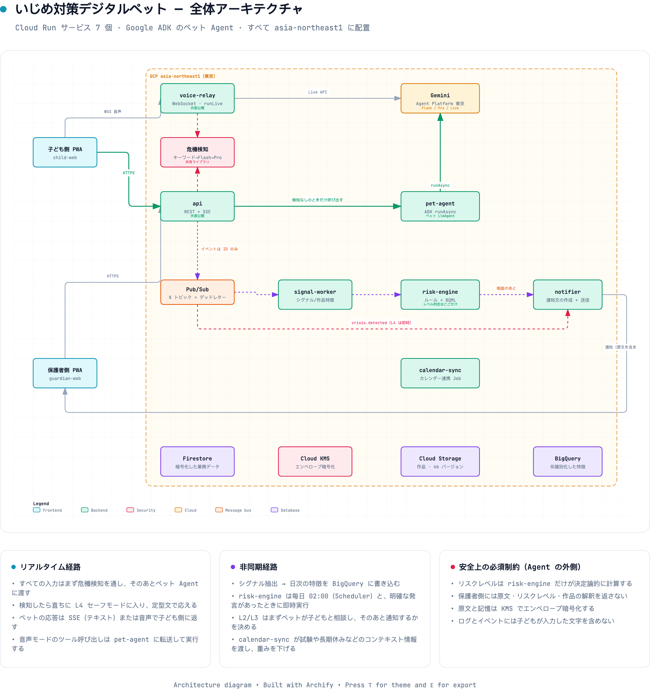
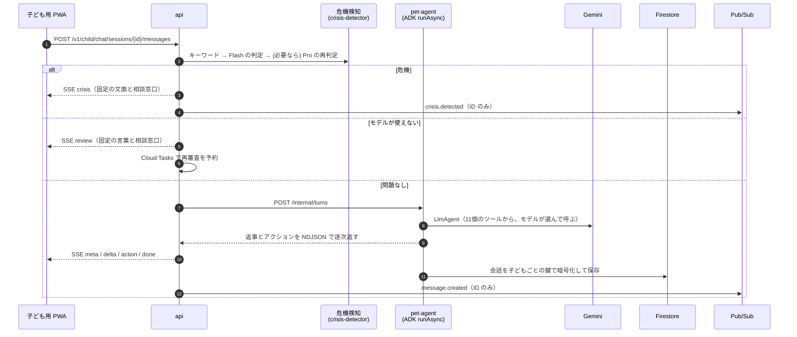
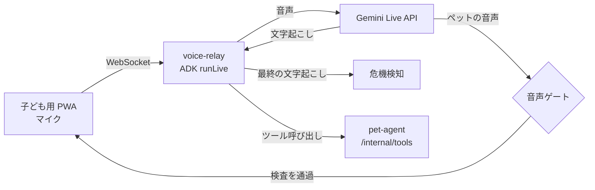
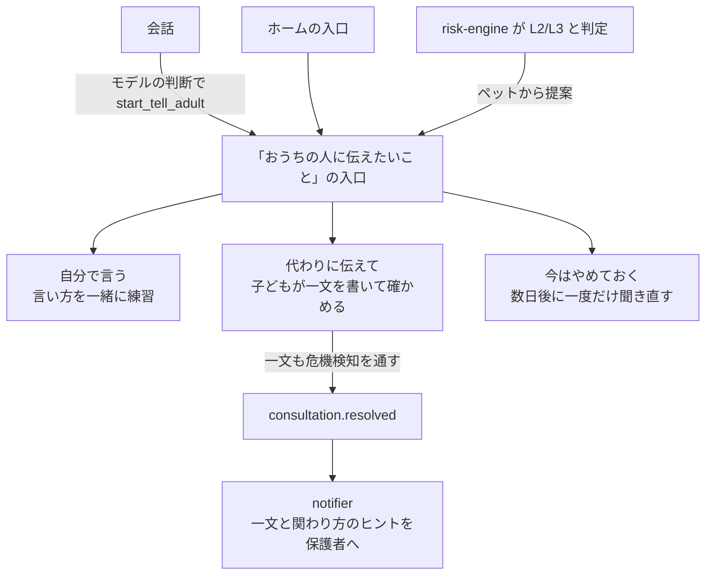
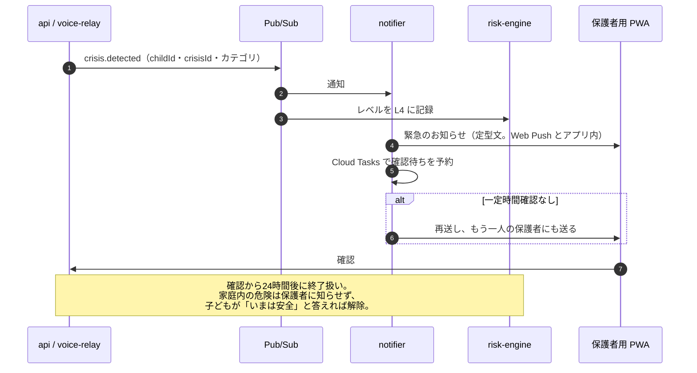
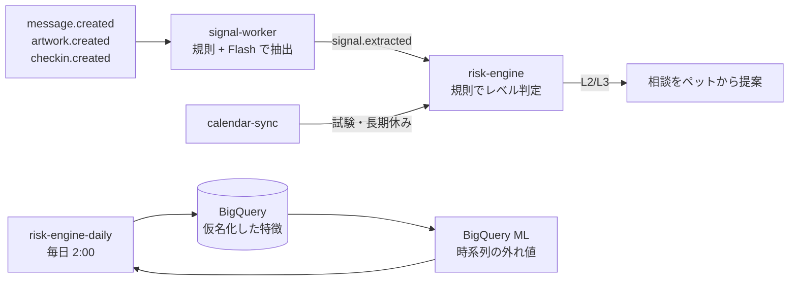

# 全体構成とデータの流れ

この文書は、まもりペットのシステムがどう組み合わさって動くかを、データの流れに沿って説明します。各サービスの API やデータ項目の詳細は、[04-backend-api.md](04-backend-api.md) と [03-database.md](03-database.md) が正です。

## 設計の前提

1. **エージェントは1体、判断はモデル**：ペットは Google ADK の `LlmAgent` 1体です。どのツールをいつ呼ぶかはモデルが毎ターン決めます。
2. **安全の線はエージェントの外**：危機検知、リスクレベルの計算、危機時の文面は、モデルが変えられない決定論的なコードとナレッジベースの規則で決めます。
3. **子どもの言葉は外に出さない**：会話の原文は暗号化して保存し、ログ・トレース・イベントには ID と数値しか載せません。保護者向けの API は原文を型として持ちません。
4. **すべて東京**：GCP の資源はすべて asia-northeast1 に置き、Gemini も東京リージョンのエンドポイントを使います。

## 構成要素

| 層 | 構成要素 |
| --- | --- |
| クライアント | 子ども用 PWA、保護者用 PWA、紹介ページ（いずれも Next.js。Firebase Hosting から Cloud Run に書き換え） |
| 公開サービス | `api`（REST・SSE）、`voice-relay`（WebSocket） |
| 内部サービス | `pet-agent`、`signal-worker`、`risk-engine`、`notifier`、`calendar-sync`（イングレスは内部のみ。呼び出しには Cloud Run の起動権限を持つサービスアカウントの ID トークンが必要） |
| 定時ジョブ | `risk-engine-daily`（毎日 2:00、Cloud Run Jobs の分片実行）、`calendar-sync-daily`（毎日 3:00）、週次レポート（月曜 7:00）、ペットからの声かけ（朝・放課後・就寝前） |
| 非同期 | Pub/Sub トピック8本（すべてデッドレター付き）、Cloud Tasks キュー6本 |
| データ | Firestore（業務データ。本文は暗号化）、BigQuery（仮名化した数値の特徴）、Cloud Storage（作品の原画、ナレッジベース）、Cloud KMS（鍵4本）、Secret Manager |
| モデル | Gemini 3.5 Flash（会話・危機の一次判定・シグナル抽出）、Gemini 2.5 Pro（危機の再判定・通知文）、Gemini Live API（音声） |

## 会話の1ターン

子どもがメッセージを送ってから、ペットの返事が画面に流れるまでの流れです。

- 子どものすべての入力（文字、音声の文字起こし、絵・物語・小島の説明、相談の要約）は、この危機検知を通ります。
- キーワードに当たったのに再判定がタイムアウトしたら、カテゴリ「その他」の危機として扱います。
- ペットの返事も、出力フィルターで規則に反する内容を止めてから子どもに届きます。

## 音声

音声ゲートは、子どもが話し始めてから最終の文字起こしが危機検知を通るまで、ペットの出力をすべて保留します。危機と判定されたら、以降のペットの出力は一切流しません。音声そのものはメモリの中だけを流れ、保存しません。子どもごとに1日の利用時間の上限があり、予算に達したら音声だけを全体で止めます。

## 相談：子どもが「大人に伝える」まで

保護者に届くのは、子どもが確かめた一文と、ナレッジベースの手引きにもとづく関わり方のヒントだけです。「代わりに伝えて」を選ばなかった場合、保護者に内容は届きません。

## 危機

家庭内の危険が疑われるとき（カテゴリ `family_harm`）だけは保護者に知らせず、子どもには 189（児童相談所）と 110 を示します。

## シグナルとリスクレベル

- シグナルは数値と ID だけで、子どもの文字は含みません。
- レベルはナレッジベースの規則（`kb/v0.1.0/rules`）だけで決まり、モデルは書き込めません。
- 日次ジョブは子どもを分片して並列に処理し、最後の分片が BigQuery ML の外れ値検出を走らせます。
- カレンダーの試験期間や長期休みは「情境」として特徴に加え、ふだんと違う時期の変化を読み違えないようにします。

## ペットからの声かけと週次レポート

- Cloud Scheduler が朝・放課後・就寝前に `api` を呼び、`api` が子どもごとに Cloud Tasks へ積み、`pet-agent` が同じ `LlmAgent` で短い声かけを作ります。使えるツールは記憶の参照・遊びの提案・表情だけです。
- 週次レポートは月曜 7:00 に Cloud Tasks で家族ごとに扇出し、ナレッジベースの定型の文で「今週のようす」を作ります。

## データと暗号化

| 保存先 | 中身 | 保護 |
| --- | --- | --- |
| Firestore | 家族・子ども・会話・記憶・相談・通知など | 本文系の項目は子どもごとのデータ鍵で AES-256-GCM 暗号化し、データ鍵を Cloud KMS（`content`）で包む。クライアントからの直接アクセスはルールで全拒否 |
| BigQuery `features_deid` | 日次の特徴、基準値、外れ値、レベルの履歴 | 仮名 ID（KMS の `pseudo` 鍵による HMAC）と数値だけ |
| Cloud Storage | 作品の原画（子どもが保存を選んだときだけ）、ナレッジベースのバージョン | KMS（`storage`）、保存期間つき |
| Secret Manager | OAuth の状態用鍵、声かけ配信の内部トークン、メール送信の認証情報（設定した場合） | シークレットごとに、使うサービスにだけ権限を付与 |

カレンダーのトークンは KMS の `tokens` 鍵で封印します。データ削除の依頼は、`api` が Firestore を消して `data.deletion_requested` を発行し、`risk-engine` が Cloud Storage と BigQuery を消して完了を記録します。

## 障害と負荷への備え

- **モデルの 429・タイムアウト**：危機検知は1回だけ待って再試行し、続けて失敗したら遮断して入力を審査待ちにします。審査待ちの入力は `crisis-recheck` キューで再審査し、遅れて危機と分かったら、そのことを保護者への連絡に明記します。
- **費用の上限**：モデル呼び出しには子どもごと・分ごとの上限と、日次の予算があります。予算に達したら音声だけを全体で止めます。
- **重複配信**：Pub/Sub と Cloud Tasks の処理はすべて冪等で、失敗したイベントはデッドレターに送ります。
- **常駐**：危機経路の `api` と `notifier` だけ最小1インスタンスで常駐し、ほかはゼロまで縮みます。
- **監視**：5xx と 429 の比率、会話の初回表示の p95、危機検知の p95 と審査待ちの比率、危機通知の遅延と未確認、デッドレターの滞留にアラートを設定しています。
